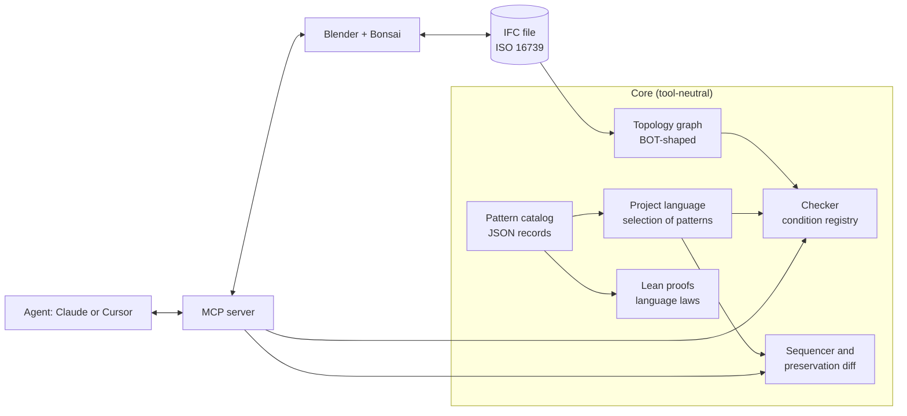
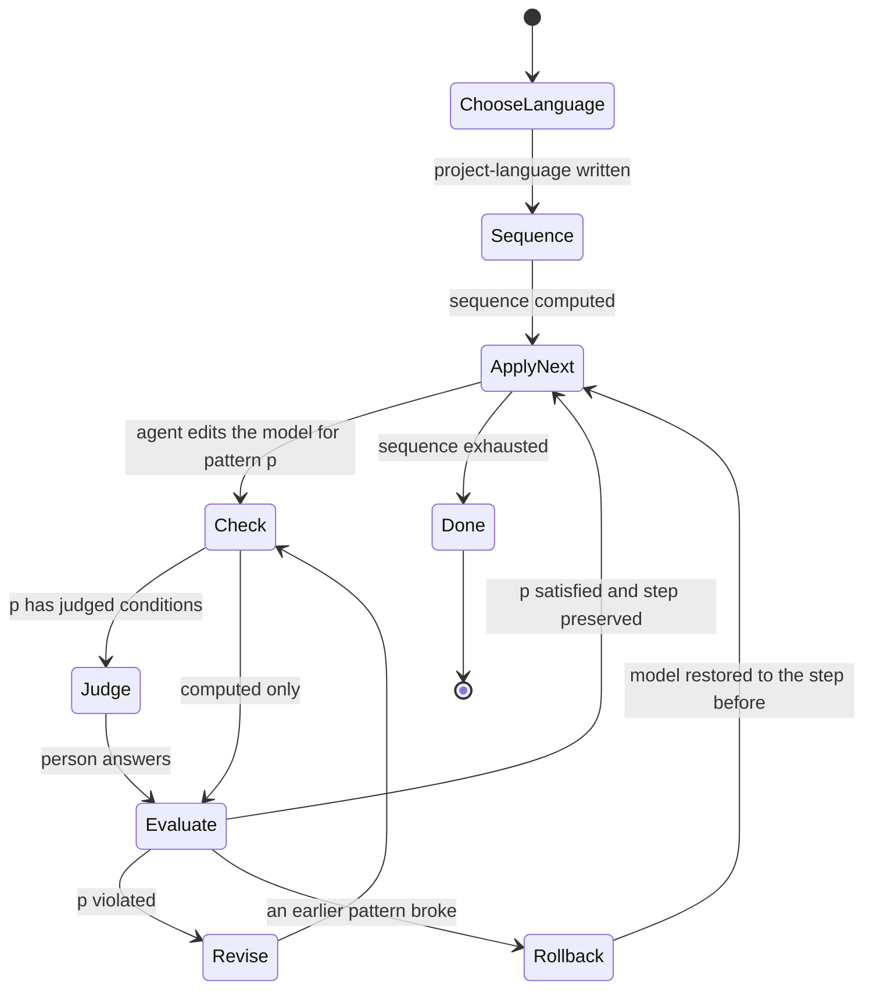
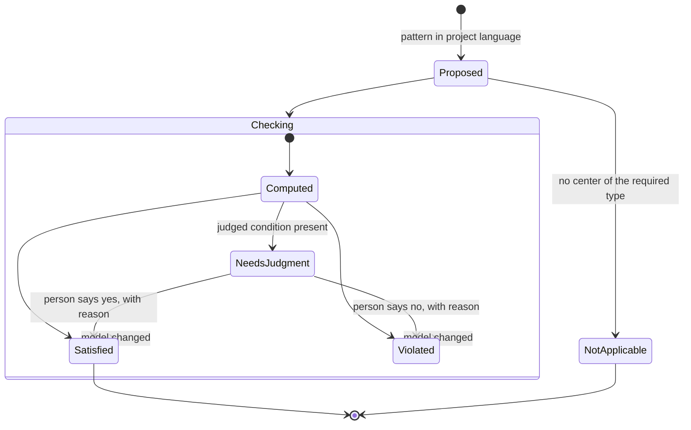
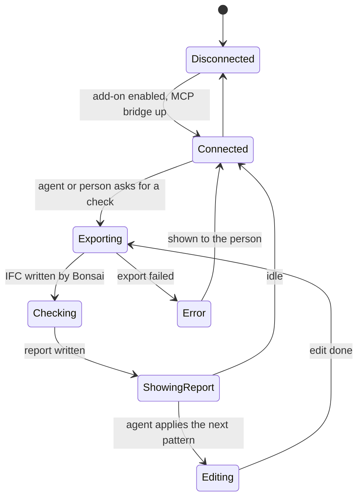

# A pattern language for buildings, as a formal system

## Goal

Take a pattern language for buildings and towns (the 1977 book *A Pattern Language* by Alexander, Ishikawa and Silverstein is the reference) and encode it the way the Everything Ecosystem encodes everything else: a tool-neutral ontology, records under JSON Schema, rules that a program checks, and Lean proofs for the laws of the language itself. Design apps (Blender first) are adapters that read and write the model. An AI agent can then build a house or a town inside an app by applying patterns one at a time, and the checker says after every step which patterns hold.

It also tests thesis T1 of the Everything Ecosystem site: the same structural questions apply to software, buildings and cities. The proof of that is a Lean signature with no building terms in it, instantiated once for buildings and later once for software.

## Smallest version that proves it

Twelve building-scale patterns, a checker that reads an IFC file and reports which of them hold, and one run where an agent builds a small house in Blender pattern by pattern and no step undoes an earlier one. Towns, other apps and the full catalog come after.



---

## 1. Domain design

### 1.1 What a pattern language is (standard terms, from the book)

- A **pattern** has a number, a name, a confidence rating (zero, one or two asterisks), a **context** (the larger patterns it helps complete), a **problem** stated as a conflict of **forces**, a **solution** (a field of spatial relationships, not a single object), and the **smaller patterns** that complete it.
- A **pattern language** is the network of patterns joined by those larger and smaller links. The book orders 253 patterns from the largest scale to the smallest, in three parts: towns (1 to 94), buildings (95 to 204) and construction (205 to 253).
- A **project language** is the subset a person picks for one project. The book tells the reader to choose it: start with the pattern that best describes the project, follow the smaller links, and add or drop patterns.
- A **sequence** is the order in which the patterns of a project language are applied: larger before smaller, so each pattern is applied inside the whole that the earlier ones made.
- From Alexander's later work (*The Nature of Order*), two terms we use as process laws, not as content: a **center** (a coherent region the patterns act on) and a **structure-preserving transformation** (a step that keeps the structure already there and strengthens it). We use only these two in version 1. The fifteen properties of living structure are a later layer.

### 1.2 What the building is made of (standard ontologies, not new terms)

We do not invent a building vocabulary. Three standards cover it.

| Scale | Standard | Terms we use |
|---|---|---|
| Building and construction | **IFC** (ISO 16739, buildingSMART) | `IfcSite`, `IfcBuilding`, `IfcBuildingStorey`, `IfcSpace`, `IfcWall`, `IfcWindow`, `IfcDoor`, `IfcSlab`, `IfcStair`, `IfcRelSpaceBoundary` |
| Topology across tools | **BOT**, the Building Topology Ontology (W3C Linked Building Data group) | `bot:Zone` (`Site`, `Building`, `Storey`, `Space`), `bot:Element`, `bot:containsZone`, `bot:adjacentZone`, `bot:hasElement`, `bot:interfaceOf` |
| Town and city (phase 3) | **CityJSON** (OGC CityGML encoding) and OpenStreetMap tags | `Building`, `Road`, `LandUse`, `PlantCover`, `WaterBody` |
| Upper ontology | **BFO**, as in Naive's `ontology.json` | a pattern is an information artifact (generically dependent continuant); a space is a site (immaterial entity); a wall is a material entity |

A **center** in version 1 is a `bot:Zone` or a named group of zones. That keeps Alexander's term without inventing a geometry for it.

### 1.3 The formal split: language, model, rules

Following spct-lean's discipline, every item is tagged **[D]** definitional, **[S]** substantive (could be false; say what would falsify it), or **[P]** parameter.

1. **The language signature** (domain-free). Patterns, a scale order, the larger/smaller link, selections, sequences, satisfaction and preservation. It mentions no walls, rooms or windows. This is the T1 claim made checkable: if the same signature has a model for software design patterns, the structure was never about buildings.
2. **The building instantiation.** The catalog of building patterns, the BOT/IFC vocabulary, and one **condition** per checkable part of each pattern.
3. **A model** is a concrete design: an IFC file read into a topology graph.

### 1.4 Records

| Record | Holds | Owner |
|---|---|---|
| `pattern` | number, name, scale (`town`, `building`, `construction`), confidence (0 to 2), `larger[]`, `smaller[]`, a one-line summary written by us, `forces[]` named by us, `conditions[]`, `source` (book and pattern number) | a person enters it from the book |
| `condition` (inside a pattern) | `id`, `kind` (`computed`, `judged`, `unchecked`), for `computed` a `check` id from the registry and its `params` (each a **[P]**), for `judged` the yes/no question a person answers | a person; checks are code |
| `project-language` | project id, the chosen pattern numbers, per-pattern parameter overrides (climate, latitude, units), the starting pattern | a person |
| `pattern-instance` | pattern number, the centers (zone ids) it is claimed for, status, evidence (check output or a person's judgment with reason) | the checker writes computed ones; a person writes judged ones |
| `check-report` | model file and its sha256, project language, one `pattern-instance` per pattern per center, the satisfied set | the checker |
| `step` | before and after model sha256, the pattern applied, the satisfied sets before and after, `preserved: bool` | the sequencer |

**Copyright rule.** A pattern record holds the number, name, scale, confidence, links and a source pointer. It never holds the book's problem or solution text, and nothing scrapes patternlanguage.com. The summary, forces and conditions are written by us. Names and numbers are facts we cite.

### 1.5 Seed catalog (version 1)

Twelve building-scale patterns chosen because most of their solution is a spatial relationship a program can check. A person confirms each number, name and link against the book while entering it.

| No. | Name | Condition kind | What the computed check tests (our wording) |
|---|---|---|---|
| 105 | South Facing Outdoors | computed | the main outdoor zone lies on the equator-facing side of the building (latitude **[P]**) |
| 106 | Positive Outdoor Space | computed | each outdoor zone is mostly enclosed: convexity ratio above a threshold **[P]** |
| 107 | Wings of Light | computed | no occupied space is farther than a set depth from an exterior wall **[P]** |
| 110 | Main Entrance | judged | is the entrance seen from the approach? |
| 112 | Entrance Transition | computed | the path from the street to the main door passes through a transition zone |
| 127 | Intimacy Gradient | computed | on the circulation graph from the entrance, spaces tagged public come before semi-private before private |
| 128 | Indoor Sunlight | computed | spaces tagged for daytime use sit on the equator-facing side |
| 130 | Entrance Room | computed | the main door opens into a room, not straight into a corridor or a living space |
| 159 | Light on Two Sides of Every Room | computed | each occupied space has windows in at least two walls of different orientation |
| 167 | Six-Foot Balcony | computed | every balcony is at least 1.83 m deep (six feet, **[P]**) |
| 180 | Window Place | judged | does the main room have a window with a place to sit? |
| 190 | Ceiling Height Variety | computed | ceiling heights across occupied spaces vary by at least a set amount **[P]** |

Ten of twelve are computed. That ratio is itself a finding to report: how much of a pattern language a machine can check. Expect it to fall at the town scale and rise at construction.

---

## 2. System design

### 2.1 Two shapes considered (architect)

- **Shape A: TypeScript core**, like Naive. Blender and IFC tools speak Python, so every check would cross a process boundary, and geometry libraries would be reimplemented or wrapped.
- **Shape B: Python core** with JSON Schema records (language-neutral) and Lean for the laws. IfcOpenShell, Bonsai, Blender's `bpy`, shapely and networkx are all Python, so the checker runs inside Blender for live feedback with no bridge.

**Chosen: B.** Each piece of state has one owner: IFC owns geometry, the JSON records own the language, the checker owns reports, Lean owns the laws. A TypeScript reader (for Naive, Mentura or Reflect) can come later from the same schemas.

### 2.2 Components

| Component | Does | Boundary rule |
|---|---|---|
| `catalog` | loads and validates pattern records, builds the link graph, reports back-edges (a smaller link to a lower-numbered pattern) | parses JSON at the edge, then trusts types |
| `topology` | IFC file to a BOT-shaped graph: zones with type tags, containment, adjacency, openings with wall orientation, heights, outdoor zones | the only module that imports IfcOpenShell |
| `conditions` | a **registry** of check functions keyed by id, each `check(topology, center, params) -> Evidence`; pure functions | no file I/O, no IFC types |
| `checker` | runs a project language over a topology and writes a `check-report` | |
| `sequencer` | orders a project language (larger before smaller, ties by number); computes a `step` from two reports | |
| `lean/` | the language signature, sequences, preservation; a generator writes the seed catalog as a Lean file so the laws are checked on the real data | generated file is committed; CI fails when stale |
| `mcp` | MCP server over the core | |
| `adapters/blender` | Blender add-on: export the scene as IFC through Bonsai, run the checker, show the report in a panel; bridge for an agent to act in Blender | only adapter code imports `bpy` |

Adapters for other apps (Rhino and Grasshopper, SketchUp, Revit, ArchiCAD, CityEngine, Minecraft through Idionautics) all reduce to one contract: produce IFC (or CityJSON at town scale) and, optionally, apply edits. Speckle, the open-source AEC data hub, already connects many of them and is the likely second adapter instead of writing one per app.

### 2.3 Statechart: the design process an agent runs



### 2.4 Statechart: one pattern instance



### 2.5 Statechart: Blender adapter session



### 2.6 The laws (Lean, no Mathlib, same conventions as spct-lean)

```lean
inductive Scale | town | building | construction  -- [D], ordered town > building > construction

structure Language where
  Pattern  : Type
  scale    : Pattern → Scale
  /-- [D] `smaller q p`: q is one of the smaller patterns that help complete p. -/
  smaller  : Pattern → Pattern → Prop
  /-- [S] The link never goes up in scale. False if some pattern lists a
      larger-scale pattern among its smaller ones. -/
  scale_mono : ∀ p q, smaller q p → scale q ≤ scale p
  /-- [S] The link graph has no cycle. False if two patterns each help complete
      the other, directly or through a chain. -/
  acyclic  : WellFounded (fun q p => smaller q p)
```

Definitions and theorems to prove:

- `Selection L` and `DownClosed`: a project language closed under following smaller links (a parameter of the project, not of the language).
- `ValidSequence L s`: every pattern appears after every larger pattern it completes. Theorem: a finite selection has a valid sequence (from `acyclic`). For the seed catalog, the generated Lean file lets `decide` prove that numeric order is a valid sequence.
- Satisfaction is abstract in the signature: `Design : Type`, `sat : Design → Pattern → Prop`. `Preserving S d d' := ∀ p ∈ S, sat d p → sat d' p`. Theorems: preservation is reflexive and transitive, so a run of preserving steps is preserving; a run of preserving steps that each add one pattern ends with every pattern of the sequence satisfied.
- `Instantiations/Buildings.lean`: the seed catalog. Later, `Instantiations/Software.lean`: a handful of software design patterns (the Gang of Four book took the idea from Alexander) as a second model of the same signature. That is the T1 evidence.

**What Lean does not cover, stated plainly:** the geometry checks. Those are tested against fixture models, not proved. The Lean side proves the laws of the language and the process; the Python side is held to them by tests that compare its sequencer and preservation diff with the same definitions.

---

## 3. Implementation plan

### 3.1 Stack

- Python 3.12, `uv`, `pytest`, `jsonschema`, `ifcopenshell` (with its `api` for writing fixtures), `shapely`, `networkx`, the official MCP Python SDK.
- Blender 4.x with the Bonsai add-on (formerly BlenderBIM, part of the IfcOpenShell project). For agent control, evaluate an existing Blender MCP add-on (for example the open-source `blender-mcp`) before writing a bridge.
- Lean 4 at the toolchain spct-lean pins, no Mathlib, `lake build`.

### 3.2 Repository layout

```
pattern-language/
  AGENTS.md  CLAUDE.md  README.md
  schema/            pattern, project-language, pattern-instance, check-report, step (*.schema.json)
  catalog/           <number>-<slug>.json, one per pattern
  projects/          example project languages
  src/pattern_language/
    catalog.py  topology.py  checker.py  sequencer.py  cli.py
    conditions/      registry.py and one module per check
  mcp/server.py
  adapters/blender/  add-on and bridge
  fixtures/          generated IFC houses and their expected reports
  scripts/           make_fixtures.py, catalog_to_lean.py
  lean/              PatternLanguage/{Language,Sequence,Preservation}.lean, Instantiations/
  tests/
```

### 3.3 Units, each ending in a check

| Unit | Delivers | Done when |
|---|---|---|
| U0 | scaffold, AGENTS.md, CI running pytest, schema validation and `lake build` | CI green on an empty catalog |
| U1 | five schemas, catalog loader, the twelve seed records | every record validates; every link target exists; back-edges reported, not hidden |
| U2 | Lean signature, sequences, preservation; `catalog_to_lean.py` | `lake build` passes; numeric order proved a valid sequence for the seed by `decide`; CI fails if the generated file is stale |
| U3 | `make_fixtures.py` writes small IFC houses with IfcOpenShell (one passing and one failing house per computed pattern); `topology.py` | tests assert zones, adjacency, window orientations and heights read back from each fixture |
| U4 | condition registry, checker, `pl check <model.ifc> --language <project.json>` | each computed condition passes on its passing fixture and fails on its failing one; report validates against its schema |
| U5 | `pl sequence <project.json>`, `pl step <before.ifc> <after.ifc> --language ...` | sequencer output matches the Lean definition on the seed; a fixture pair that breaks an earlier pattern reports `preserved: false` |
| U6 | MCP server: `patterns_search`, `pattern_get`, `language_sequence`, `model_check`, `model_step` | a client test calls each tool on fixtures |
| U7 | Blender adapter: panel with the report, export through Bonsai, agent bridge | recorded run: an agent builds a small house in Blender following the sequence for the twelve patterns; every step logged with its report; no step has `preserved: false` at the end of the run |
| U8 (later) | town scale (CityJSON and OSM, patterns from 1 to 94), Speckle adapter, `Instantiations/Software.lean`, the fifteen properties | each its own PR with its own check |

One unit per pull request. Draft PRs; Torian merges.

### 3.4 Open questions (not blocking version 1)

- Units: the book is imperial. Parameters store SI with the book's value noted.
- Climate and hemisphere: "south facing" means equator-facing; latitude is a project parameter.
- Who judges: the judged conditions need a person. In Mentura this is a decision record; here it is a `pattern-instance` with `judged_by`.
- Full catalog: entering all 253 patterns is a person's work from the book. Do it only after U7 shows the loop works.
