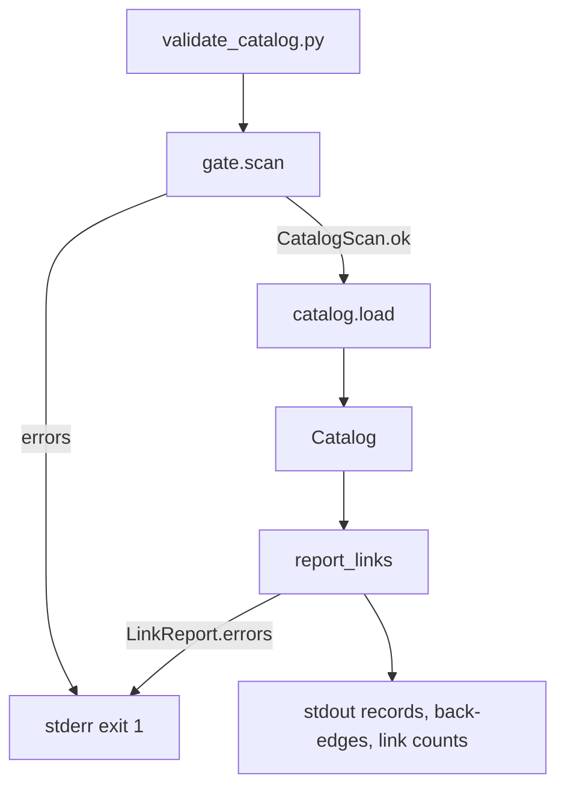

# U1 sketch B: loader-first catalog

The gate stays a directory schema scan. A catalog loader runs only after `scan` returns `ok`, builds typed pattern and project records, and exposes links as `Link` values. Back-edges are a frozen `LinkReport` with the same shape of fields as `CatalogScan` (`root`, a tuple of findings, `errors`, `ok`). They are printed on success. They are not scan errors.

U1 is done when `scan` accepts every seed record, `LinkReport.errors` is empty (every link target exists), and `LinkReport.back_edges` is emitted in full, including when that tuple is empty.

This candidate fits the live gate names: records under `catalog/` validate with `schema/catalog.schema.json`; records under `projects/` validate with `schema/projects.schema.json`. `gate.py` does not gain link rules, and `CatalogScan` does not gain a back-edge field.

## Usage

From the repository root, after the seed files exist:

```bash
uv sync
uv run pytest
uv run python scripts/validate_catalog.py
cd lean && lake build
```

Success on this seed prints three facts and exits 0:

```text
ok: 13 records
links: 24 edges, 0 back-edges
```

`13` is twelve pattern files plus one project file. `24` is twelve `smaller` links and their twelve `larger` inverses. The seed graph is forward under pattern number, so the back-edge tuple is empty and the count line still reports that fact.

A back-edge, when one exists, is an extra stdout line between those two, and the process still exits 0:

```text
ok: 13 records
back-edge: 130 smaller 112
links: 24 edges, 1 back-edges
```

A missing target, a broken inverse, a self-link, a duplicate link, a project number that is not in the catalog, an override that names no parameter, or a file whose leading number disagrees with `number` prints one error per problem on stderr and exits 1. Back-edge lines are still printed when the report also has errors, so a failing run cannot drop them.

An empty `catalog/` and `projects/` (only `.gitkeep`) stays a successful scan of zero records. The script then prints the U0 line only:

```text
ok: 0 records
```

No project file is valid. The seed includes one so `projects.schema.json` is on the path CI already runs.

Library entry, which tests and the script share:

```python
from pathlib import Path

from pattern_language.catalog import load, report_links
from pattern_language.gate import scan

root = Path(".").resolve()
scanned = scan(root)
if not scanned.ok:
    raise SystemExit(1)
catalog = load(scanned)
report = report_links(catalog)
```

`load` reads each record file a second time and constructs `Pattern` and `ProjectLanguage` values. `scan` keeps owning schema errors and does not return parsed documents. Call `load` only when `scanned.ok` is true. `load` raises `LoadError` if a schema-valid document still cannot be built (unknown `kind`, two patterns with one number, `source.number` different from `number`). Those are programmer failures, not link findings.

There is no `pl` command in U1.

## Call sites

| Caller | Calls | Role in U1 |
|---|---|---|
| `scripts/validate_catalog.py` | `scan`, then `load`, then `report_links` | CI command. Exit 0 only when both `ok` flags are true. |
| `tests/test_catalog.py` | same pair on `repo_root` | Twelve patterns, closed targets, expected back-edge tuple, `draft` true, condition kinds. |
| `tests/test_catalog.py` | `scan` / `load` / `report_links` on `tmp_path` trees | Back-edge reported with `report.ok`; missing target sets `report.ok` false; empty `projects/*.json` still loads. |
| `tests/test_gate.py` | `scan` only | Empty tree, missing schema, schema failure. Unchanged cases. Workspace expectation becomes 13 records once the seed lands. |
| U2 `scripts/catalog_to_lean.py` (not built here) | `Catalog.smaller_targets` | Later unit reads the graph, not raw JSON. |

`gate.scan` remains the call inside the script for schema failures. Link checks are not a second pass inside `_check_record`.



## Data shapes

### On disk

```text
schema/catalog.schema.json          covers catalog/*.json
schema/projects.schema.json         covers projects/*.json
schema/pattern-instance.schema.json inert under the live gate
schema/check-report.schema.json     inert under the live gate
schema/step.schema.json             inert under the live gate
catalog/105-south-facing-outdoors.json
catalog/106-positive-outdoor-space.json
catalog/107-wings-of-light.json
catalog/110-main-entrance.json
catalog/112-entrance-transition.json
catalog/127-intimacy-gradient.json
catalog/128-indoor-sunlight.json
catalog/130-entrance-room.json
catalog/159-light-on-two-sides-of-every-room.json
catalog/167-six-foot-balcony.json
catalog/180-window-place.json
catalog/190-ceiling-height-variety.json
projects/seed-house.json
```

`DirectorySchemaMap` keys a schema by its path under `schema/`. `catalog.schema.json` is the key `catalog`. `projects.schema.json` is the key `projects`. The other three files become keys `pattern-instance`, `check-report`, and `step`. Nothing in U1 puts records in those directories, and `RECORD_ROOTS` is still only `catalog` and `projects`, so `scan` never applies them. A test calls `Draft202012Validator.check_schema` on each of the five files so they are real schemas. Each of the five is self-contained: the live validator constructs `Draft202012Validator(schema)` with no `$ref` registry, so cross-file `$ref` would fail `check_schema` or validation.

File name rule, enforced by `load`: `catalog/<number>-<slug>.json`, and the leading integer equals `number`. Slug is the name in lowercase with spaces turned into hyphens.

Copyright shape: a pattern holds number, name, scale, confidence, links, a source pointer, our summary, our forces, and our conditions. It has no problem field and no solution field. `additionalProperties` is false. Summary text and each force are our sentences, each with `"draft": true`. The edge list below is a closed draft over these twelve numbers so every target exists. Patterns outside this set are left out of the arrays. Omission is not a back-edge and not an error. `"links_draft": true` on every seed pattern marks that the arrays still need a human check against the book. Confidence is `0`, `1`, or `2` and is entered from the book's asterisk count when the records are written. This sketch does not assign those twelve integers.

### Pattern JSON

Computed seed (105). Parameter `latitude` has a unit and no default; the project override supplies a value.

```json
{
  "number": 105,
  "name": "South Facing Outdoors",
  "scale": "building",
  "confidence": 0,
  "larger": [],
  "smaller": [106, 128],
  "links_draft": true,
  "summary": {
    "text": "The main outdoor zone sits on the equator-facing side of the building.",
    "draft": true
  },
  "forces": [
    {"text": "Daylight on the outdoor zone.", "draft": true},
    {"text": "Latitude picks the equator-facing side.", "draft": true}
  ],
  "conditions": [
    {
      "id": "south-facing-outdoors",
      "kind": "computed",
      "check": "south-facing-outdoors",
      "params": [{"name": "latitude", "unit": "deg"}]
    }
  ],
  "source": {"work": "alexander-pattern-language", "number": 105}
}
```

`confidence` in that example is a schema illustration. The committed record uses the book's asterisk count.

Judged seed (110):

```json
{
  "number": 110,
  "name": "Main Entrance",
  "scale": "building",
  "confidence": 0,
  "larger": [],
  "smaller": [112, 130],
  "links_draft": true,
  "summary": {
    "text": "The entrance is judged by whether it can be seen from the approach.",
    "draft": true
  },
  "forces": [
    {"text": "Sightline along the approach.", "draft": true},
    {"text": "Finding the door.", "draft": true}
  ],
  "conditions": [
    {
      "id": "entrance-visible",
      "kind": "judged",
      "question": "Is the entrance seen from the approach?"
    }
  ],
  "source": {"work": "alexander-pattern-language", "number": 110}
}
```

`kind` is the discriminator. `computed` requires `check` and `params` and rejects `question`. `judged` requires `question` and rejects `check`. `unchecked` requires `note` and rejects both. The seed uses `computed` and `judged` only. `unchecked` is in the schema and the union so a later pattern can use it without a second parser.

### Twelve seeds

Scale is `building` for all twelve. Each summary and each force is stored with `"draft": true`. Wording below is ours, taken from the check column of the design, not from the book.

| No. | Name | Kind | Condition id | Check or question | Params |
|---|---|---|---|---|---|
| 105 | South Facing Outdoors | computed | `south-facing-outdoors` | check `south-facing-outdoors` | `latitude` deg |
| 106 | Positive Outdoor Space | computed | `outdoor-enclosure` | check `outdoor-enclosure` | `min_convexity` 1 |
| 107 | Wings of Light | computed | `wing-depth` | check `wing-depth` | `max_depth` m |
| 110 | Main Entrance | judged | `entrance-visible` | Is the entrance seen from the approach? | |
| 112 | Entrance Transition | computed | `entrance-transition` | check `entrance-transition` | |
| 127 | Intimacy Gradient | computed | `intimacy-gradient` | check `intimacy-gradient` | |
| 128 | Indoor Sunlight | computed | `indoor-sunlight` | check `indoor-sunlight` | |
| 130 | Entrance Room | computed | `entrance-room` | check `entrance-room` | |
| 159 | Light on Two Sides of Every Room | computed | `light-on-two-sides` | check `light-on-two-sides` | |
| 167 | Six-Foot Balcony | computed | `balcony-depth` | check `balcony-depth` | `min_depth` m = 1.83 |
| 180 | Window Place | judged | `window-seat` | Does the main room have a window with a place to sit? | |
| 190 | Ceiling Height Variety | computed | `ceiling-height-variety` | check `ceiling-height-variety` | `min_delta` m |

Our summaries, one line each:

| No. | Summary |
|---|---|
| 105 | The main outdoor zone sits on the equator-facing side of the building. |
| 106 | Each outdoor zone is mostly enclosed, as a convexity ratio. |
| 107 | No occupied space is farther than a set depth from an exterior wall. |
| 110 | The entrance is judged by whether it can be seen from the approach. |
| 112 | The path from the street to the main door passes through a transition zone. |
| 127 | From the entrance, public spaces come before semi-private spaces, then private ones. |
| 128 | Spaces tagged for daytime use sit on the equator-facing side. |
| 130 | The main door opens into a room, not straight into a corridor or a living space. |
| 159 | Each occupied space has windows in at least two walls of different orientation. |
| 167 | Every balcony is at least 1.83 m deep. |
| 180 | The main room is judged by whether a window has a place to sit. |
| 190 | Ceiling heights across occupied spaces differ by at least a set amount. |

Each pattern has two forces, both `draft: true`, naming the two quantities the line above already uses (outdoor zone and latitude; enclosure and openings; wing depth and daylight reach; approach and door; street edge and transition zone; public-to-private order and circulation; daytime tag and equator-facing side; arrival room and corridor; two window walls and their orientations; balcony depth and standing room; window and seat; height difference and occupied spaces).

`min_depth` value `1.83` is the design's SI parameter for six feet. Other numeric thresholds stay unset on the pattern until a person supplies them. Names of parameters are fixed in U1 so the project override can point at them.

### Draft induced edges

`links_draft` is true. These arrays are a working closed graph for the loader, confirmed later against the book. A `smaller` target is always a higher number in this draft, so the seed back-edge tuple is empty. The report still has a test where 130 lists smaller 112 and that edge appears on `LinkReport.back_edges` while `ok` stays true.

`smaller` lists:

| Source | Smaller targets |
|---|---|
| 105 | 106, 128 |
| 106 | 167 |
| 107 | 128, 159, 190 |
| 110 | 112, 130 |
| 112 | 130 |
| 127 | 130 |
| 128 | 159 |
| 130 | |
| 159 | 180 |
| 167 | |
| 180 | |
| 190 | |

`larger` is the inverse, stored on the target:

| Source | Larger targets |
|---|---|
| 105 | |
| 106 | 105 |
| 107 | |
| 110 | |
| 112 | 110 |
| 127 | |
| 128 | 105, 107 |
| 130 | 110, 112, 127 |
| 159 | 107, 128 |
| 167 | 106 |
| 180 | 159 |
| 190 | 107 |

That is 12 `smaller` links and 12 `larger` links, 24 `Link` values. `report_links` requires the inverse: every `smaller` link `(a, b)` has a `larger` link `(b, a)`, and the other way around. A one-sided pair is `inverse missing: {source} {kind} {target}` and `ok` is false.

Back-edge rule, the only one: a `Link` with `kind == "smaller"` and `target < source`. A `larger` link pointing at a lower number is the ordinary direction in this numbering and is not a back-edge.

### Project language seed

Optional at the type level: `Catalog.projects` may be empty when `projects/` contains no JSON. The repository ships one record so the live projects schema runs in CI.

```json
{
  "id": "seed-house",
  "patterns": [105, 106, 107, 110, 112, 127, 128, 130, 159, 167, 180, 190],
  "starting": 107,
  "overrides": [
    {"pattern": 105, "name": "latitude", "value": 35.0, "unit": "deg"}
  ]
}
```

`starting` 107 is our choice for a house-scale start in this set. `latitude` 35 is an example override, not a book figure. `report_links` checks that every chosen number and `starting` exist in the catalog, that `starting` is a member of `patterns`, and that each override names a `params` entry on a `computed` condition of that pattern, with the same `unit`.

### Typed values

`Condition` is a discriminated union of three frozen dataclasses. Construction is `condition_from_mapping` in `types.py`, which branches on `kind` and returns one of the three. Graph code annotates `Condition` and matches on `kind`. It does not read a `dict`.

```text
Param
  name: str
  unit: str
  value: float | None

ComputedCondition
  id: str
  kind: "computed"
  check: str
  params: tuple[Param, ...]

JudgedCondition
  id: str
  kind: "judged"
  question: str

UncheckedCondition
  id: str
  kind: "unchecked"
  note: str

Condition = ComputedCondition | JudgedCondition | UncheckedCondition

DraftText
  text: str
  draft: bool

Source
  work: "alexander-pattern-language"
  number: int

Pattern
  number: int
  name: str
  scale: "town" | "building" | "construction"
  confidence: 0 | 1 | 2
  larger: tuple[int, ...]
  smaller: tuple[int, ...]
  links_draft: bool
  summary: DraftText
  forces: tuple[DraftText, ...]
  conditions: tuple[Condition, ...]
  source: Source
  path: Path

Override
  pattern: int
  name: str
  value: float
  unit: str

ProjectLanguage
  id: str
  patterns: tuple[int, ...]
  starting: int
  overrides: tuple[Override, ...]
  path: Path

Link
  source: int
  target: int
  kind: "smaller" | "larger"
  path: Path

Catalog
  root: Path
  patterns: tuple[Pattern, ...]      sorted by number
  projects: tuple[ProjectLanguage, ...]  sorted by id

LinkReport
  root: Path
  edges: tuple[Link, ...]
  back_edges: tuple[Link, ...]
  errors: tuple[str, ...]
  ok: bool                            true when errors is empty
```

`LinkReport` mirrors `CatalogScan`: frozen, a root, a tuple of what was found, an error tuple, and `ok` derived from empty errors. `CatalogScan` finds record paths. `LinkReport` finds edges. Back-edges live in their own tuple, parallel to `records`, and stay out of `errors`.

### Schemas the gate does not apply

Written so later units have a document, checked only by `check_schema` in U1.

`pattern-instance.schema.json`: `pattern` (integer), `centers` (array of strings, zone ids), `status` (`proposed`, `not_applicable`, `satisfied`, `violated`), `evidence` (object with `kind` `computed` or `judged`, plus `output` string or `answered` boolean and `reason` string).

`check-report.schema.json`: `model` (string path), `sha256` (64 hex chars), `language` (project id string), `instances` (array of pattern-instance objects, inlined), `satisfied` (array of integers).

`step.schema.json`: `before_sha256`, `after_sha256`, `pattern` (integer), `satisfied_before` (array of integers), `satisfied_after` (array of integers), `preserved` (boolean).

`catalog.schema.json` `$defs` hold `param`, `draftText`, and the `condition` `oneOf`. `projects.schema.json` holds the project object. Both set `"additionalProperties": false` and `"$schema": "https://json-schema.org/draft/2020-12/schema"`.

### Error strings

Stable, one finding per string, so tests match exactly:

```text
missing link target: {relative_path} {kind} {number}
self link: {relative_path} {kind} {number}
inverse missing: {source} {kind} {target}
duplicate link: {source} {kind} {target}
missing project pattern: {relative_path} {number}
starting pattern absent: {relative_path} {number}
unknown override: {relative_path} {pattern} {name}
filename number: {relative_path} {number}
```

`filename number` is raised by `load` as `LoadError`, because the file is schema-valid and the identity check is the loader's. The other lines are `LinkReport.errors`.

Stdout lines:

```text
ok: {N} records
back-edge: {source} smaller {target}
links: {E} edges, {B} back-edges
```

The `back-edge:` lines follow `edges` order. The `links:` line is printed whenever `E` or `B` is non-zero, and also whenever the catalog has at least one pattern. A zero-record scan prints neither.

## Module map

```text
src/pattern_language/
  __init__.py          exports scan, CatalogScan, DirectorySchemaMap,
                       load, Catalog, LinkReport
  gate.py              unchanged U0 scanner
  catalog/
    __init__.py        re-exports load, report_links, Catalog, Link, LinkReport
    types.py           Param, Condition union, Pattern, ProjectLanguage, Link
    load.py            CatalogScan -> Catalog
    graph.py           Catalog -> tuple[Link, ...]
    report.py          Catalog -> LinkReport
scripts/validate_catalog.py
schema/catalog.schema.json
schema/projects.schema.json
schema/pattern-instance.schema.json
schema/check-report.schema.json
schema/step.schema.json
catalog/<number>-<slug>.json
projects/seed-house.json
tests/test_catalog.py
```

`gate.py` does not import `catalog`. `catalog.load` imports `CatalogScan` and reads paths from `scan.records`. `graph.py` and `report.py` import types only. No module imports `ifcopenshell` or `bpy`. Lean stays the empty `PatternLanguage` namespace. `lake-manifest.json` keeps `packages` empty.

`tests/test_boundaries.py` currently asserts that `schema/`, `catalog/`, and `projects/` contain no JSON. That assertion is the U0 empty-tree check. The U1 change replaces it with assertions that those trees contain the files listed above and no others. `test_u0_has_no_pl_command` stays: no `[project.scripts]` and no `scripts/pl*`.

## Signatures

```python
def condition_from_mapping(data: Mapping[str, object], *, where: str) -> Condition:
    """Branch on data['kind']. Raise LoadError if kind is not one of the three."""

def load(result: CatalogScan) -> Catalog:
    """Require result.ok. Parse each record path into Pattern or ProjectLanguage.
    Raise LoadError when result.ok is false, when a catalog record is not a
    pattern, when a projects record is not a project language, when two
    patterns share a number, when source.number differs from number, or when
    the filename prefix differs from number.
    """

def edges(catalog: Catalog) -> tuple[Link, ...]:
    """One Link per larger or smaller entry.
    Order: kind smaller, then larger; then source; then target.
    path is the source pattern's file.
    """

def back_edges(links: Iterable[Link]) -> tuple[Link, ...]:
    """Keep kind smaller whose target is less than source. Preserve order."""

class Catalog:
    def pattern(self, number: int) -> Pattern:
        """Return the pattern with this number. Raise KeyError when absent."""

    def smaller_targets(self, number: int) -> tuple[int, ...]:
        """Numbers in this pattern's smaller array, ascending."""

    def larger_targets(self, number: int) -> tuple[int, ...]:
        """Numbers in this pattern's larger array, ascending."""

    def links_of(self, number: int) -> tuple[Link, ...]:
        """Edges whose source is number, in edges() order."""

    def edges(self) -> tuple[Link, ...]:
        """Same tuple as the module function edges."""

def report_links(catalog: Catalog) -> LinkReport:
    """Build edges and back_edges from the catalog.
    errors collects missing targets, self-links, duplicate links, inverse
    gaps, and project reference failures.
    back_edges is complete even when errors is non-empty.
    ok is true only when errors is empty.
    """
```

`LinkReport` is a frozen dataclass with `ok` as a property, matching `CatalogScan.ok`.

`validate_catalog.main(argv: list[str] | None = None) -> int` keeps the optional root argument. On a failed scan it prints `scan.errors` to stderr and returns 1 without calling `load`. On a clean scan it loads, prints the stdout block, prints `report.errors` to stderr when present, and returns 1 when `report.ok` is false.

## Rationale

Link identity is a relation between records. `scan` sees one file at a time and reports schema problems for that file. A loader that runs after a clean scan is the first place a pattern number is a key other records can point at. Putting the graph there keeps `CatalogScan.records` a tuple of paths and leaves the U0 empty-tree behavior in place.

Back-edges are findings the unit must show. They are not schema violations: a smaller link to a lower number can be true of a record that validates. `LinkReport` gives them a field of their own, the way `CatalogScan.records` gives paths a field of their own, and reserves `errors` for targets that do not exist. Exit 0 with a printed back-edge is a successful report. Exit 1 is a broken link. Hiding the back-edge inside a boolean would fail the unit even when the line was never printed.

`Condition` is a union in `types.py` because the three kinds carry different fields. The schema `oneOf` rejects a mixed object before `load`. `condition_from_mapping` repeats the branch so the value the graph holds is one of the three types. U4's registry can match `ComputedCondition` without reading JSON again. Judged questions stay text on `JudgedCondition`. Unchecked notes stay on `UncheckedCondition`.

The project seed is optional in `load`: zero project records yield `projects == ()` and `report_links` skips project checks. Shipping `projects/seed-house.json` is what makes `schema/projects.schema.json` cover a real file under the live directory map. Without that file the projects schema would be untested by `scan`.

The five schema documents from the unit list are the two live names plus three inert documents. Naming the pattern file `pattern.schema.json` would register the key `pattern`, and `scan` would still validate `catalog/*.json` only through `catalog.schema.json`. The live names are the ones the gate already resolves.

Records are parsed at `load` and then trusted. `graph.py` takes `Pattern` values. A second JSON walk inside the report would undo that boundary. The cost is a second file read after `scan`, which already discarded the parsed instance. That cost is accepted so `gate.py` stays the U0 scanner.

Seed edges are draft and closed. Open links to the other 241 patterns would make `missing link target` fail the unit. `links_draft: true` records that the closure is provisional. Summaries and forces use `draft: true` for the same reason: the words are ours and still need a human pass. The report does not treat `draft` as a reason to skip an edge.

## CI

`.github/workflows/ci.yml` stays as it is. U1 changes what those commands mean:

| Step | U1 result |
|---|---|
| `uv sync --frozen` | Lockfile unchanged unless a dependency is added. None is required for the loader. |
| `uv run pytest` | Gate empty-tree tests still pass on `tmp_path`. New catalog tests pass on `repo_root`: `scan.ok`, 13 records, `load` returns 12 patterns and 1 project, `report.ok`, `report.back_edges == ()`, every summary and force has `draft` true, every pattern has `links_draft` true, condition kinds match the table (10 computed, 2 judged). A temp tree with a smaller link from 130 to 112 yields one back-edge and `report.ok`. A temp tree with smaller 999 yields `missing link target` and `report.ok` false. |
| `uv run python scripts/validate_catalog.py` | Exit 0. Stdout is `ok: 13 records` and `links: 24 edges, 0 back-edges`. |
| `lake build` in `lean/` | Unchanged. No generated catalog file in U1. |

`test_workspace_catalog_is_empty` is updated to expect 13 records and a successful link report. The U0 name no longer matches the assertion; rename it to the seed check in the same change.

A back-edge added to a seed file later does not fail this job by itself. It does fail `test_catalog.py` until the expected `back_edges` tuple is updated, and it shows up as a `back-edge:` line in the validate log. A missing target fails both pytest and the validate script.

Done for U1: every seed record passes `schema/catalog.schema.json` or `schema/projects.schema.json`, every `Link.target` is a pattern number in `Catalog`, and every back-edge is present on `LinkReport.back_edges` and on stdout.
