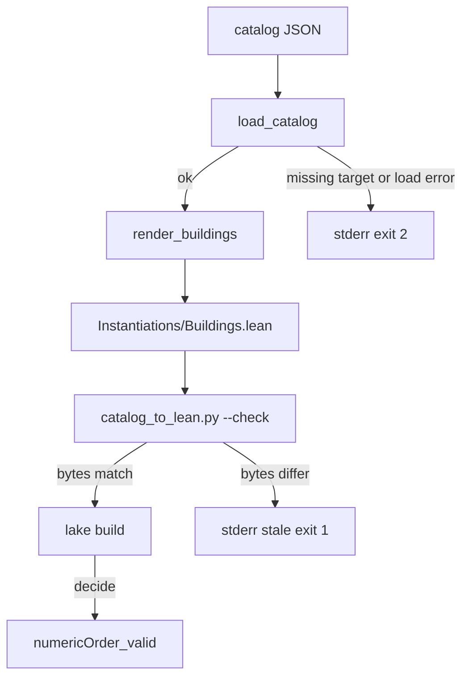
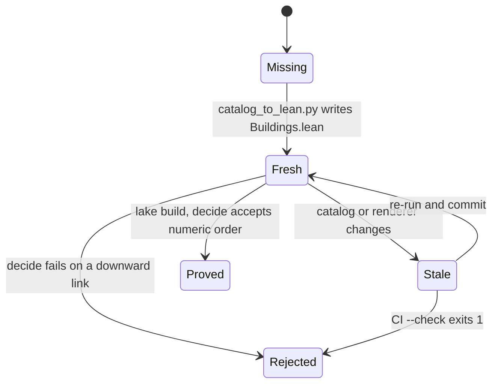

# U2 sketch B: generator-first laws

`scripts/catalog_to_lean.py` is the only writer of seed facts in Lean. `Language`, `Sequence`, and `Preservation` are a number-free kernel: scale order, the `Language` structure, a rank proof of `WellFounded`, the `ValidSequence` algebra, and preservation. Committed `lean/PatternLanguage/Instantiations/Buildings.lean` is generated from `load_catalog` and is the only Lean file that names the twelve patterns. `smaller q p` means q helps complete p, so 105's catalog entry 106 is the clause `smallerBool p106 p105`. A generated `Decidable` instance lets `by decide` close the finite facts: every smaller-link raises the pattern number, scale stays monotone, numeric order is a `ValidSequence`, and the reversed list is not. Kernel lemmas, applied in that same generated file, add the richer theorems: every prefix is a valid sequence, a pattern may be appended once the patterns it completes are already present, a strict rank yields a valid sequence, one inverted edge witnesses that the reverse fails, the two link-spans are down-closed valid sequences, and a preserving run along numeric order finishes with every seed pattern satisfied. `catalog_to_lean.py --check` diffs the generated file and exits 1 with `stale:` when it drifts; CI runs that check before `lake build`. Missing targets refuse generation. A back-edge still emits `numericOrder_valid := by decide`, and `lake build` is what fails. No Mathlib, `lake-manifest.json` keeps `packages` empty, there is no `pl` command, and `projects/` stays empty. Done when `lake build` passes, `decide` proves numeric order valid for the seed, and a stale generated file fails CI.

## Usage

From the repository root, after U1's seed is in place:

```bash
uv sync
uv run pytest
uv run python scripts/validate_catalog.py
uv run python scripts/catalog_to_lean.py --check
cd lean && lake build
```

`--check` reads the catalog, renders the file in memory, and compares it to the committed bytes. It does not write. On this seed it prints one line and exits 0:

```text
fresh: lean/PatternLanguage/Instantiations/Buildings.lean
```

A drifted or missing file prints `stale:` and a unified diff on stderr and exits 1. Stdout is empty on failure:

```text
stale: lean/PatternLanguage/Instantiations/Buildings.lean
--- lean/PatternLanguage/Instantiations/Buildings.lean
+++ lean/PatternLanguage/Instantiations/Buildings.lean.generated
@@ -1,3 +1,3 @@
...
```

Writing is the same command without `--check`. It creates parent directories and overwrites the committed path. A second run writes the same bytes.

```text
wrote: lean/PatternLanguage/Instantiations/Buildings.lean
```

`load_catalog` must succeed and `catalog.ok` must be true. Otherwise the script writes nothing, prints each loader error or each `missing target:` line to stderr, and exits 2. An empty pattern tuple exits 2 with `empty catalog`. The seed has twelve patterns and zero missing targets, so CI never takes that path.

A catalog whose `back_edges` is non-empty still renders. The render always contains `theorem numericOrder_valid : ValidSequence buildingsLanguage numericOrder := by decide`. Numeric order puts a lower number first. A downward smaller-link makes that goal false, `decide` fails, and `lake build` exits non-zero. Staleness and validity are different gates.

There is no `pl` command in U2.

Library entry, which tests and the script share:

```python
from pathlib import Path

from pattern_language.catalog import load_catalog
from pattern_language.to_lean import GENERATED_REL, render_buildings

root = Path(".").resolve()
catalog = load_catalog(root)
text = render_buildings(catalog)
path = root / GENERATED_REL
```

`render_buildings` is a pure function of the `Catalog` value. It does not read JSON and it does not touch the disk.

## Call sites

| Caller | Calls | Role in U2 |
|---|---|---|
| `scripts/catalog_to_lean.py` | `load_catalog`, then `render_buildings` | Writer and `--check`. Exit 0, 1, or 2 as above. |
| `tests/test_to_lean.py` | `render_buildings` on `repo_root` | Committed file equals the render. Banner, twelve names, twelve `by decide` sites, no summary sentences. |
| `tests/test_to_lean.py` | `render_buildings` on a `tmp_path` catalog | A downward smaller-link still emits `numericOrder_valid` and the flipped `smallerBool` clause. |
| `tests/test_boundaries.py` | file scan and CI text | Hand-written Lean has none of the twelve numbers. Workflow contains the `--check` step. `packages` stays `[]`. |
| `.github/workflows/ci.yml` | `catalog_to_lean.py --check`, then `lake build` | Stale file fails before Lean. `decide` fails inside Lean. |
| U5 sequencer (not built here) | the generated `numericOrder` | Later unit matches this list. U2 does not add `sequencer.py`. |

`gate.scan` stays the schema gate. `to_lean.py` imports `Catalog` types and does not call `scan` itself. The script calls `load_catalog`, which calls `scan`.





## Data shapes

### What is hand-written

The kernel has no pattern number, no pattern name, and no `smallerBool` clause. A test scans these files for the twelve seed numbers and expects zero hits: `lean/PatternLanguage/Language.lean`, `lean/PatternLanguage/Sequence.lean`, `lean/PatternLanguage/Preservation.lean`, `lean/lakefile.lean`, `lean/lake-manifest.json`.

`Language.lean` replaces the empty namespace. The structure matches `DESIGN.full.md` §2.6, including the argument order `smaller q p` (q helps complete p) and the quantifier order on `scale_mono`.

```lean
inductive Scale where
  | construction
  | building
  | town
  deriving DecidableEq, Repr

/-- [D] Town outranks building. Building outranks construction. -/
def Scale.rank : Scale → Nat
  | .construction => 0
  | .building => 1
  | .town => 2

/-- [D] `a ≤ b` when `a` is the same scale as `b` or a finer one. -/
def Scale.le (a b : Scale) : Prop := a.rank ≤ b.rank

instance : LE Scale where
  le := Scale.le

theorem Scale.le_refl (a : Scale) : a ≤ a := Nat.le_refl _

/-- [D] Domain-free pattern language. Buildings are one value of this structure. -/
structure Language where
  Pattern : Type
  /-- [D] Scale of a pattern. -/
  scale : Pattern → Scale
  /-- [D] `smaller q p`: q is one of the smaller patterns that help complete p. -/
  smaller : Pattern → Pattern → Prop
  /-- [S] The link never goes up in scale.
      False if some pattern lists a larger-scale pattern among its smaller ones. -/
  scale_mono : ∀ p q, smaller q p → scale q ≤ scale p
  /-- [S] The link graph has no cycle.
      False if two patterns each help complete the other, directly or through a chain. -/
  acyclic : WellFounded (fun q p => smaller q p)
```

`WellFounded` is the one in `Init`. The kernel proves it from a bounded strict rank. Walking `smaller q p` moves from p to q, and the seed's numbers go up on that step, so the measure that goes down is `bound - rank`. `omega` closes the subtraction inequality. It ships with Lean 4.33.1. It is not Mathlib, and it is not a Lake package.

```lean
theorem wf_of_rankBound {α : Type} (r : α → α → Prop)
    (rank : α → Nat) (bound : Nat)
    (hbound : ∀ a, rank a ≤ bound)
    (hr : ∀ q p, r q p → rank p < rank q) : WellFounded r := by
  intro p
  generalize hn : bound - rank p = n
  induction n using Nat.strongRecOn generalizing p with
  | ind n ih =>
    refine Acc.intro p ?_
    intro q hq
    have hqlt : bound - rank q < bound - rank p := by
      have hpq : rank p < rank q := hr q p hq
      have hqb : rank q ≤ bound := hbound q
      omega
    exact ih (bound - rank q) hqlt q rfl
```

If a toolchain lemma name differs, keep this `Acc.intro` shape. Do not import Mathlib to get `WellFounded.invImage`.

`Sequence.lean` imports `PatternLanguage.Language`.

```lean
/-- [P] Which patterns a project puts in play. A parameter of the project, not of the language. -/
def Selection (L : Language) : Type := L.Pattern → Prop

/-- [D] Closed under following smaller links. -/
def DownClosed (L : Language) (S : Selection L) : Prop :=
  ∀ p q, S p → L.smaller q p → S q

theorem downClosed_univ (L : Language) : DownClosed L (fun _ => True) := by
  intro _ _ _ _; trivial

/-- First index of `a` in `s`. -/
def indexOf? [DecidableEq α] (a : α) (s : List α) : Option Nat :=
  s.findIdx? (· == a)

/-- [D] `p` occurs strictly earlier than `q` in `s`. -/
def Before [DecidableEq α] (p q : α) (s : List α) : Prop :=
  ∃ i j, indexOf? p s = some i ∧ indexOf? q s = some j ∧ i < j

/-- [D] Every pattern in `s` appears after every larger pattern it completes,
    when that larger pattern is also in `s`. -/
def ValidSequence (L : Language) (s : List L.Pattern) : Prop :=
  ∀ q p, L.smaller q p → q ∈ s → p ∈ s → Before p q s
```

The boolean shadow lives in the kernel so every instantiation decides the same way. `elem` needs `BEq`, which `DecidableEq` supplies. `beforeBool` is `true` when both `indexOf?` values are `some` and the first index is smaller. One function, quantified over an explicit carrier:

```lean
def beforeBool [DecidableEq α] (p q : α) (s : List α) : Bool :=
  match indexOf? p s, indexOf? q s with
  | some i, some j => decide (i < j)
  | _, _ => false

def validSequenceBool [DecidableEq α]
    (carrier : List α) (smallerBool : α → α → Bool) (s : List α) : Bool :=
  (carrier.flatMap fun q => carrier.map fun p => (q, p)).all fun qp =>
    !smallerBool qp.1 qp.2 || !s.elem qp.1 || !s.elem qp.2 || beforeBool qp.2 qp.1 s
```

The carrier list keeps the check finite without `Fintype`. A bare `by decide` on `∀ q p : BPattern, …` would need Mathlib's `Fintype`. This unit does not add it. `decide` runs on a closed `Bool`, then `decidable_of_iff` lifts that to the `Prop`.

Kernel theorems, none of them proved by `decide`:

| Theorem | States |
|---|---|
| `validSequence_bool_iff` | If `L.smaller q p ↔ smallerBool q p = true` and every pattern of `L` is in `carrier`, then `ValidSequence L s ↔ validSequenceBool carrier smallerBool s = true`. |
| `validSequence_nil` | `ValidSequence L []`. |
| `validSequence_take` | A valid sequence's `take n` is a valid sequence. Indices of surviving entries match the original list. |
| `validSequence_append` | From a valid `s`, append `q ∉ s` when every `p` with `smaller q p` that lands in `s ++ [q]` is already in `s`. |
| `validSequence_of_rank` | If `smaller q p` implies `rank p < rank q`, and `s` is `Pairwise` strictly increasing in `rank`, then `ValidSequence L s`. |
| `not_validSequence_of_early` | If `smaller q p`, both are in `s`, and `Before q p s`, then `¬ ValidSequence L s`. |
| `downClosed_bool_iff` | Boolean shadow: a member `p` and `smaller q p` imply `q` is a member. |

`validSequence_of_rank` is the constructive form of the §2.6 existence claim that this unit can prove with no Mathlib and no choice. The enumeration is an argument. The theorem does not claim that every `WellFounded` relation on an unlisted type has a `List`. The seed exhibits the list. `Language.acyclic` is the `WellFounded` consequence of the same rank inequality, via `wf_of_rankBound`.

`Preservation.lean` imports `PatternLanguage.Language` only so the namespace has one root. The definitions are polymorphic in the pattern type. They do not read `L.smaller`. A later `Instantiations/Software.lean` (U8, not this unit) reuses them unchanged.

```lean
/-- [D] Patterns in `S` that hold in `d` still hold in `d'`. -/
def Preserving {D P : Type} (sat : D → P → Prop) (S : P → Prop) (d d' : D) : Prop :=
  ∀ p, S p → sat d p → sat d' p

theorem preserving_refl {D P} (sat : D → P → Prop) (S : P → Prop) (d : D) :
    Preserving sat S d d := fun _ _ h => h

theorem preserving_trans {D P} (sat : D → P → Prop) (S : P → Prop) (d₁ d₂ d₃ : D)
    (h₁₂ : Preserving sat S d₁ d₂) (h₂₃ : Preserving sat S d₂ d₃) :
    Preserving sat S d₁ d₃ := fun p hS h => h₂₃ p hS (h₁₂ p hS h)

/-- [D] Fold `step` left along `s`, each step preserving an arbitrary already-satisfied set. -/
theorem preserving_foldl {D P}
    (sat : D → P → Prop) (step : P → D → D) (s : List P) (d0 : D)
    (h : ∀ q t d, Preserving sat (fun p => p ∈ t) d (step q d)) :
    Preserving sat (fun p => p ∈ s) d0 (s.foldl (fun d p => step p d) d0)

/-- [S] A run of preserving steps that each add the next pattern of `s`
    ends with every pattern of `s` satisfied.
    False if some step drops an earlier pattern or fails to satisfy its own. -/
theorem run_satisfies {D P}
    (sat : D → P → Prop) (step : P → D → D) (s : List P) (d0 : D)
    (hpres : ∀ q t d, Preserving sat (fun p => p ∈ t) d (step q d))
    (hadd : ∀ q d, sat (step q d) q) :
    ∀ p, p ∈ s → sat (s.foldl (fun d p => step p d) d0) p
```

`run_satisfies` is induction on `s`, generalizing `d0`. The cons step uses `hadd` for the head pattern and `hpres` so the tail keeps it. Geometry, IFC, and `sat`'s meaning stay outside Lean, as §2.6 requires.

### What is generated

`lean/PatternLanguage/Instantiations/Buildings.lean` is committed. Its first lines are this banner and nothing else before the imports:

```lean
/-
Generated by scripts/catalog_to_lean.py from catalog/*.json via load_catalog.
Do not edit. Re-run the script and commit the result.
-/
import PatternLanguage.Language
import PatternLanguage.Sequence
import PatternLanguage.Preservation

namespace PatternLanguage.Instantiations.Buildings
```

The renderer emits, in this order:

1. `inductive BPattern` with one constructor per catalog pattern, sorted by `number`. Constructor name is `p` plus the decimal number, no zero-padding: `p105`. The doc comment is the number and `pattern.name` only, for example `/-- 105 South Facing Outdoors -/`.
2. `def number : BPattern → Nat` with one arm per constructor, the catalog number.
3. `def numberBound : Nat` equal to the maximum `number` in the catalog. On this seed that is `190`.
4. `def scale : BPattern → Scale` with one arm per constructor, read from `pattern.scale`: `town`, `building`, or `construction`. The seed is `building` on all twelve. The renderer does not hard-code that.
5. `def smallerBool : BPattern → BPattern → Bool`. One `| .pQ, .pP => true` arm per catalog smaller-link, then `| _, _ => false`. Arm order is `(q, p)` sorted by `q` then `p`.
6. `def smaller (q p : BPattern) : Prop := smallerBool q p = true`.
7. `def numericOrder : List BPattern` in ascending `number`. `def carrier : List BPattern := numericOrder`.
8. Pair lemma: `theorem smaller_iff (q p) : smaller q p ↔ smallerBool q p = true := Iff.rfl`.
9. Rank certificate, scale certificate, bound certificate, each a `Bool` proved by `decide`, then a `Prop` lemma that walks `carrier × carrier` with `List.all_eq_true`.
10. `def buildingsLanguage : Language where` filling `scale_mono` and `acyclic` from those lemmas and `wf_of_rankBound`.
11. `instance (s : List BPattern) : Decidable (ValidSequence buildingsLanguage s)`.
12. The seed theorems in the table below.
13. `end PatternLanguage.Instantiations.Buildings` and a single trailing `\n`.

Line endings are `\n`. There is no timestamp, no absolute path, and no `summary`, `forces`, `conditions`, or `confidence` text. Those fields are draft prose or a later unit's data. The laws quantify over pattern, scale, and smaller.

Catalog direction, spelled once so the arms cannot be flipped. Record 105 stores `"smaller": [106, 107, 128]`, meaning those three help complete 105. Lean arms:

```lean
def smallerBool : BPattern → BPattern → Bool
  | .p106, .p105 => true
  | .p107, .p105 => true
  | .p112, .p110 => true
  | .p128, .p105 => true
  | .p128, .p107 => true
  | .p130, .p110 => true
  | .p130, .p112 => true
  | .p130, .p127 => true
  | .p159, .p107 => true
  | .p159, .p128 => true
  | .p167, .p106 => true
  | .p180, .p159 => true
  | .p190, .p107 => true
  | _, _ => false
```

That is the twelve `smaller` links. `larger` is not a Lean relation. U1's loader does not audit inverses. U2 follows `pattern.smaller`, which is the §2.6 field.

`numericOrder` on this seed:

```lean
def numericOrder : List BPattern :=
  [.p105, .p106, .p107, .p110, .p112, .p127, .p128, .p130, .p159, .p167, .p180, .p190]
```

### Decide certificates and the theorems they feed

`decide` is allowed only in the generated file. The kernel's proofs are written out. A test asserts `by\ndecide` (tactic, ignoring whitespace) occurs in `Buildings.lean` and does not occur in the three kernel files.

| Generated theorem | Proof | What it locks |
|---|---|---|
| `edgesRankBool = true` | `by decide` | Every true `smallerBool` arm has `number p < number q`. |
| `number_lt_of_smaller` | `edgesRankBool` plus `List.all_eq_true` | The `Prop` rank inequality. |
| `number_bound` | `by decide` after `cases p` | `number p ≤ numberBound`. |
| `scaleMonoBool = true` | `by decide` | `smallerBool q p = true` implies `Scale.rank (scale q) ≤ Scale.rank (scale p)`. |
| `scale_mono_holds` | the bool plus the pair walk | Fills `buildingsLanguage.scale_mono`. |
| `buildings_acyclic` | `wf_of_rankBound smaller number numberBound number_bound number_lt_of_smaller` | Fills `buildingsLanguage.acyclic`. |
| `mem_carrier` | `intro p; cases p <;> decide` | Every constructor occurs in `carrier`. |
| `numericOrder_nodup` | `by decide` | `numericOrder.Nodup`. Core `Decidable (List.Nodup)` for `DecidableEq`. |
| `numericOrder_sorted` | `by decide` | `List.Pairwise (fun a b => number a < number b) numericOrder`. |
| `numericOrder_valid` | `by decide` | **Unit check.** Numeric order is a `ValidSequence` for `buildingsLanguage`. |
| `numericOrder_valid_of_rank` | `validSequence_of_rank number_lt_of_smaller numericOrder_sorted` | Same fact, from the rank lemma, so the bool and the algebra cannot drift. |
| `numericOrder_take_valid` | `validSequence_take numericOrder_valid` | Every prefix is a valid sequence. |
| `numericOrder_reverse_invalid` | `by decide` | `¬ ValidSequence buildingsLanguage numericOrder.reverse`. |
| `reverse_invalid_witness` | `not_validSequence_of_early` on the least `(q, p)` arm | On this seed, `smaller p106 p105` and 106 stands before 105 in the reverse. |
| `span105_valid`, `span110_valid` | `by decide` | Each link-span, listed by number, is a valid sequence. |
| `span105_downClosed`, `span110_downClosed` | `by decide` on the down-closed bool | Following `smaller` stays inside the span. |
| `spans_cover` | `intro p; cases p <;> decide` | Every constructor is in exactly one span. |
| `buildings_univ_downClosed` | `downClosed_univ buildingsLanguage` | The full carrier is down-closed. |
| `numericOrder_run_satisfies` | `run_satisfies sat step numericOrder d0` | A preserving run along numeric order satisfies every pattern in it. |

`numericOrder_valid` is the theorem §2.6 names. Its instance:

```lean
instance (s : List BPattern) : Decidable (ValidSequence buildingsLanguage s) :=
  decidable_of_iff (validSequenceBool carrier smallerBool s = true)
    (validSequence_bool_iff buildingsLanguage smallerBool carrier smaller_iff mem_carrier s)

theorem numericOrder_valid : ValidSequence buildingsLanguage numericOrder := by
  decide
```

`decidable_of_iff` is in Init. The `iff` proof is the kernel theorem. `by decide` then reduces the `Bool`.

`numericOrder_run_satisfies` keeps `sat` and `step` as arguments. U2 does not invent a design type and does not claim a particular house satisfies anything.

### Spans

The renderer builds an undirected graph whose edges are the `smaller` links. It walks pattern numbers ascending. Each unvisited number starts a span. Neighbors are visited in number order. The Lean list is that set sorted by number, not discovery order. The name is `span` plus the least number. On this seed the walk emits two:

| Name | Members in list order |
|---|---|
| `span105` | 105, 106, 107, 128, 159, 167, 180, 190 |
| `span110` | 110, 112, 127, 130 |

`span105` is the outdoor and light cluster: 105 links to 106, 107, and 128, and those links continue through 167, 159, 190, and 180. `span110` is the entrance cluster: 110 links to 112 and 130, 112 links to 130, and 127 links to 130. No smaller-link crosses the two sets. A later catalog with an isolated pattern emits `spanN` as the singleton `[.pN]`.

### Renderer rules

`render_buildings(catalog: Catalog) -> str` reads `pattern.number`, `pattern.name`, `pattern.scale`, and `pattern.smaller`. It sorts patterns by number. It sorts each pattern's `smaller` tuple before emitting arms. It rejects a scale outside `town`, `building`, and `construction` by raising `RenderError`, which the script prints and turns into exit 2. It does not look at `projects/`. U2 ships no project file. The sequence under proof is the catalog's numeric order, which is what §2.6 asks `decide` to accept for the seed.

The render is a pure string. Tests compare it with `==` against the file read as UTF-8 text. No normalization pass: the committed file must already be `\n` and must already end with one newline.

## Module map

```text
src/pattern_language/to_lean.py     render_buildings, GENERATED_REL, RenderError
scripts/catalog_to_lean.py         CLI: write or --check
lean/PatternLanguage/Language.lean            kernel: Scale, Language, wf_of_rankBound
lean/PatternLanguage/Sequence.lean            kernel: Selection, ValidSequence, algebra
lean/PatternLanguage/Preservation.lean        kernel: Preserving, run_satisfies
lean/PatternLanguage/Instantiations/Buildings.lean   generated, committed
lean/lakefile.lean                 unchanged glob `.submodules PatternLanguage`
lean/lake-manifest.json            packages stays []
lean/lean-toolchain                stays leanprover/lean4:v4.33.1
tests/test_to_lean.py
.github/workflows/ci.yml           one added step
```

`Language.lean` today is an empty namespace. U2 replaces that file with the kernel. Lake's existing glob already builds nested modules, so `PatternLanguage.Instantiations.Buildings` is compiled without a root `PatternLanguage.lean` and without a new glob. `lakefile.lean` gains no `require`. No file under `lean/` contains the strings `Mathlib` or `mathlib`.

`to_lean.py` imports `Catalog` and `Pattern` from `pattern_language.catalog`. It does not import `ifcopenshell` or `bpy`. `__init__.py` stays as U1 left it. Callers import `pattern_language.to_lean`.

Docs the implementer updates in the same change:

- `README.md` — U2 is the kernel plus a generated buildings file; the check command is `catalog_to_lean.py --check`; `lake build` is what accepts numeric order.
- `AGENTS.md` — path table gains `scripts/catalog_to_lean.py` and `lean/PatternLanguage/Instantiations/Buildings.lean`. The bans on a `pl` command and on Mathlib stay.
- `docs/design/DESIGN.md` — the Lean section names the three kernel modules, the generated file, and the `--check` step.

`projects/` stays empty. `schema/` stays the five U1 documents. No new pattern record.

## Signatures

```python
GENERATED_REL: Path  # Path("lean/PatternLanguage/Instantiations/Buildings.lean")

class RenderError(Exception):
    """Scale outside the three constructors, or a smaller target with no pattern."""

def render_buildings(catalog: Catalog) -> str:
    """Lean source for Instantiations/Buildings.lean.

    Require catalog.ok and a non-empty pattern tuple; raise RenderError otherwise,
    and also when a scale string is not town, building, or construction.
    The script maps RenderError and CatalogLoadError to exit 2.
    Missing targets are catalog.ok false, so they never produce a partial file.
    """

def fresh(path: Path, text: str) -> bool:
    """True when path exists and its UTF-8 text equals text."""

def stale_diff(path: Path, text: str) -> str:
    """unified_diff of the file (empty if missing) against text.
    fromfile is GENERATED_REL as posix. tofile is that path plus '.generated'.
    """
```

```python
def main(argv: list[str] | None = None) -> int:
    """root defaults to the parent of scripts/, same as validate_catalog.py.

    catalog_to_lean.py [--check] [root]
    --check: exit 0 and print 'fresh: …' when fresh; exit 1, print nothing
    to stdout, print 'stale: …' and stale_diff to stderr otherwise.
    Without --check: write the render and print 'wrote: …'.
    """
```

Lean kernel signatures are the definitions and theorems in the data-shapes section. These are the ones the generated file must apply by name:

```lean
wf_of_rankBound
validSequence_bool_iff
validSequence_take
validSequence_of_rank
not_validSequence_of_early
downClosed_univ
run_satisfies
```

Generated file, the unit-check theorem and the staleness banner, by name:

```lean
buildingsLanguage
numericOrder
numericOrder_valid
numericOrder_valid_of_rank
numericOrder_reverse_invalid
numericOrder_run_satisfies
```

## Rationale

The catalog is already the source of pattern numbers and smaller-links. U1 loads it into `Catalog`. Putting those facts into Lean by hand would make a second source, and the two would drift while both still compiled. The generator is the lever: one `render_buildings` function, one committed file, one byte compare in CI. `lake build` then typechecks that file, and `decide` evaluates the finite order claim on the real seed.

The kernel stays number-free so a buildings fact cannot hide in a hand-written proof. `wf_of_rankBound`, `validSequence_of_rank`, `validSequence_take`, `validSequence_append`, and `run_satisfies` mention no constructor. The generated file supplies the rank, the list, and the `Decidable` instance. `numericOrder_valid` is `by decide`. `numericOrder_valid_of_rank` is the same statement from the rank algebra. Both have to build. A renderer bug that makes the bool true while the rank lemma is false fails the algebra. A rank lemma that ignores an edge fails `decide` on `edgesRankBool`.

Richer than a single closed `decide`: prefixes are valid sequences, so a partial numeric prefix is already a legal order; the reverse is not, and `reverse_invalid_witness` names the least edge that says why (106 completes 105, and the reverse places 106 first); `span105` and `span110` are two smaller valid sequences whose down-closure stays inside each span; `numericOrder_run_satisfies` is the process law on that same list, with `sat` still abstract. U5 reads this list. It does not invent a second order.

`decide` never quantifies over `BPattern` by itself. The carrier list is explicit, `validSequenceBool` folds it, and `decidable_of_iff` is the bridge. That is why the unit needs no Mathlib and no `Fintype`. `cases p <;> decide` appears only for membership and the bound, where each goal is one constructor.

Staleness is a Python diff, not a Lean failure. A hand edit that still typechecks, or a catalog edit that was not re-rendered, fails `--check` with exit 1 before `lean-action`. A downward link that was re-rendered honestly fails later, inside `numericOrder_valid`. The script does not drop the theorem to keep `lake build` green.

`projects/` stays empty because the proved sequence is the seed catalog, not a project selection. `DownClosed` and `Selection` are in the kernel for that later parameter. The full carrier and the two spans are the selections U2 actually closes.

## CI

`.github/workflows/ci.yml` gains one step after `validate_catalog.py` and before `leanprover/lean-action`:

```yaml
- run: uv run python scripts/catalog_to_lean.py --check
```

`uv.lock` stays. `use-mathlib-cache` stays `"false"`. `lake-package-directory` stays `lean`.

| Step | U2 result |
|---|---|
| `uv sync --frozen` | No new dependency. `difflib` is stdlib. |
| `uv run pytest` | Freshness against the committed file. Kernel files contain none of `105`–`190` from the seed set. Generated file contains each of the twelve names, the twelve `smallerBool` arms, and `by decide`. A temp catalog with 130's `smaller` equal to `[112]` renders `smallerBool p112 p130` and still contains `theorem numericOrder_valid`. `test_u0_has_no_pl_command` stays. `test_lean_has_no_mathlib` stays and now scans the generated file too. |
| `validate_catalog.py` | Unchanged. `back-edges: 0` and `ok: 12 records`. |
| `catalog_to_lean.py --check` | Exit 0, stdout `fresh: lean/PatternLanguage/Instantiations/Buildings.lean`. |
| `lake build` | Elaborates the kernel and `Buildings.lean`. `numericOrder_valid` closes by `decide`. |

`tests/test_boundaries.py` `test_ci_workflow_covers_gate_and_lean` gains the assertion that the workflow contains `uv run python scripts/catalog_to_lean.py --check`.

A tamper test writes the render into a temp file, flips one byte, and asserts `fresh` is false and `stale_diff` is non-empty. It does not rewrite the committed file.

Done for U2: `lake build` passes with `packages` still empty; `numericOrder_valid` is proved by `decide` for the twelve-pattern numeric order; CI exits 1 on a stale `Instantiations/Buildings.lean`.
