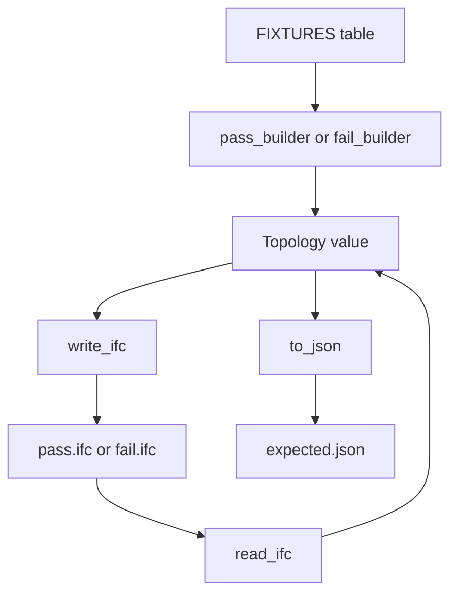
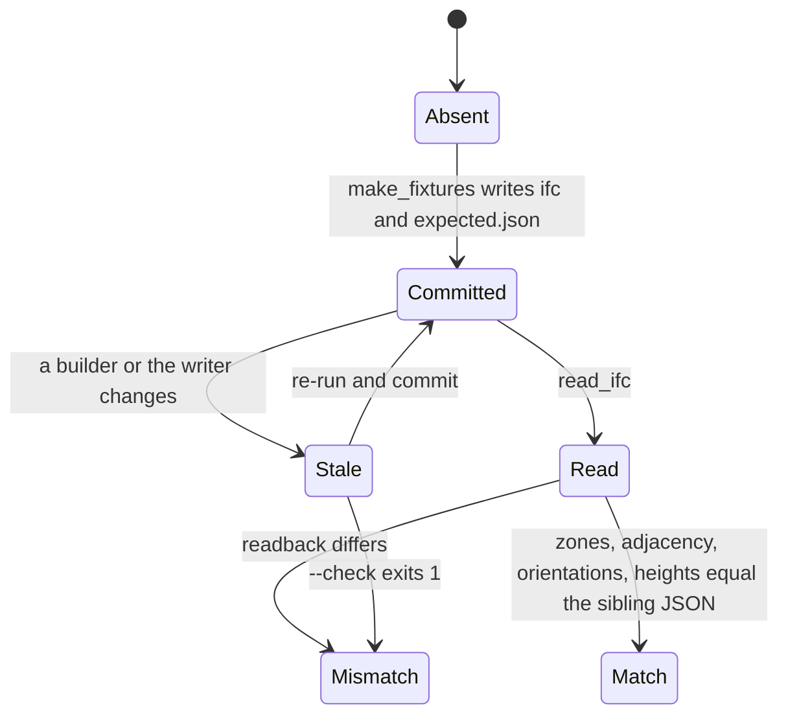

# U3 sketch B: fixture registry

## Summary

`FIXTURES` is a table from pattern number to `(pass_builder, fail_builder)` for the ten computed seed patterns, and that table is the whole house catalog.
Each builder returns a `Topology` of zones, openings, and adjacencies and never receives an IFC object.
`read_ifc` and `write_ifc` are the only functions that import IfcOpenShell, and they import it inside the function body.
The public graph is frozen `Zone`, `Opening`, `Adjacency`, and `Topology` values; an IfcOpenShell entity cannot appear in a signature, a return value, or another module.
`scripts/make_fixtures.py` walks the table and writes `fixtures/<catalog-stem>/{pass,fail}.ifc` with `{pass,fail}.expected.json` beside each file.
The JSON is the builder's topology report (`to_json` of the returned value), and `scan` keeps ignoring `fixtures/`.
Tests read all twenty committed IFC files and assert zone ids and kinds, adjacency, window orientations, and heights against that sibling JSON, plus the distinguishing fact for the pair.
`make_fixtures.py --check` regenerates every plan, exits 1 when committed JSON differs, and exits 1 when a committed IFC reads back as a different graph. IFC bytes are not compared.
110 Main Entrance and 180 Window Place have no rows. U3 adds no `pl` command, no schema, no Lean edit, and no condition function.
Done when the twenty readbacks match and the registry keys are exactly the catalog's computed pattern numbers.

## Usage

From the repository root, after the twenty houses are committed:

```bash
uv sync
uv run pytest
uv run python scripts/validate_catalog.py
uv run python scripts/catalog_to_lean.py --check
uv run python scripts/make_fixtures.py --check
cd lean && lake build
```

`make_fixtures.py` with no flag walks `FIXTURES` in ascending pattern number, writes the IFC and the expected JSON, and prints one line:

```text
wrote: 20 houses
```

`--check` writes nothing. On a match it prints one line and exits 0:

```text
fresh: 20 houses
```

A drifted JSON file, a missing house, or an IFC file whose `read_ifc` value differs from its sibling JSON prints nothing on stdout, prints one `stale:` line per house on stderr, and exits 1:

```text
stale: fixtures/159-light-on-two-sides-of-every-room/fail.expected.json
stale: fixtures/159-light-on-two-sides-of-every-room/fail.ifc
```

Exit 2 is a registry fault: `load_catalog` fails, `catalog.ok` is false, or `FIXTURES` keys are not exactly the computed pattern numbers. Stderr names the mismatch. No file is written.

An optional positional `root` defaults to the parent of `scripts/`, the same default as `scripts/validate_catalog.py`.

There is no `pl` command in U3.

Library entry, which the script and the tests share:

```python
from pathlib import Path

from pattern_language.catalog import load_catalog
from pattern_language.fixtures import FIXTURES, build
from pattern_language.topology import read_ifc, to_json

root = Path(".").resolve()
catalog = load_catalog(root)
plan = build(159, "pass")
text = to_json(plan)
graph = read_ifc(root / "fixtures/159-light-on-two-sides-of-every-room/pass.ifc")
assert graph == plan
assert set(FIXTURES) == {159, 105, 106, 107, 112, 127, 128, 130, 167, 190}
```

`build` calls the table. It does not read a file. `to_json` is a pure function of a `Topology`.

## Call sites

| Caller | Calls | Role in U3 |
|---|---|---|
| `scripts/make_fixtures.py` | `load_catalog`, `FIXTURES`, `build`, `write_ifc`, `to_json` | Writer and `--check`. Exit 0, 1, or 2 as above. |
| `tests/test_fixtures.py` | `build` and `to_json` against the committed JSON | A builder edit without a regenerated JSON fails. |
| `tests/test_fixtures.py` | `read_ifc` on each of the twenty IFC paths | Zones, adjacency, window orientations, and heights equal the sibling JSON. |
| `tests/test_topology.py` | `write_ifc` then `read_ifc` on `tmp_path` | One rectangular plan round-trips, including a south window's host midpoint. |
| `tests/test_boundaries.py` | AST scan and CI text | `ifcopenshell` appears only inside `read_ifc` and `write_ifc`. Workflow contains the `--check` step. |
| `.github/workflows/ci.yml` | `make_fixtures.py --check` | Stale JSON or a bad readback fails before `lake build`. |
| U4 checker (not built here) | `read_ifc` | Later unit consumes `Topology`. U3 does not add `conditions/` or `checker.py`. |

`gate.scan` stays the schema gate. `fixtures/` is not a record root. A JSON file beside an IFC is not a catalog record and is not a `check-report`.





## Data shapes

Axes are fixed for every house. X increases east, Y increases north, Z increases up, units are meters. A footprint is a tuple of `(x, y)` corners, counterclockwise, first point not repeated. Edges are axis-aligned. `write_ifc` raises `TopologyError` when an edge is not parallel to an axis.

A window's `orientation` is the outward normal of its host edge: the right-hand normal of a counterclockwise ring. `at_m` is the midpoint of that edge. Builders set both as literals. `read_ifc` measures both from the wall solid and the space profile. A shared normal helper cannot hide a flipped compass, because the plan's midpoint is a coordinate literal and the reader's midpoint is measured.

`height_m` is the Z length of the space's extruded solid. It is the space body, not `IfcBuildingStorey` elevation. Every U3 storey is named `ground` at elevation 0. Outdoor, street, balcony, and transition zones still carry a height so every house answers the height assertion: 3.0 for those kinds, 2.5 for occupied rooms, except 190's tall room at 3.0.

Site latitude is 40 on every house, stored as `IfcSite.RefLatitude` degrees `(40, 0, 0)` and returned as `Topology.latitude_deg == 40.0`. South is the equator-facing side of these models. The catalog parameters `latitude_deg: 0` on 105 and 128 stay in the JSON records. U3 does not edit the catalog. U4 is the unit that decides how a check parameter meets a site latitude.

### Graph

These dataclasses live in `topology.py`. They are the only geometry types other modules may name.

```python
ZoneKind = Literal["space", "outdoor", "balcony", "street", "transition", "corridor"]
Occupancy = Literal["occupied", "unoccupied"]
Privacy = Literal["public", "semi_private", "private"]
Cardinal = Literal["north", "east", "south", "west"]
OpeningKind = Literal["window", "door"]
AdjacencyKind = Literal["wall", "door"]


@dataclass(frozen=True)
class Zone:
    id: str
    kind: ZoneKind
    storey: str
    occupancy: Occupancy
    privacy: Privacy | None
    daytime: bool
    footprint: tuple[tuple[float, float], ...]
    height_m: float
    elevation_m: float


@dataclass(frozen=True)
class Opening:
    id: str
    kind: OpeningKind
    zone_id: str
    orientation: Cardinal
    at_m: tuple[float, float]
    sill_m: float
    head_m: float
    width_m: float


@dataclass(frozen=True)
class Adjacency:
    a: str
    b: str
    kind: AdjacencyKind
    opening_id: str | None


@dataclass(frozen=True)
class Topology:
    latitude_deg: float
    zones: tuple[Zone, ...]
    openings: tuple[Opening, ...]
    adjacencies: tuple[Adjacency, ...]
```

| Field | Meaning |
|---|---|
| `Zone.kind` | `space`, `outdoor`, `balcony`, `street`, `transition`, or `corridor`. |
| `Zone.occupancy` | `occupied` for `space`. `unoccupied` for the other five kinds, including `corridor`. |
| `Zone.privacy` | Set on 127's indoor rooms. `None` on every other zone. |
| `Zone.daytime` | `True` only on 128's daytime room. |
| `Zone.footprint` | Plan ring in meters. |
| `Zone.height_m` | Extruded height in meters. |
| `Opening.zone_id` | The zone that owns the opening. A door's orientation points from this zone toward the neighbor. |
| `Opening.at_m` | Midpoint of the host edge. |
| `Adjacency` | Endpoints sorted so `a < b` as strings. `kind` is `door` when `opening_id` names a door, and `wall` when the zones share a wall and `opening_id` is `None`. A window does not create an adjacency. |

`to_json` sorts zones and openings by `id`, and adjacencies by `(a, b, opening_id or "")`. It uses 2-space indent, `sort_keys`, and one trailing newline. Floats are rounded to three decimal places on the way into the dataclass, in the builders and in `read_ifc`, so equality is exact. Coordinates in this unit are multiples of 0.5 so the rounded values are the decimals written below.

`from_json` returns a `Topology`. Tests compare dataclasses.

### What crosses the IFC boundary

`read_ifc` and `write_ifc` are the only functions whose bodies import `ifcopenshell`. The import is inside the function, so `import pattern_language.topology` does not load IfcOpenShell. `__init__.py` does not import `topology` or `fixtures`.

Inside those two functions, and nowhere else:

| Graph fact | IFC fact |
|---|---|
| `Zone.id` | `IfcSpace.Name` |
| `Zone.kind` | `IfcSpace.ObjectType`, one of the six tokens |
| `Zone.occupancy` | derived from `kind` on read; written to agree with the table above |
| `Zone.privacy` | `IfcSpace.Description` token `privacy=<value>`, omitted when `None` |
| `Zone.daytime` | `IfcSpace.Description` token `daytime=true`, omitted when false |
| `Zone.footprint` | polyline of the extruded profile |
| `Zone.height_m` | extrusion depth, also written to `Qto_SpaceBaseQuantities.Height` |
| `Zone.storey` | containing `IfcBuildingStorey.Name` |
| `Zone.elevation_m` | storey elevation plus the space placement Z |
| `Opening.id` | `IfcWindow.Name` or `IfcDoor.Name` |
| `Opening.zone_id` | `ObjectType` of that window or door |
| `Opening.orientation` and `at_m` | computed from the host wall and the space ring on read |
| `Adjacency` | two `IfcRelSpaceBoundary` rows that name the same wall |
| `latitude_deg` | `IfcSite.RefLatitude` |

`IsExternal` on `Pset_SpaceCommon` is true for `outdoor`, `balcony`, and `street`. On read, a disagreement with `kind` raises `TopologyError`. Description tokens are the storage for privacy and daytime. They are parsed inside `read_ifc` and formatted inside `write_ifc`. Callers see `privacy` and `daytime` fields.

Orientation is computed on read. It is not stored as a property. The PR body lists the six `ObjectType` tokens and the two description tokens, because they are reading conventions for facts IFC does not name.

GlobalIds are `ifcopenshell.guid.compress` of a UUID5 over `pattern/case/kind/id`. Owner-history time is a constant. Those choices keep regeneration stable enough to read back. `--check` still compares graphs, because a STEP dump can change across an IfcOpenShell release while the graph stays the same.

Walls are derived from footprint edges. One undirected edge is one `IfcWall`. A window or door is placed in the wall whose outward normal, from `zone_id`, equals `orientation`, centered at `at_m`.

### The table

```python
Builder = Callable[[], Topology]

FIXTURES: Mapping[int, tuple[Builder, Builder]]
```

The mapping is a `MappingProxyType`. Key order is pattern number ascending. The value is `(pass_builder, fail_builder)`. Builders take no arguments. Lengths and tags are literals inside the function. The script chooses paths.

Keys, and the catalog file stem used as the directory name:

| Number | Name | Directory |
|---|---|---|
| 105 | South Facing Outdoors | `fixtures/105-south-facing-outdoors/` |
| 106 | Positive Outdoor Space | `fixtures/106-positive-outdoor-space/` |
| 107 | Wings of Light | `fixtures/107-wings-of-light/` |
| 112 | Entrance Transition | `fixtures/112-entrance-transition/` |
| 127 | Intimacy Gradient | `fixtures/127-intimacy-gradient/` |
| 128 | Indoor Sunlight | `fixtures/128-indoor-sunlight/` |
| 130 | Entrance Room | `fixtures/130-entrance-room/` |
| 159 | Light on Two Sides of Every Room | `fixtures/159-light-on-two-sides-of-every-room/` |
| 167 | Six-Foot Balcony | `fixtures/167-six-foot-balcony/` |
| 190 | Ceiling Height Variety | `fixtures/190-ceiling-height-variety/` |

Each directory holds `pass.ifc`, `pass.expected.json`, `fail.ifc`, and `fail.expected.json`. Twenty houses, forty files. 110 and 180 are absent because their conditions are `judged`.

`computed_pattern_numbers(catalog)` returns the pattern numbers that own a condition of kind `computed`, ascending. On this seed that tuple is the ten keys above. `build(pattern, case)` looks up the table and calls the builder.

A house is a `Topology` with `latitude_deg` 40, one or more zones, one or more adjacencies, one or more windows, and a positive `height_m` on every zone. Pass and fail for the same key are unequal.

Window defaults, unless a row says otherwise: sill 1.0, head 2.0, width 1.0. Door defaults: sill 0.0, head 2.0, width 1.0. `storey` is `ground`. `elevation_m` is 0. `privacy` is `None` and `daytime` is false except where a row sets them.

`rect(x0, y0, x1, y1)` means the ring `(x0, y0), (x1, y0), (x1, y1), (x0, y1)` with `x0 < x1` and `y0 < y1`.

### Twenty houses

The distinguishing fact is what the pair exists to carry. U3 tests assert the whole graph, and they assert this fact by name so a swapped pair fails even when both files are internally consistent. U3 does not evaluate a condition. The catalog thresholds in the last column are the reason the geometry was chosen; the checker that applies them is U4.

| Pattern | Pass | Fail | Threshold the geometry is aimed at |
|---|---|---|---|
| 105 | outdoor `yard` south of `room` | `yard` north of `room` | equator-facing side; site latitude 40, south is that side |
| 106 | rectangular outdoor ring, area/hull = 1 | C-shaped outdoor ring, area 52, hull 100, ratio 0.52 | `min_convexity_ratio` 0.75 |
| 107 | occupied footprint 10 by 10, center 5 m from the exterior | occupied footprint 20 by 20, center 10 m from the exterior | `max_depth_m` 8 |
| 112 | street–transition–room through two doors | street–room through one door, no `transition` zone | path passes through a transition zone |
| 127 | door order public, then semi-private, then private | door from the street opens into `private` | tags advance along the door graph |
| 128 | `daytime` room on the south band | `daytime` room on the north band | equator-facing side |
| 130 | main door opens into `kind=space` | main door opens into `kind=corridor` | a room, rather than a corridor |
| 159 | one window south and one window east | two windows, both south | `min_orientations` 2 |
| 167 | balcony Y extent 2.0 | balcony Y extent 1.5 | `min_depth_m` 1.83 |
| 190 | occupied heights 2.5 and 3.0 | both occupied heights 2.5 | `min_height_difference_m` 0.3 |

Rings, openings, and adjacencies:

**105 South Facing Outdoors.** Both cases: `room` rect(0, 0, 6, 4), kind `space`, height 2.5. Pass: `yard` rect(0, −4, 6, 0), kind `outdoor`, height 3.0; window `w` on `room` south at (3, 0); adjacency (`room`, `yard`, wall). Fail: `yard` rect(0, 4, 6, 8); window `w` on `room` north at (3, 4); same adjacency.

**106 Positive Outdoor Space.** Pass: `court` rect(0, 0, 8, 8), kind `outdoor`, height 3.0; `room` rect(0, 8, 8, 12), kind `space`, height 2.5; window `w` on `room` south at (4, 8); adjacency (`court`, `room`, wall). Fail: `court` ring `(0, 0), (10, 0), (10, 10), (0, 10), (0, 8), (8, 8), (8, 2), (0, 2)`, height 3.0; `room` rect(0, 10, 10, 14), height 2.5; window `w` on `room` south at (5, 10); adjacency (`court`, `room`, wall). Shoelace on that ring is 52. The convex hull is the 10 by 10 square, area 100.

**107 Wings of Light.** Pass: `room` rect(0, 0, 10, 10), kind `space`, height 2.5; `yard` rect(0, −2, 10, 0), kind `outdoor`, height 3.0; window `w` on `room` south at (5, 0); adjacency (`room`, `yard`, wall). Fail: `room` rect(0, 0, 20, 20); `yard` rect(0, −2, 20, 0); window `w` at (10, 0); same adjacency pattern. The four room walls are single-boundary walls except the shared south wall, which faces `yard` and is exterior because `yard` is outdoor.

**112 Entrance Transition.** Pass: `street` rect(0, −2, 4, 0), kind `street`, height 3.0; `porch` rect(0, 0, 4, 2), kind `transition`, height 3.0; `hall` rect(0, 2, 4, 6), kind `space`, height 2.5. Door `d-porch` on `porch` south at (2, 0). Door `d-hall` on `hall` south at (2, 2). Window `w` on `hall` east at (4, 4). Adjacencies (`porch`, `street`, door, `d-porch`) and (`hall`, `porch`, door, `d-hall`). Fail: `street` rect(0, −2, 4, 0); `hall` rect(0, 0, 4, 4), kind `space`, height 2.5; door `d-hall` on `hall` south at (2, 0); window `w` on `hall` east at (4, 2); adjacency (`hall`, `street`, door, `d-hall`). The fail house has no zone of kind `transition`.

**127 Intimacy Gradient.** Pass, south to north: `street` rect(0, −2, 3, 0), kind `street`, height 3.0; `entry` rect(0, 0, 3, 3), kind `space`, privacy `public`, height 2.5; `sit` rect(0, 3, 3, 6), privacy `semi_private`, height 2.5; `bed` rect(0, 6, 3, 9), privacy `private`, height 2.5. Doors: `d-entry` on `entry` south at (1.5, 0); `d-sit` on `sit` south at (1.5, 3); `d-bed` on `bed` south at (1.5, 6). Window `w` on `entry` east at (3, 1.5). Adjacencies (`entry`, `street`, door, `d-entry`), (`entry`, `sit`, door, `d-sit`), (`bed`, `sit`, door, `d-bed`). Fail: `street` rect(0, −2, 3, 0); `bed` rect(0, 0, 3, 3), privacy `private`, height 2.5; `entry` rect(0, 3, 3, 6), privacy `public`, height 2.5. Door `d-bed` on `bed` south at (1.5, 0). Door `d-entry` on `entry` south at (1.5, 3). Window `w` on `entry` east at (3, 4.5). Adjacencies (`bed`, `street`, door, `d-bed`), (`bed`, `entry`, door, `d-entry`).

**128 Indoor Sunlight.** Pass: `day` rect(0, 0, 6, 4), kind `space`, `daytime` true, height 2.5; `store` rect(0, 4, 6, 8), kind `space`, `daytime` false, height 2.5; window `w` on `day` south at (3, 0); adjacency (`day`, `store`, wall). Fail: `store` rect(0, 0, 6, 4), `daytime` false; `day` rect(0, 4, 6, 8), `daytime` true; window `w` on `day` north at (3, 8); same adjacency.

**130 Entrance Room.** Pass: `street` rect(0, −2, 4, 0), kind `street`, height 3.0; `room` rect(0, 0, 4, 4), kind `space`, height 2.5; door `d` on `room` south at (2, 0); window `w` on `room` east at (4, 2); adjacency (`room`, `street`, door, `d`). Fail: `street` unchanged; indoor zone `hall` rect(0, 0, 4, 4), kind `corridor`, height 2.5, occupancy `unoccupied`; door `d` on `hall` south at (2, 0); window `w` on `hall` east at (4, 2); adjacency (`hall`, `street`, door, `d`).

**159 Light on Two Sides of Every Room.** Both cases: `room` rect(0, 0, 4, 4), kind `space`, height 2.5; `yard` rect(0, −2, 4, 0), kind `outdoor`, height 3.0; adjacency (`room`, `yard`, wall). Pass openings: window `w-south` on `room` south at (2, 0); window `w-east` on `room` east at (4, 2). Fail openings: window `w-a` on `room` south at (1, 0); window `w-b` on `room` south at (3, 0).

**167 Six-Foot Balcony.** Pass: `room` rect(0, 2, 4, 6), kind `space`, height 2.5; `balcony` rect(0, 0, 4, 2), kind `balcony`, height 3.0; door `d` on `room` south at (2, 2); window `w` on `room` east at (4, 4); adjacency (`balcony`, `room`, door, `d`). The balcony's Y extent is 2.0. Fail: `balcony` rect(0, 0.5, 4, 2), Y extent 1.5; `room`, door, window, and adjacency unchanged.

**190 Ceiling Height Variety.** Both cases: `low` rect(0, 0, 4, 4) and `high` rect(4, 0, 8, 4), both kind `space`, occupancy `occupied`; window `w` on `low` south at (2, 0); adjacency (`high`, `low`, wall). Pass heights: `low` 2.5, `high` 3.0. Fail heights: both 2.5.

### Expected JSON

`pass.expected.json` and `fail.expected.json` are `to_json` of the builder's `Topology` plus two envelope fields the script adds, `pattern` and `case`. Envelope shape:

```json
{
  "pattern": 190,
  "case": "pass",
  "latitude_deg": 40.0,
  "zones": [],
  "openings": [],
  "adjacencies": []
}
```

`zones`, `openings`, and `adjacencies` are the dataclass fields. `pattern` is the registry key. `case` is `pass` or `fail`. This document is the oracle `read_ifc` is compared to. It is not a `check-report`: it has no `model.sha256`, no `satisfied` list, and no pattern-instance status. The five schemas stay the five U1 documents. `DirectorySchemaMap` does not gain a fixtures entry.

`from_json` accepts this envelope and ignores `pattern` and `case` when building the `Topology`. The test checks those two fields against the path.

## Module map

```text
src/pattern_language/topology.py     Zone, Opening, Adjacency, Topology, to_json, from_json, read_ifc, write_ifc
src/pattern_language/houses.py       twenty builders and the rect helper
src/pattern_language/fixtures.py     FIXTURES table, build, computed_pattern_numbers, paths
scripts/make_fixtures.py             CLI: write or --check
fixtures/<stem>/{pass,fail}.ifc
fixtures/<stem>/{pass,fail}.expected.json
tests/test_fixtures.py
tests/test_topology.py
tests/test_boundaries.py             import rule and CI line
.github/workflows/ci.yml             one added step
```

`houses.py` imports the dataclasses from `topology.py` and does not import `ifcopenshell`. `fixtures.py` imports the builders and the dataclasses. `topology.py` does not import `fixtures` or `houses`.

`catalog.py`, `gate.py`, the twelve JSON records, the five schemas, and `lean/` stay. `projects/` stays empty. `uv.lock` gains `ifcopenshell`. `shapely` and `networkx` stay out of this unit; convexity and depth-to-wall are U4 arithmetic over footprints already stored here. `bpy` stays unused.

Docs the implementer updates in the same change:

- `README.md` — U3 is the fixture table and `topology.read_ifc`; the check command is `make_fixtures.py --check`; tests read back zones, adjacency, window orientations, and heights.
- `AGENTS.md` — path table gains `topology.py`, `fixtures.py`, `houses.py`, `scripts/make_fixtures.py`, and `fixtures/`. The import sentence becomes: core modules other than `topology.py` do not import `ifcopenshell`, and `topology.py` imports it only inside `read_ifc` and `write_ifc`. The ban on a `pl` command stays.
- `docs/design/DESIGN.md` — a U3 section after U2: twenty houses, one pass and one fail for each computed seed pattern; `topology.py` returns the graph; expected JSON sits beside each IFC.

`pyproject.toml` gains the `ifcopenshell` dependency and gains no `[project.scripts]` entry.

## Signatures

```python
class TopologyError(Exception):
    """Unreadable IFC, a non-cardinal edge, a height/quantity mismatch,
    an unknown zone kind, or a missing site latitude.
    """


def to_json(model: Topology, *, pattern: int | None = None, case: str | None = None) -> str:
    """Canonical JSON. pattern and case are included when both are passed."""


def from_json(text: str) -> Topology:
    """Parse a topology report. Ignore envelope keys pattern and case."""


def read_ifc(path: Path) -> Topology:
    """Read one IFC4 file into a Topology.

    Import ifcopenshell inside this function.
    Compute each opening orientation and at_m from the host wall.
    Raise TopologyError when the file is missing, is not IFC, has no site
    latitude, has a non-axis-aligned space edge, or has an ObjectType
    outside the six kind tokens.
    """


def write_ifc(model: Topology, path: Path) -> None:
    """Write model to an IFC4 file at path, creating parent directories.

    Import ifcopenshell inside this function.
    Return None. Raise TopologyError on a non-axis-aligned ring.
    """
```

```python
Builder = Callable[[], Topology]

FIXTURES: Mapping[int, tuple[Builder, Builder]]


def computed_pattern_numbers(catalog: Catalog) -> tuple[int, ...]:
    """Ascending pattern numbers that have a computed condition."""


def build(pattern: int, case: Literal["pass", "fail"]) -> Topology:
    """Call FIXTURES[pattern][0] or [1]. Raise KeyError for 110 and 180."""


def house_paths(root: Path, stem: str, case: Literal["pass", "fail"]) -> tuple[Path, Path]:
    """Return (ifc_path, expected_json_path) under fixtures/<stem>/."""
```

```python
def main(argv: list[str] | None = None) -> int:
    """make_fixtures.py [--check] [root]

    Load the catalog. Exit 2 when the load fails, catalog.ok is false,
    or FIXTURES keys differ from computed_pattern_numbers.
    Without --check, write twenty IFC files and twenty JSON files.
    With --check, compare each builder's canonical JSON to the committed
    file and compare read_ifc of the committed IFC to that same Topology.
    """
```

The twenty builder names are `<slug>_pass` and `<slug>_fail`, slug underscores matching the catalog file stem without the number: `south_facing_outdoors_pass`, `light_on_two_sides_of_every_room_fail`, and the rest in the same pattern.

## Tests

`tests/test_fixtures.py`

- `tuple(FIXTURES) == (105, 106, 107, 112, 127, 128, 130, 159, 167, 190)`
- that tuple equals `computed_pattern_numbers(load_catalog(repo_root))`
- `110 not in FIXTURES` and `180 not in FIXTURES`
- for each of the twenty `(pattern, case)` pairs, parametrized: the committed expected JSON equals `to_json(build(pattern, case), pattern=pattern, case=case)`; `read_ifc(ifc_path) == build(pattern, case)`; every zone id in the graph is the expected set; every adjacency endpoint is a zone id; every window `orientation` is one of the four cardinals; every `height_m` is greater than 0; `build(pattern, "pass") != build(pattern, "fail")`
- one assertion per row of the distinguishing table: 105 pass yard centroid Y is less than the room's minimum Y, and 105 fail yard centroid Y is greater than the room's maximum Y; 106 rings equal the rectangle and the C ring; 107 footprints are 10 by 10 and 20 by 20; 112 pass contains a `transition` zone between street and hall, and 112 fail does not; 127 pass door-neighbor order from `street` is `entry`, `sit`, `bed` with those privacy tags, and 127 fail's street neighbor is `private`; 128 pass `day.daytime` and the day footprint is the south band; 130 pass indoor kind is `space` and 130 fail indoor kind is `corridor`; 159 pass window orientations are `{south, east}` and 159 fail window orientations are `{south}`; 167 balcony Y extents are 2.0 and 1.5; 190 occupied height sets are `{2.5, 3.0}` and `{2.5}`
- for every window on a rectangular zone, a south window's `at_m[1]` equals the footprint's minimum Y, a north window's equals the maximum Y, an east window's `at_m[0]` equals the maximum X, and a west window's equals the minimum X

`tests/test_topology.py`

- write a one-room, one-window plan to `tmp_path`, read it back, and require equality
- a south window's measured `at_m` sits on the footprint's minimum Y
- `write_ifc` raises `TopologyError` on a triangle footprint
- the returned object's type module is `pattern_language.topology`, and walking `dataclasses.fields` finds no value whose type module starts with `ifcopenshell`

`tests/test_boundaries.py`

- `ifcopenshell` may be imported only in `src/pattern_language/topology.py`, and the AST import nodes sit inside `read_ifc` and `write_ifc`
- `bpy` is imported nowhere
- `import pattern_language`, `import pattern_language.topology`, and `import pattern_language.fixtures` leave `ifcopenshell` out of `sys.modules`
- the CI workflow text contains `uv run python scripts/make_fixtures.py --check`
- `test_u0_has_no_pl_command` stays
- `test_u1_ships_five_schemas_and_twelve_records` stays, including `projects/` with no JSON and `schema/` with the same five files
- `scan` of the repo still reports `ok: 12 records`. The new files under `fixtures/` do not change that count

## Rationale

The house catalog is a finite set of pairs, one pair per computed pattern. A table makes that set the thing CI checks: the keys have to equal the computed numbers, and each key has to have two builders. Adding a computed condition without a row fails `computed_pattern_numbers` against `FIXTURES`. Judged patterns 110 and 180 stay out of the table because U3's done-when counts computed patterns.

Builders return the same dataclass the reader returns. The expected JSON is that value, written beside the IFC. The test is then a comparison of `read_ifc` to the plan. Zones, adjacency, orientations, and heights are fields of that plan, so the done-when is one equality plus the named fact that keeps pass and fail apart.

`at_m` is part of the opening so the cardinal enum is tied to a footprint edge. The plan states the midpoint. The reader measures it. A window written into the wrong wall fails the comparison even when both sides share a normal function.

IfcOpenShell stays inside two functions because the registry is pure data. `houses.py` and `make_fixtures.py` can be imported, listed, and compared without an IFC file. The existing package import stays free of `ifcopenshell`, which is what `test_importing_gate_does_not_load_forbidden_modules` already guards for `gate`. The boundary test grows a narrower allow-list instead of a blanket permission for every script.

Twenty separate houses keep each distinguishing fact in its own file. A later checker can load one pair and ignore the other nine. U3 does not claim that a pass house satisfies its pattern. It claims that the reader recovers the graph the builder stated. Satisfaction is U4, against these same files.

Byte comparison of IFC is the wrong staleness check. GlobalIds are deterministic here, and a future IfcOpenShell can still reorder a STEP file. The graph comparison catches a hand-edited house and a builder that was not regenerated. `--check` does both halves: JSON against the builder, and IFC against that JSON.

`fixtures/` stays outside `RECORD_ROOTS`. The expected files are reports for tests. Putting them through `schema/check-report.schema.json` would drop the zones and heights the unit exists to assert. The checker in U4 writes check-reports; these oracles stay topology reports.

The catalog's `latitude_deg: 0` and the houses' site latitude 40 are different numbers on purpose. U3 records the site. It does not reinterpret 105 or 128. A project override can pass 40 into the check when U4 runs. Changing the seed parameter now would be a catalog edit outside this unit.

## CI

`.github/workflows/ci.yml` gains one step after `catalog_to_lean.py --check` and before `leanprover/lean-action`:

```yaml
- run: uv run python scripts/make_fixtures.py --check
```

`uv.lock` is regenerated for `ifcopenshell`. `use-mathlib-cache` stays `"false"`. `lake-package-directory` stays `lean`. Lean files are unchanged, so `lake build` has the same proof obligation as U2.

| Step | U3 result |
|---|---|
| `uv sync --frozen` | Installs `ifcopenshell`. No `shapely`, no `networkx`, no `bpy`. |
| `uv run pytest` | Twenty readbacks match. Registry keys are the ten computed numbers. Import of the package does not load IfcOpenShell. `test_u0_has_no_pl_command` stays. |
| `validate_catalog.py` | Unchanged. `back-edges: 0` and `ok: 12 records`. |
| `catalog_to_lean.py --check` | Unchanged. |
| `make_fixtures.py --check` | Exit 0, stdout `fresh: 20 houses`. |
| `lake build` | Unchanged. |

Done for U3: the registry has one pass builder and one fail builder for each of the ten computed patterns; each committed IFC reads back to the sibling JSON; the tests assert zones, adjacency, window orientations, and heights on all twenty houses.
