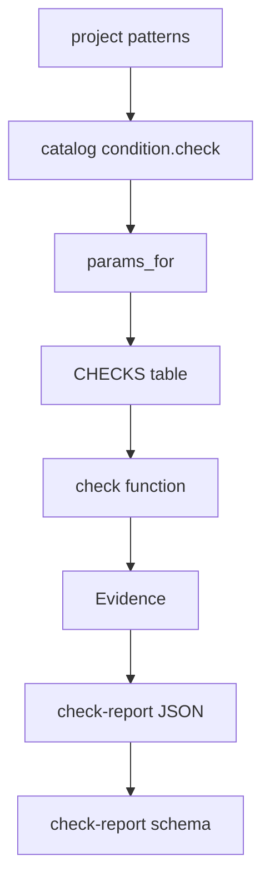
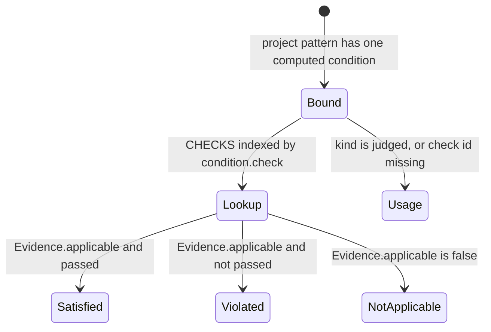

# U4 sketch B: check registry

## Summary

`CHECKS` maps each catalog `condition.check` id to one function, and that table is the whole registry.
Each id is a module under `conditions/`, named by turning hyphens into underscores, and the module exports `check`.
`check(topology, center, params)` returns a frozen `Evidence` dataclass and never receives a pattern number.
`checker.py` evaluates a project by `CHECKS[condition.check]` only; it does not branch on pattern number.
110 Main Entrance and 180 Window Place are judged, have no registry row, and a project that selects either exits 2.
`projects/seed-house.json` overrides `latitude_deg` to 40; the catalog value 0 stays in the pattern records.
`pl check` reads a U3 house with `read_topology`, writes one check-report, and validates it against `schema/check-report.schema.json`.
On `fixtures/pass-house.ifc` all ten computed checks pass; on `fixtures/fail-house.ifc` all ten fail.
The report evidence is `kind`, `check`, and `passed`; measured numbers stay on `Evidence` and are not report fields.
Done when the pass fixture exits 0, the fail fixture exits 1, and both JSON reports validate. Lean and the five schemas stay.

## Usage

From the repository root, after U3's two houses are in `fixtures/`:

```bash
uv sync
uv run pytest
uv run python scripts/validate_catalog.py
uv run python scripts/catalog_to_lean.py --check
uv run python scripts/make_fixtures.py --check
uv run pl check fixtures/pass-house.ifc --language projects/seed-house.json
uv run pl check fixtures/fail-house.ifc --language projects/seed-house.json
cd lean && lake build
```

`pl check` loads the catalog from `--root` (default: the current directory), reads the project file, reads the IFC through `read_topology`, and writes one check-report. Stdout is that JSON and nothing else. `--out` writes the same bytes to a file and still prints them.

Exit 0: the report validates and every instance is `satisfied`. The pass house does this. Stdout is the report. Stderr is empty.

Exit 1: the report validates and some instance is `violated` or `not_applicable`. The fail house does this. Stdout is still the full report. Stderr is empty.

Exit 2: usage, a catalog or project load error, a judged pattern in the project, a check id missing from `CHECKS`, a topology the reader rejects, or a report that fails the schema. Stdout is empty. Stderr is one line.

```text
judged condition has no check: 110
```

```text
unknown check: not-a-check
```

Library entry, which the CLI and the tests share:

```python
from pathlib import Path

from pattern_language.catalog import load_catalog
from pattern_language.checker import run
from pattern_language.conditions.registry import CHECKS
from pattern_language.parameters import load_project

root = Path(".").resolve()
catalog = load_catalog(root)
project = load_project(root / "projects/seed-house.json")
report = run(catalog, project, root / "fixtures/pass-house.ifc", model_file="fixtures/pass-house.ifc")
assert report.satisfied == (105, 106, 107, 112, 127, 128, 130, 159, 167, 190)
assert set(CHECKS) == {
    "south-facing-outdoors",
    "positive-outdoor-space",
    "wings-of-light",
    "entrance-transition",
    "intimacy-gradient",
    "indoor-sunlight",
    "entrance-room",
    "light-on-two-sides",
    "six-foot-balcony",
    "ceiling-height-variety",
}
```

`run` returns a frozen `CheckReport`. `report_json` serializes it. The schema check happens inside `run`, before the CLI prints.

There is one subcommand. `pl sequence` and `pl step` are U5. `pl` with no command, or with any other command, exits 2 with `unknown command`.

## Call sites

| Caller | Calls | Role in U4 |
|---|---|---|
| `pattern_language.cli:main` | `load_catalog`, `load_project`, `run`, `report_json` | `pl check`. Exit 0, 1, or 2 as above. |
| `checker.run` | `read_topology`, `CHECKS[condition.check]`, `params_for` | One instance per selected pattern. Validates the report dict against the schema. |
| `conditions/registry.py` | the ten `check` functions | The only module that imports the ten check modules. |
| `tests/test_checks.py` | each `check` on both houses, then `run` | Pass house passes all ten. Fail house fails all ten. Report validates. |
| `tests/test_boundaries.py` | AST scan, `pyproject.toml`, CI text | `ifcopenshell` stays inside `read_ifc` and `write_ifc`. The only script entry is `pl`. |
| `.github/workflows/ci.yml` | `uv run pl check` on the pass house | The entry point exits 0 on the passing fixture. |

`gate.scan` stays the schema gate for `catalog/` and `projects/`. A check-report is not a record. `fixtures/` stays outside `RECORD_ROOTS`. `--out` does not add a scanned directory.

`import pattern_language` and `import pattern_language.checker` do not import `ifcopenshell`. `read_topology` still imports it inside `read_ifc`. Check modules import `Topology` from `topology.py` and call no write function.





## Data shapes

U4 adds no geometry type. Checks read the frozen graph U3 already returns.

| U3 field | What a check reads |
|---|---|
| `Topology.north` | Plan north. Both houses store `(0.0, 1.0)`. |
| `Zone.kind` | `Building` is the center. Predicates run over `Space` zones under that building. |
| `Zone.tags` | The closed U3 set: `outdoor`, `street`, `transition`, `public`, `semi-private`, `private`, `daytime`, `corridor`, `living`, `room`, `balcony`, `occupied`. |
| `Zone.footprint`, `Zone.height_m` | Plan ring and extrusion depth of a space. |
| `Opening.kind`, `spaces`, `orientation` | A door edge is an opening of kind `door` with two space names. A window counts toward 159. |
| `Boundary.external`, `start`, `end` | Exterior segments for 107. Internal segments for 167. |

`Adjacency` is not an input. Circulation is the door graph, so a wall-only link is not a step. Both houses already carry the door openings the witnesses describe.

### Evidence

`Evidence` is the check's return value. It is frozen. The report stores three of its fields.

```python
@dataclass(frozen=True, slots=True)
class Evidence:
    check: str
    passed: bool
    applicable: bool
    subjects: tuple[str, ...]
    measured: tuple[tuple[str, str], ...]
```

`check` equals the registry key. `subjects` is the space names the predicate quantified over, sorted. `measured` is sorted pairs. Values are decimals from `format(value, ".3f")` or the token `1.000` / `0.000` for a boolean outcome. Keys are unique.

Status comes from `Evidence` and from nowhere else:

| `applicable` | `passed` | instance `status` | instance `centers` |
|---|---|---|---|
| True | True | `satisfied` | `[building]` |
| True | False | `violated` | `[building]` |
| False | False | `not_applicable` | `[]` |

`passed` is false when the check does not apply. The schema still requires `evidence.passed`. The status field carries applicability.

Report evidence is only:

```json
{"kind": "check", "check": "light-on-two-sides", "passed": true}
```

`subjects` and `measured` stay on the dataclass. Putting them in the JSON would fail `additionalProperties: false` on `checkEvidence`. U4 does not edit the five schemas. `needs_judgment` and `judgmentEvidence` stay in the schema for a later unit. This unit never emits them. A judged pattern in the project is exit 2, because a judgment needs a person and the schema's judgment object requires an answer.

### Registry

```python
CheckFn = Callable[[Topology, str, Mapping[str, Any]], Evidence]

CHECKS: Mapping[str, CheckFn]
```

The mapping is a `MappingProxyType`. Each key is a catalog `condition.check` string. Each value is that module's `check`. The module path is `pattern_language.conditions.<id with hyphens turned to underscores>`. The module sets `CHECK_ID` to the same string as the key.

| Check id | Module | Params the function reads |
|---|---|---|
| `south-facing-outdoors` | `south_facing_outdoors.py` | `latitude_deg` |
| `positive-outdoor-space` | `positive_outdoor_space.py` | `min_convexity_ratio` |
| `wings-of-light` | `wings_of_light.py` | `max_depth_m` |
| `entrance-transition` | `entrance_transition.py` | none |
| `intimacy-gradient` | `intimacy_gradient.py` | none |
| `indoor-sunlight` | `indoor_sunlight.py` | `latitude_deg` |
| `entrance-room` | `entrance_room.py` | none |
| `light-on-two-sides` | `light_on_two_sides.py` | `min_orientations` |
| `six-foot-balcony` | `six_foot_balcony.py` | `min_depth_m` |
| `ceiling-height-variety` | `ceiling_height_variety.py` | `min_height_difference_m` |

A missing required param raises `CheckError`. That is exit 2, a usage fault. It is not a violated instance.

The seed has one condition per pattern. `bind` requires `len(pattern.conditions) == 1`. Zero or two conditions is exit 2.

### Parameters

Catalog params are the defaults. The project replaces them by key.

1. Copy `condition.params`.
2. When that copy contains `latitude_deg` and the project sets `parameters.latitude_deg`, replace the value.
3. Apply `parameters.by_pattern[<number>]` key by key. A key absent from the condition params is exit 2. A pattern number absent from `project.patterns` is exit 2.

The project latitude does not appear on a condition that has no `latitude_deg` key. 106, 107, 112, 127, 130, 159, 167, and 190 keep their catalog numbers. 105 and 128 see 40 on the seed project and 0 when the caller passes the catalog params through unchanged.

`latitude_deg` 0 has no equator-facing direction. 105 and 128 then return `applicable` true and `passed` false. The seed project exists so the pass house is not failed by the catalog default.

### Project file

`projects/seed-house.json` is a gate record. `scan` counts it. `load_catalog` still returns the twelve patterns and ignores `projects/`.

```json
{
  "id": "seed-house",
  "patterns": [105, 106, 107, 112, 127, 128, 130, 159, 167, 190],
  "start": 105,
  "parameters": {
    "units": "si",
    "latitude_deg": 40
  }
}
```

`start` is stored because the schema requires it. U4 checks every selected pattern. Order in the report is pattern number ascending. Sequence order is U5.

`validate_catalog.py` then prints:

```text
back-edges: 0
ok: 13 records
```

### Center

The center is the unique zone of kind `Building`. Both houses name it `house`. Every `Space` whose parent chain reaches that zone is in scope. Both houses hang every space from `ground` under `house`, so every space is in scope. A topology with no building, or with two, raises `CheckError`.

### Shared measurements

These functions live in `conditions/measure.py`. Check modules call them. Check modules do not import each other. `measure.py` does not import a check id or a pattern number.

Footprint centroid is the shoelace centroid. A set centroid is the unweighted mean of the member centroids. Area is the absolute shoelace area. The convex hull is Andrew's monotone chain. Coordinates are the millimetre-rounded rings U3 already stores. Fixture gaps are larger than `0.01`, so comparisons use `>=` and `>` on those floats with no extra epsilon.

Equator direction: unit vector of `Topology.north`, multiplied by `-1` when `latitude_deg > 0` and by `+1` when `latitude_deg < 0`. `latitude_deg == 0` yields no direction. A subject is equator-ward of a reference when the dot product of `(subject - reference)` with that direction is strictly positive.

Door graph: nodes are space names; an edge is an `Opening` of kind `door` whose `spaces` has length 2. Distance is breadth-first.

```python
@dataclass(frozen=True, slots=True)
class Entrance:
    street: str
    path: tuple[str, ...]
    arrival: str
```

`entrance` searches from every space tagged `street`. A space tagged `street`, `transition`, or `outdoor` is not an arrival. The result is the shortest path from a street space to an arrival. Ties break by arrival name, then by the path tuple. `path` includes the street space and the arrival. `None` means there is no such path.

On the pass house the path is (`street`, `court`, `hall`). On the fail house the path is (`street`, `corridor`).

### The ten predicates

Each predicate returns one `Evidence` for the whole building. The pass house makes `passed` true. The fail house makes `passed` false. Both houses make `applicable` true.

**`south-facing-outdoors`.** Subjects are spaces tagged `outdoor` and not `balcony`. Zero or several: `applicable` false. One: call it the main outdoor space. Reference is the set centroid of spaces tagged `occupied`. No occupied space: `applicable` false. Passed when the main outdoor centroid is equator-ward of that reference. Measured keys: `latitude_deg`, `dot`.

Pass, latitude 40: court `(4, 2)`, occupied mean `(4.667, 7.333)`, dot `5.333`. Fail: court `(2.2, 17.6)`, occupied mean `(4.5, 10.25)`, dot `-7.350`.

**`positive-outdoor-space`.** Subjects are spaces tagged `outdoor`, balcony included. None: `applicable` false. For each, ratio is footprint area over convex-hull area. A hull area of 0 raises `CheckError`. Passed when every ratio is `>= min_convexity_ratio`. Measured key: `min_ratio`, the smallest ratio.

Pass: court and balcony are rectangles, `min_ratio` `1.000`. Fail: balcony stays `1.000`, the court ring has area 20 and hull area 38, `min_ratio` `0.526`, threshold `0.75`.

**`wings-of-light`.** Subjects are spaces tagged `occupied`. None: `applicable` false. Depth of a space is the maximum, over footprint vertices, of the minimum distance to that space's exterior boundary segments (`Boundary.external`). A space with no exterior segment has infinite depth. Passed when every finite depth is `<= max_depth_m`. Measured key: `max_depth_m`, the largest depth, or `inf` rendered as `inf`.

Pass: hall, living, and bedroom are 4 m by 4 m with a full exterior side, `max_depth_m` `4.000`, threshold `8`. Fail: bedroom's only exterior segment is `(6, 12)`–`(8, 12)`; vertex `(4, 2)` is `10.198` from it.

**`entrance-transition`.** No entrance: `applicable` false. Passed when some strict intermediate node of `path` is tagged `transition`. Measured key: `transition`, `1.000` or `0.000`.

Pass: `court` is between `street` and `hall` and is tagged `transition`. Fail: the path is `street` to `corridor` and no zone is tagged `transition`.

**`intimacy-gradient`.** No entrance: `applicable` false. Rank `public` 0, `semi-private` 1, `private` 2. Subjects are spaces that carry exactly one of those tags. A space with two of them fails the check. Distances are door-graph distances from `arrival`. Passed when all three ranks occur and, for every pair with a lower rank and a higher rank, the lower rank's distance is strictly smaller. Measured key: `ordered`, `1.000` or `0.000`.

Pass, from `hall`: public at 0, semi-private at 1, private at 2. Fail, from `corridor`: private at 1, public at 2, and no semi-private space.

**`indoor-sunlight`.** Subjects are spaces tagged `daytime`. None: `applicable` false. Reference is the set centroid of occupied spaces that are not daytime. That set empty: `applicable` false. Passed when every daytime centroid is equator-ward of the reference. Measured key: `dot`, the smallest dot.

Pass: `living` against hall and bedroom, dot `2.000`. Fail: `dayroom` against bedroom, dot `-6.500`.

**`entrance-room`.** No entrance: `applicable` false. Passed when the arrival is tagged `room` and is tagged neither `corridor` nor `living`. Measured key: `room`, `1.000` or `0.000`.

Pass: `hall` is tagged `room`. Fail: `corridor` is tagged `corridor`.

**`light-on-two-sides`.** Subjects are spaces tagged `occupied`. None: `applicable` false. A space's orientations are the `orientation` values of openings of kind `window` whose `spaces` contain that name. Passed when every occupied space has at least `min_orientations` distinct orientations. Measured key: `min_orientations`, the smallest count, as a decimal.

Pass: hall `{south, west}`, living `{south, east}`, bedroom `{north, west}`, minimum `2.000`, threshold `2`. Fail: bedroom `{north}`, dayroom `{north, west}`, minimum `1.000`.

**`six-foot-balcony`.** Subjects are spaces tagged `balcony`. None: `applicable` false. Internal segments are that space's boundaries with `external` false. Depth is the minimum distance, among footprint vertices that do not lie on an internal segment, to the nearest internal segment. A vertex lies on a segment when its distance is below `0.001`. No off-segment vertex means depth 0. Passed when every balcony depth is `>= min_depth_m`. Measured key: `min_depth_m`, the shallowest balcony.

Pass: balcony extends 2 m east of `x = 8`, depth `2.000`, threshold `1.83`. Fail: balcony extends 1 m west of `x = 0`, depth `1.000`.

**`ceiling-height-variety`.** Subjects are spaces tagged `occupied` with a numeric `height_m`. Fewer than two: `applicable` false. Passed when `max(height) - min(height) >= min_height_difference_m`. Measured key: `difference_m`.

Pass: 2.4, 3.0, and 2.7, difference `0.600`, threshold `0.3`. Fail: bedroom and dayroom both 2.4, difference `0.000`.

### Report

```python
@dataclass(frozen=True, slots=True)
class PatternInstance:
    pattern: int
    centers: tuple[str, ...]
    status: str
    check: str
    passed: bool


@dataclass(frozen=True, slots=True)
class CheckReport:
    model_file: str
    model_sha256: str
    project: str
    instances: tuple[PatternInstance, ...]
    satisfied: tuple[int, ...]
```

`model_file` is the path argument with backslashes replaced by `/`, unresolved. `model_sha256` is the hex SHA-256 of the file bytes. `project` is the project id. `instances` follow pattern number. `satisfied` is the numbers whose status is `satisfied`, ascending.

`report_json` uses 2-space indent, `sort_keys`, and one trailing newline. `run` validates that object with `Draft202012Validator` against `schema/check-report.schema.json` and raises `CheckError` when the schema rejects it.

Pass-house instance, one of ten:

```json
{
  "pattern": 159,
  "centers": ["house"],
  "status": "satisfied",
  "evidence": {"kind": "check", "check": "light-on-two-sides", "passed": true}
}
```

The pass report's `satisfied` array is the ten numbers in the project. The fail report's `satisfied` array is empty, and all ten statuses are `violated`.

## Module map

```text
src/pattern_language/conditions/evidence.py
src/pattern_language/conditions/measure.py
src/pattern_language/conditions/registry.py
src/pattern_language/conditions/south_facing_outdoors.py
src/pattern_language/conditions/positive_outdoor_space.py
src/pattern_language/conditions/wings_of_light.py
src/pattern_language/conditions/entrance_transition.py
src/pattern_language/conditions/intimacy_gradient.py
src/pattern_language/conditions/indoor_sunlight.py
src/pattern_language/conditions/entrance_room.py
src/pattern_language/conditions/light_on_two_sides.py
src/pattern_language/conditions/six_foot_balcony.py
src/pattern_language/conditions/ceiling_height_variety.py
src/pattern_language/parameters.py
src/pattern_language/checker.py
src/pattern_language/cli.py
projects/seed-house.json
tests/test_checks.py
tests/test_cli.py
```

`conditions/__init__.py` exports nothing and imports nothing. `checker.py` imports `CHECKS` and does not import the ten modules. `topology.py` does not import `conditions`. `__init__.py` stays limited to `catalog` and `gate`.

`catalog.py`, `gate.py`, the twelve pattern records, the five schemas, `lean/`, and both IFC houses stay. `uv.lock` gains no package. `shapely` and `networkx` stay out; area, hull, depth, and door distance are arithmetic in `measure.py`. `bpy` stays unused.

Docs and tests the implementer updates in the same change:

- `README.md` — U4 is `pl check`, the registry, and `projects/seed-house.json`. The pass house satisfies the ten computed checks.
- `AGENTS.md` — path table gains `conditions/`, `checker.py`, `parameters.py`, `cli.py`, and `projects/seed-house.json`. The command list gains `uv run pl check`. The sentence that forbids a `pl` command becomes: U4 adds `pl check` only.
- `docs/design/DESIGN.md` — a U4 section after U3: registry keyed by `condition.check`, `Evidence`, `pl check`, reports validated against the existing check-report schema.
- `tests/test_boundaries.py` — `test_u0_has_no_pl_command` becomes `test_u4_pl_check_is_the_only_command`. The seed scan expects `ok: 13 records`. `projects/` contains `seed-house.json` and no other JSON. The five schemas and twelve catalog files stay.
- `pyproject.toml` gains:

```toml
[project.scripts]
pl = "pattern_language.cli:main"
```

## Signatures

```python
class CheckError(Exception):
    """Unknown check id, judged pattern in the project, missing param,
    project override for an unknown key, or a report the schema rejects.
    """


@dataclass(frozen=True, slots=True)
class Evidence:
    check: str
    passed: bool
    applicable: bool
    subjects: tuple[str, ...]
    measured: tuple[tuple[str, str], ...]


def check(topology: Topology, center: str, params: Mapping[str, Any]) -> Evidence:
    """One predicate. center is the building zone name.

    Read params for this check id only. Raise CheckError when a required
    param is missing or not a number. Return applicable False when the
    building has no subject for this predicate.
    """
```

The ten modules each define that function and `CHECK_ID: str`.

```python
CHECKS: Mapping[str, CheckFn]


def building_center(topology: Topology) -> str:
    """Name of the unique zone of kind Building. Raise CheckError otherwise."""


def entrance(topology: Topology) -> Entrance | None:
    """Shortest door-graph path from a street space to an arrival."""


def equator_direction(north: tuple[float, float], latitude_deg: float) -> tuple[float, float] | None:
    """Unit vector toward the equator. None when latitude_deg is 0."""
```

```python
@dataclass(frozen=True, slots=True)
class Project:
    id: str
    patterns: tuple[int, ...]
    start: int
    units: str
    latitude_deg: float | None
    by_pattern: Mapping[int, Mapping[str, Any]]


def load_project(path: Path) -> Project:
    """Validate path against schema/projects.schema.json and return a Project.

    Raise CheckError when the file is missing, the schema rejects it,
    start is outside patterns, or a by_pattern key is outside patterns.
    """


def params_for(pattern: Pattern, project: Project) -> Mapping[str, Any]:
    """Condition params, with project latitude and by_pattern overrides applied.

    Raise CheckError when an override names a key the condition does not have.
    """
```

```python
def run(
    catalog: Catalog,
    project: Project,
    model_path: Path,
    *,
    model_file: str,
    schema_path: Path | None = None,
) -> CheckReport:
    """Read the IFC, evaluate each selected pattern, validate the report.

    schema_path defaults to <catalog root>/schema/check-report.schema.json
    when the caller passes a catalog loaded from that root. The CLI passes
    root / "schema/check-report.schema.json".

    For each selected pattern number, in ascending order:
    require one condition; require kind computed; call
    CHECKS[condition.check](topology, building_center, params_for(...)).
    Raise CheckError for a judged condition or a missing registry key.
    """


def report_json(report: CheckReport) -> str:
    """Canonical check-report JSON, one trailing newline."""
```

```python
def main(argv: list[str] | None = None) -> int:
    """pl check <model.ifc> --language <project.json> [--out PATH] [--root PATH]

    --root defaults to the current directory. Relative model and language
    paths open from the current directory. model.file in the report is the
    model argument, posix-separated, not resolved.
    """
```

`python -m pattern_language.cli` calls `main` and exits with its code.

## Tests

`tests/test_checks.py`

- `set(CHECKS)` equals the set of `condition.check` values on computed conditions of `load_catalog(repo_root)`, and that set has length 10
- for each registry item, the key equals the module's `CHECK_ID`, and the function's `__module__` is `pattern_language.conditions.<underscored id>`
- 110 and 180 contribute no `CHECKS` key; their condition kind is `judged`
- parametrize the ten check ids: on the pass house, with seed-project params, `applicable` and `passed` are true and `check` equals the id; on the fail house, `applicable` is true and `passed` is false
- measured decimals on those two calls equal the table in the predicate section (`dot` `5.333` / `-7.350`, `min_ratio` `1.000` / `0.526`, `max_depth_m` `4.000` / `10.198`, `transition` `1.000` / `0.000`, `ordered` `1.000` / `0.000`, indoor `dot` `2.000` / `-6.500`, `room` `1.000` / `0.000`, `min_orientations` `2.000` / `1.000`, balcony `min_depth_m` `2.000` / `1.000`, `difference_m` `0.600` / `0.000`)
- `south_facing_outdoors.check` and `indoor_sunlight.check` on the pass house with `latitude_deg` 0 return `passed` false and `applicable` true
- `run` on the pass house: ten instances, every status `satisfied`, every `centers == ("house",)`, `satisfied` is the ten numbers, `model_sha256` matches the file, `project == "seed-house"`
- `run` on the fail house: ten instances, every status `violated`, `satisfied == ()`
- both reports pass `Draft202012Validator` against `schema/check-report.schema.json`
- a `Topology` built in the test with one building and one occupied room, and with no outdoor, balcony, street, or daytime space, yields `not_applicable` for 105, 106, 112, 127, 128, 130, 167, and 190
- an AST walk of `checker.py`, `cli.py`, `parameters.py`, and every file under `conditions/` finds no `ast.Constant` integer in `{105, 106, 107, 110, 112, 127, 128, 130, 159, 167, 180, 190}`

`tests/test_cli.py`

- `main(["check", "fixtures/pass-house.ifc", "--language", "projects/seed-house.json", "--root", repo])` returns 0 and stdout validates
- the same call on `fixtures/fail-house.ifc` returns 1, stdout validates, and `satisfied` is `[]`
- `main(["check", "fixtures/pass-house.ifc", "--language", project_with_110])` returns 2 and stdout is empty
- `main(["sequence"])` returns 2

`tests/test_boundaries.py`

- `ifcopenshell` import nodes sit only inside `read_ifc` and `write_ifc`
- `bpy` is imported nowhere under the repo
- importing `pattern_language`, `pattern_language.topology`, `pattern_language.checker`, and `pattern_language.conditions.registry` leaves `ifcopenshell` out of `sys.modules`
- `pyproject.toml` contains `pl = "pattern_language.cli:main"` and no other script entry
- the CI workflow contains `uv run pl check fixtures/pass-house.ifc --language projects/seed-house.json`
- `test_u1_ships_five_schemas_and_twelve_records` still requires the five schema files and the twelve catalog files, and requires `projects/seed-house.json` as the only project record
- the seed `validate_catalog.py` stdout is `back-edges: 0` then `ok: 13 records`
- the empty-tree CLI case still prints `ok: 0 records`
- `load_catalog(repo_root).patterns` still has length 12

## Rationale

The catalog already stores the function name on `condition.check`. A table keyed by that string makes the seed's computed checks a set CI can compare to the catalog. A new computed condition arrives as a new module and a new row. `checker.py` stays a loop: one condition, kind `computed`, then `CHECKS[condition.check]`.

Pattern numbers stay in the JSON. The checker indexes the catalog by the project's numbers and indexes the registry by the check id. The AST test rejects the twelve seed integers as literals anywhere in the check path, so a future edit cannot hide a number branch inside a helper.

`Evidence` is the value tests assert. The schema's evidence object is the projection of that value down to `kind`, `check`, and `passed`. Measured depths and ratios remain available to tests and stay out of a document the schema would reject.

The two U3 houses already separate the ten predicates: court south of the occupied rooms against court north of them, a rectangle against the L of area 20 / hull 38, a 4 m room against a bedroom 10.198 m from its only exterior segment, a transition on the door path against a direct street-to-corridor door, public-then-semi-private-then-private against private-then-public, living on the south band against dayroom on the north band, hall tagged `room` against corridor, two window orientations against one, a 2.00 m balcony against a 1.00 m balcony, and a 0.600 m height span against 0. The predicates above are the readings that put each witness on the passing side or the failing side of the catalog threshold.

Latitude is a parameter, and north is a fact on the graph. The houses store north as +Y and do not store a site latitude. Equator-facing is the opposite of north when the project says 40. The catalog's 0 remains the recorded default; the seed project is what makes the pass house pass 105 and 128.

Judged 110 and 180 stay out of `CHECKS`. Emitting `needs_judgment` would require a judgment object with an answer, and this unit does not invent one. Leaving the schema unchanged keeps the report valid for the ten computed instances.

The door graph, rather than `Adjacency`, is the circulation those three entrance predicates share. `measure.entrance` is one function with no check id inside it. 112, 127, and 130 each read a different field of the same `Entrance`.

## CI

`.github/workflows/ci.yml` gains one step after `catalog_to_lean.py --check` and before `leanprover/lean-action`:

```yaml
- run: uv run pl check fixtures/pass-house.ifc --language projects/seed-house.json
```

The fail house returns exit 1. Pytest covers that exit. The CI step covers the console entry on the house that satisfies every selected check. `use-mathlib-cache` stays `"false"`. `lake-package-directory` stays `lean`. Lean files are unchanged.

| Step | U4 result |
|---|---|
| `uv sync --frozen` | Same lock. No `shapely`, no `networkx`, no `bpy`. |
| `uv run pytest` | Ten checks pass on the pass house and fail on the fail house. Both reports validate. Registry keys equal the catalog check ids. |
| `validate_catalog.py` | `back-edges: 0` and `ok: 13 records`. |
| `catalog_to_lean.py --check` | Unchanged. |
| `pl check` on `fixtures/pass-house.ifc` | Exit 0. The report validates. |
| `lake build` | Unchanged. |

Done for U4: each of the ten computed conditions passes on `fixtures/pass-house.ifc` and fails on `fixtures/fail-house.ifc`; each report validates against `schema/check-report.schema.json`; `pl check` is the command that writes them.
