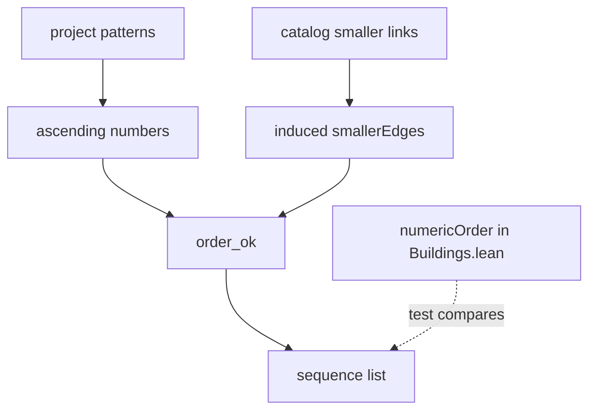
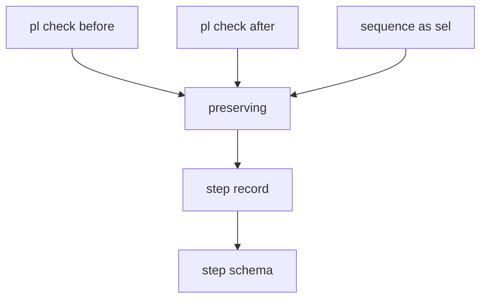

# U5 sketch B: Lean-aligned sequence and step

## Summary

`sequence.py` is the Python twin of `Sequence.lean`: `index_before` and `order_ok` are those Bool procedures, and `sequence` emits the project selection in ascending number order.
That list is valid when `order_ok` holds on the induced smaller-edges, in the `(q, p)` orientation `catalog_to_lean.py` writes as `smallerEdges`.
On `projects/seed-house.json` the list is `numericOrder` in `lean/PatternLanguage/Instantiations/Buildings.lean`.
The test parses that definition and `render(catalog)`; the sequencer reads the catalog, and the Lean file stays a test oracle.
`step.py` is the Python twin of `Preserving`: `preserved` is true when every selected pattern in `satisfied_before` is in `satisfied_after`.
`pl step` runs the U4 evaluator on both models, writes one step record, and validates it against `schema/step.schema.json`.
`--pattern` is the pattern the record stores; the quantifier does not read that field.
Pass house then fail house drops 105 South Facing Outdoors from `satisfied`, so the record has `preserved: false` and the command exits 1.
The same house twice has `preserved: true` and exits 0.
Lean, the five schemas, and the two IFC files stay as U4 left them.

## Usage

From the repository root, after U4:

```bash
uv sync
uv run pytest
uv run python scripts/validate_catalog.py
uv run python scripts/catalog_to_lean.py --check
uv run python scripts/make_fixtures.py --check
uv run pl check fixtures/pass-house.ifc --language projects/seed-house.json
uv run pl sequence projects/seed-house.json
uv run pl step fixtures/pass-house.ifc fixtures/pass-house.ifc \
  --language projects/seed-house.json --pattern 105
uv run pl step fixtures/pass-house.ifc fixtures/fail-house.ifc \
  --language projects/seed-house.json --pattern 112
cd lean && lake build
```

`pl check` stays the U4 command, with the same exits.

`pl sequence <project.json> [--root PATH]` loads the catalog from `--root` (default: the current directory) and the project from the current directory. Stdout is a JSON array of pattern numbers, indented two spaces, with one trailing newline. Stderr is empty on success.

Exit 0: every selected number is in the catalog, and `order_ok` accepts ascending order on the induced edges. The seed project does this. The array is the twelve numbers of `numericOrder`.

Exit 2: usage, a catalog or project load error, a selected number missing from the catalog, or `order_ok` false. Stdout is empty. Stderr is one line.

```text
usage: pl sequence <project.json>
```

```text
missing pattern: 200
```

```text
sequence is not valid
```

`pl step <before.ifc> <after.ifc> --language <project.json> --pattern <n> [--root PATH] [--out PATH]` evaluates both models with the U4 checker, builds one step, and validates it against `schema/step.schema.json`. Stdout is that JSON and nothing else. `--out` writes the same bytes and still prints them. `model` paths and the language path follow the U4 rule: relative to the current directory, and the `file` fields store the arguments with backslashes replaced by slashes, unresolved.

Exit 0: the step validates and `preserved` is true. Pass house then the same pass house does this.

Exit 1: the step validates and `preserved` is false. Pass house then fail house does this. Stdout is the step. Stderr is empty.

Exit 2: usage, a load or topology error, a pattern argument outside the project, a sequence the seed rule rejects, or a step the schema rejects. Stdout is empty. Stderr is one line.

```text
usage: pl step <before.ifc> <after.ifc> --language <project.json> --pattern <n>
```

```text
pattern is not in language: 99
```

`pl` with no command, or with any other command, exits 2 with `unknown command`.

Library entry, which the CLI and the tests share:

```python
from pathlib import Path

from pattern_language.catalog import load_catalog
from pattern_language.parameters import load_project
from pattern_language.sequence import order_ok, sequence, smaller_edges
from pattern_language.step import build_step

root = Path(".").resolve()
catalog = load_catalog(root)
project = load_project(root / "projects/seed-house.json")
order = sequence(catalog, project)
assert order == (
    105, 106, 107, 110, 112, 127, 128, 130, 159, 167, 180, 190,
)
assert order_ok(order, smaller_edges(catalog, order))

kept = build_step(
    catalog,
    project,
    root / "fixtures/pass-house.ifc",
    root / "fixtures/pass-house.ifc",
    pattern=105,
    before_file="fixtures/pass-house.ifc",
    after_file="fixtures/pass-house.ifc",
)
assert kept.preserved

broken = build_step(
    catalog,
    project,
    root / "fixtures/pass-house.ifc",
    root / "fixtures/fail-house.ifc",
    pattern=112,
    before_file="fixtures/pass-house.ifc",
    after_file="fixtures/fail-house.ifc",
)
assert broken.preserved is False
assert 105 in broken.satisfied_before
assert 105 not in broken.satisfied_after
```

## Call sites

| Caller | Calls | Role in U5 |
|---|---|---|
| `pattern_language.cli:main` | `sequence`, `build_step`, `step_json` | `pl sequence` and `pl step`. `pl check` stays. |
| `sequence.sequence` | `order_ok`, `smaller_edges` | Ascending numbers, then the ValidSequence Bool. |
| `step.build_step` | `sequence`, `checker.run`, `preserving` | Two reports, then the Preserving Bool. |
| `scripts/catalog_to_lean.py` | `render` | Unchanged writer of `numericOrder` and `smallerEdges`. The test reads both. |
| `tests/test_sequence.py` | `sequence`, `render`, the committed Lean file | Seed list equals `numericOrder`. Reversed list fails `order_ok`. |
| `tests/test_step.py` | `preserving`, `build_step` | Quantifier cases, then the two houses. |
| `tests/test_boundaries.py` | AST scan, CI text | `sequence.py` does not import the checker. Workflow contains `pl sequence`. |
| `.github/workflows/ci.yml` | `pl sequence` on the seed project | The entry point exits 0 on the list Lean already decided. |

`gate.scan` still walks `catalog/` and `projects/` only. A step record is stdout. It is not a record under `fixtures/` or `projects/`. U5 adds no schema file and no catalog record.

`import pattern_language.sequence` does not import `checker`, `topology`, or `ifcopenshell`. `step.py` imports `checker.run`. `ifcopenshell` stays inside `read_ifc` and `write_ifc`. `checker.py` does not import `sequence` or `step`.





## Data shapes

U5 adds no geometry and no Lean definition. The order predicate and the preservation predicate are the ones already in `Sequence.lean` and `Preservation.lean`.

### Sequence

`Sequence.lean` decides a list with two functions. Python uses the same names and the same argument order.

```lean
def indexBefore {α : Type} [BEq α] (order : List α) (earlier later : α) : Bool :=
  match order.idxOf? earlier, order.idxOf? later with
  | some i, some j => decide (i < j)
  | _, _ => false

def orderOk {α : Type} [BEq α] (order : List α) (edges : List (α × α)) : Bool :=
  edges.all fun (q, p) => indexBefore order p q

def ValidSequence (L : Language) [BEq L.Pattern] (s : List L.Pattern) : Prop :=
  ∀ q p, L.smaller q p → indexBefore s p q = true
```

An edge `(q, p)` means q helps complete p: q is the smaller pattern, p is the pattern that lists it. `order_ok` asks that p occur strictly earlier than q. `idxOf?` is the first index. A missing endpoint is false.

`smaller_edges(catalog, selected)` emits that pair for each catalog `smaller` entry whose both numbers are in `selected` and in `catalog.by_number`. Patterns are visited in ascending number order, and each pattern's `smaller` tuple is visited in stored order. That is the orientation of `def smallerEdges` in `Buildings.lean`:

| `(q, p)` | p before q |
|---|---|
| `(106, 105)` | 105 South Facing Outdoors before 106 Positive Outdoor Space |
| `(107, 105)` | 105 before 107 Wings of Light |
| `(128, 105)` | 105 before 128 Indoor Sunlight |
| `(167, 106)` | 106 before 167 Six-Foot Balcony |
| `(128, 107)` | 107 before 128 |
| `(159, 107)` | 107 before 159 Light on Two Sides of Every Room |
| `(190, 107)` | 107 before 190 Ceiling Height Variety |
| `(112, 110)` | 110 Main Entrance before 112 Entrance Transition |
| `(130, 110)` | 110 before 130 Entrance Room |
| `(130, 112)` | 112 before 130 |
| `(130, 127)` | 127 Intimacy Gradient before 130 |
| `(159, 128)` | 128 before 159 |
| `(180, 159)` | 159 before 180 Window Place |

On the seed catalog every q is greater than p, so ascending number order puts p first. `numericOrder_ok` is `by decide` on that fact, and `numericOrder_valid` rewrites it to `ValidSequence language numericOrder`.

`sequence(catalog, project)` returns `tuple(sorted(project.patterns))` when every number is in the catalog and `order_ok` is true on `smaller_edges(catalog, that tuple)`. The seed project lists all twelve patterns, so the induced edges are all thirteen and the tuple is `numericOrder`.

A project that lists a subset uses the induced edges only. `ValidSequence` on the full language is false for a list that omits an endpoint, because `indexBefore` is false when either pattern is missing. The subset's language is the induced relation: both ends selected. The seed check is the full theorem. A one-pattern project has no induced edge, `order_ok` is true, and the sequence is that number.

`project.start` stays a field `load_project` already checks. The sequence is ascending numbers. A project whose `start` is 190 and whose patterns are 105 and 190 sequences as `(105, 190)`.

A back-edge is a smaller-link toward a lower number. Ascending order then fails `order_ok`, and `pl sequence` exits 2 with `sequence is not valid`. The command leaves the list in number order. `catalog.back_edges` stays a report from `load_catalog`.

`sequence.py` contains none of the twelve seed numbers as literals. The numbers live in the catalog, the project file, and `Buildings.lean`.

Stdout for the seed:

```json
[
  105,
  106,
  107,
  110,
  112,
  127,
  128,
  130,
  159,
  167,
  180,
  190
]
```

### Step

`Preservation.lean` is the second procedure:

```lean
def Preserving {L : Language} (S : Satisfaction L) (sel : List L.Pattern)
    (d d' : S.Design) : Prop :=
  ∀ p, p ∈ sel → S.sat d p → S.sat d' p
```

The U5 witness is the check-report U4 already writes:

| Lean | Python |
|---|---|
| `S.Design` | `CheckReport` |
| `S.sat report p` | `p` is a member of `report.satisfied` |
| `sel` | the tuple `sequence` returned for this project |
| `d`, `d'` | the before report and the after report |

`needs_judgment` is outside `sat`. 110 Main Entrance and 180 Window Place stay unanswered on both houses and appear in neither satisfied list. A step that names 110, with both files the pass house, has `preserved: true`.

`preserving` implements the quantifier:

| `p` in `sel` | `p` satisfied before | `p` satisfied after | this `p` |
|---|---|---|---|
| yes | yes | yes | holds |
| yes | yes | no | `preserved` is false |
| yes | no | yes | holds; a new satisfaction is allowed |
| yes | no | no | holds |
| no | yes | no | ignored |

The step record stores the satisfied lists the checker returned. `preserved` is the quantifier over `sel`. On two reports from `run` for this project, both lists are subsets of `sel`, and the bool agrees with subset inclusion of those lists. The function still consults `sel`, so a number that is in `satisfied_before` and outside `sel` does not by itself make `preserved` false.

`--pattern` is stored in `pattern`. It has to be a member of `project.patterns`. It is the pattern the caller says this step applied. `Preserving` does not mention it. `Adds` is a different definition in `Preservation.lean` (`failed before and holds after`). U5 does not compute `Adds`, does not build a `Run`, and does not require the named pattern to be newly satisfied.

`build_step` calls `sequence` first. An invalid ascending order exits 2 before either model is read. It then calls `checker.run` on each path. A violated or `not_applicable` instance stays in the report. Only loss of `satisfied` flips the flag. `not_applicable` and `violated` are both absent from `satisfied`, so a pattern that was satisfied and is either of those afterward makes `preserved` false.

The two houses are the command witness. U4 already records their satisfied sets:

| Model | `satisfied` |
|---|---|
| `fixtures/pass-house.ifc` | 105, 106, 107, 112, 127, 128, 130, 159, 167, 190 |
| `fixtures/fail-house.ifc` | empty |

Pass then fail, `--pattern 112`: 112 Entrance Transition is the name on the record. 105 is first in `numericOrder`, satisfied before, and absent after. `preserved` is false. The command exits 1. The same reading holds for the other nine computed patterns. 110 and 180 are in neither list.

Pass then pass, `--pattern 105`: the satisfied lists are equal, `preserved` is true, both sha256 fields are equal, and the command exits 0. That is `Preserving.refl` on this witness.

The schema is the U1 document. U5 fills it.

```json
{
  "after": {
    "file": "fixtures/fail-house.ifc",
    "sha256": "<sha256 of the fail house bytes>"
  },
  "before": {
    "file": "fixtures/pass-house.ifc",
    "sha256": "<sha256 of the pass house bytes>"
  },
  "pattern": 112,
  "preserved": false,
  "satisfied_after": [],
  "satisfied_before": [105, 106, 107, 112, 127, 128, 130, 159, 167, 190]
}
```

`step_json` uses `json.dumps(..., indent=2, sort_keys=True)` and one trailing newline, the same canonical form as `report_json`. Sha256 is the hex digest `checker.run` already computes from the file bytes.

The pass-then-fail pair drops every computed satisfaction, so it cannot by itself separate the quantifier from a check that only watches `--pattern`. `tests/test_step.py` holds the separating tuples. The fixture pair is the record the command writes when an earlier seed pattern breaks.

## Module map

```text
src/pattern_language/sequence.py          index_before, order_ok, smaller_edges, sequence
src/pattern_language/step.py              preserving, Step, build_step, step_json
src/pattern_language/cli.py               check, sequence, and step
src/pattern_language/checker.py           unchanged evaluator; the sat witness
scripts/catalog_to_lean.py                unchanged; test oracle for numericOrder
lean/PatternLanguage/Sequence.lean        unchanged
lean/PatternLanguage/Preservation.lean    unchanged
lean/PatternLanguage/Instantiations/Buildings.lean
                                          unchanged numericOrder and smallerEdges
schema/step.schema.json                   unchanged
tests/test_sequence.py                    Lean list, order_ok, back-edge, subset
tests/test_step.py                        quantifier and the two houses
tests/test_cli.py                         exits for sequence and step
tests/test_boundaries.py                  import split and the CI line
.github/workflows/ci.yml                  one added step
```

U5 does not add `sequencer.py`. The order procedure and the preservation procedure live in the two modules that match the two Lean files. `sequence.py` sees edges and numbers. `step.py` sees satisfied lists. They meet in `build_step`, which asks `sequence` for `sel` and then asks `preserving` for the flag, and in `cli.py`.

No new dependency. No `networkx`. The order is a sort plus `all`. `lake-manifest.json` keeps `packages` empty.

## Signatures

```python
class SequenceError(Exception):
    """Missing pattern, pattern outside the project, or ascending order
    that fails order_ok. The CLI prints one line and exits 2.
    """


def index_before(order: Sequence[int], earlier: int, later: int) -> bool:
    """First index of earlier is strictly less than first index of later.

    False when either number is absent. Matches Sequence.indexBefore,
    including the match arm that returns false.
    """


def order_ok(order: Sequence[int], edges: Sequence[tuple[int, int]]) -> bool:
    """True when every edge (q, p) has index_before(order, p, q).

    Matches Sequence.orderOk. An empty edge list is true.
    """


def smaller_edges(
    catalog: Catalog, selected: Sequence[int]
) -> tuple[tuple[int, int], ...]:
    """Induced (q, p) pairs.

    p lists q in smaller, both numbers are in selected, and q is in
    catalog.by_number. Same orientation as Buildings.smallerEdges.
    """


def sequence(catalog: Catalog, project: Project) -> tuple[int, ...]:
    """Selected numbers in ascending order, when that order is valid.

    Raise SequenceError when a selected number is missing from the catalog.
    Raise SequenceError("sequence is not valid") when order_ok is false
    on smaller_edges(catalog, the ascending tuple).
    """
```

`index_before` uses the first occurrence, as `List.idxOf?` does. Project patterns are unique by schema, and `sequence` sorts that tuple, so the command's own list has one index per number. Tests of `index_before` still cover a missing number and a repeated number.

```python
def preserving(
    selection: Sequence[int],
    satisfied_before: Sequence[int],
    satisfied_after: Sequence[int],
) -> bool:
    """True when every selected pattern satisfied before is satisfied after.

    Matches Preserving with sat = membership in the satisfied list.
    A pattern outside selection is ignored. A pattern satisfied only
    after stays allowed.
    """


@dataclass(frozen=True, slots=True)
class Step:
    before_file: str
    before_sha256: str
    after_file: str
    after_sha256: str
    pattern: int
    satisfied_before: tuple[int, ...]
    satisfied_after: tuple[int, ...]
    preserved: bool


def build_step(
    catalog: Catalog,
    project: Project,
    before_path: Path,
    after_path: Path,
    *,
    pattern: int,
    before_file: str,
    after_file: str,
    schema_path: Path | None = None,
) -> Step:
    """Run the checker on both models and set preserved from preserving.

    sel is sequence(catalog, project). Raise SequenceError when that
    call does, or when pattern is outside project.patterns.
    Raise CheckError unchanged when a model, a report, or the step
    schema fails. schema_path defaults the way checker.run defaults
    the check-report schema, with schema/step.schema.json beside it.
    """


def step_json(step: Step) -> str:
    """Canonical step JSON, one trailing newline."""
```

`satisfied_before` and `satisfied_after` are the tuples on the two `CheckReport` values, copied in that order. The checker already emits them in ascending number order.

```python
def main(argv: list[str] | None = None) -> int:
    """Dispatch pl check, pl sequence, and pl step.

    check keeps the U4 signature and the U4 exits.
    sequence exits 0 when sequence returns, and 2 on SequenceError,
    CatalogLoadError, CheckError, or OSError.
    step exits 0 when preserved is true, 1 when it is false, and 2
    on the same errors. A schema failure is CheckError.
    """
```

`python -m pattern_language.cli` still calls `main` and exits with its code. The console script stays `pl = "pattern_language.cli:main"`.

## Tests

`tests/test_sequence.py`

- Parse `def numericOrder` in `lean/PatternLanguage/Instantiations/Buildings.lean`: the twelve `.pN` constructors, in source order. Parse `render(load_catalog(repo_root))` the same way. Both tuples equal `sequence(catalog, seed project)`.
- Parse `def smallerEdges` the same way. The thirteen pairs equal `smaller_edges(catalog, order)`.
- `order_ok(order, those edges)` is true. `order_ok(tuple(reversed(order)), those edges)` is false. The false edge is `(106, 105)`: 105 is not before 106 in the reversed list.
- `index_before` is false when either argument is absent, false when the indexes are equal, and true only when the first index is strictly smaller. A repeated number uses the first index.
- A `Project` whose `patterns` are `(190, 105, 106)` and whose `start` is 190 yields `(105, 106, 190)`.
- A `Project` whose only pattern is 190 yields `(190,)`, and `smaller_edges` is empty.
- A `Catalog` of two patterns, 105 with `smaller == (106,)` and 106 with `smaller == (105,)`, makes `sequence` raise `SequenceError` with `sequence is not valid`.
- A project that lists 200 raises `SequenceError` with `missing pattern: 200`.
- An AST walk of `sequence.py` finds no integer literal in the twelve seed numbers.

`tests/test_step.py`

- `preserving((105, 106, 190), (105, 106), (106,))` is false. 105 dropped. 106 held.
- `preserving((105, 106), (105,), (105, 190))` is true. 190 was gained and is outside `sel`.
- `preserving((106,), (105,), ())` is true. 105 is outside `sel`.
- `preserving(order, (), ())` is true. The empty before-set is `Preserving` with nothing to keep.
- `build_step` on the pass house twice, `--pattern` 105: `preserved` is true, the two sha256 fields are equal, and both satisfied tuples are the ten computed numbers.
- `build_step` on the pass house twice, pattern 110: `preserved` is true, and 110 is in neither satisfied tuple.
- `build_step` on pass then fail, pattern 112: `preserved` is false, 105 is in `satisfied_before` and absent from `satisfied_after`, `pattern` is 112, and `Draft202012Validator` accepts `step_json` against `schema/step.schema.json`.
- The pass-then-fail satisfied lists are the U4 lists: the ten computed numbers, then empty.

`tests/test_cli.py`

- `main(["sequence", "projects/seed-house.json", "--root", repo])` returns 0, stderr is empty, and stdout is the twelve-number array.
- `main(["step", "fixtures/pass-house.ifc", "fixtures/fail-house.ifc", "--language", "projects/seed-house.json", "--pattern", "112", "--root", repo])` returns 1, stderr is empty, stdout validates, and `preserved` is false.
- The same call with both models the pass house and `--pattern 105` returns 0 and `preserved` is true.
- `--out` writes those same bytes.
- `main([])` and `main(["nope"])` return 2 with stderr `unknown command\n` and empty stdout.
- `main(["sequence"])` and `main(["step"])` return 2 with the usage line for that command and empty stdout.
- `main` with `--pattern 99` on the seed language returns 2, stderr `pattern is not in language: 99\n`, stdout empty.

`tests/test_boundaries.py`

- `ifcopenshell` import nodes sit only inside `read_ifc` and `write_ifc`.
- Importing `pattern_language.sequence` leaves `checker` and `ifcopenshell` out of `sys.modules`.
- Importing `pattern_language.step` leaves `ifcopenshell` out of `sys.modules`.
- The CI workflow contains `uv run pl sequence projects/seed-house.json` and still contains the U4 `pl check` line.
- The five schema files stay the five. `projects/seed-house.json` stays the only project record.

`tests/test_to_lean.py` stays. U5 does not change `render`.

## Rationale

The law for order is already decided. `catalog_to_lean.py` writes `numericOrder` as the catalog sorted by number, and `Buildings.lean` contains `theorem numericOrder_ok : orderOk numericOrder smallerEdges = true := by decide` and `theorem numericOrder_valid : ValidSequence language numericOrder`. U5's seed command returns that list. The test parses the committed definition and the renderer, so a sequencer that sorted by a different key fails against the Lean file, and a renderer edit that `--check` would also catch fails the same assertion.

The Bool procedures are small enough to share by transcription. `index_before` is the `idxOf?` match. `order_ok` is `edges.all` with the arguments swapped to `(p, q)` on an edge `(q, p)`. Putting those two functions in `sequence.py`, and keeping the checker out of that module, makes the order test runnable without a model and without IFC.

Preservation is the other shipped definition, and it is a quantifier over the selection. `preserved` is that bool. The step schema already has the two satisfied lists and one boolean, so the record is the quantifier plus the pattern the caller named. A gain stays preserving. A judged pattern stays outside `sat` because U4 leaves it out of `satisfied`. The pass-then-fail command is the fixture pair in the unit check: 105 is satisfied on the pass house, absent on the fail house, and the written record says `preserved: false`.

The two procedures stay apart because the Lean files are apart. `sequence.py` has the edges. `step.py` has the satisfied lists. `build_step` is the one function that asks for a valid `sel` and then applies `preserving` to the two reports. `cli.py` is the other meeting point, and it only prints.

`project.start` remains the project field U4 validates. Ascending number order is the sequence Lean decided, including when `start` is a later number.

U6 can call `sequence` and `build_step`. U5 does not add an MCP tool. U7 is the run of steps whose `preserved` flags stay true. U5 records one step.

## CI

`.github/workflows/ci.yml` gains one step after the U4 `pl check` line and before `leanprover/lean-action`:

```yaml
- run: uv run pl sequence projects/seed-house.json
```

The pass-then-fail step returns exit 1. Pytest covers that exit and the step schema. The CI step covers the console entry whose stdout is `numericOrder`. `use-mathlib-cache` stays `"false"`. `lake-package-directory` stays `lean`. Lean files, schemas, and fixtures are unchanged.

| Step | U5 result |
|---|---|
| `uv sync --frozen` | Same lock. No `networkx`. |
| `uv run pytest` | Seed sequence equals the parsed `numericOrder`. Pass then fail writes `preserved: false`. Pass then pass writes `preserved: true`. |
| `validate_catalog.py` | `back-edges: 0` and `ok: 13 records`. |
| `catalog_to_lean.py --check` | Unchanged. |
| `pl check` on `fixtures/pass-house.ifc` | Unchanged. Exit 0. |
| `pl sequence` on `projects/seed-house.json` | Exit 0. The twelve numbers. |
| `lake build` | Unchanged. `numericOrder_valid` still closes by `decide`. |

Done for U5: `pl sequence` on the seed project prints the `numericOrder` list Lean decided, and `pl step` from `fixtures/pass-house.ifc` to `fixtures/fail-house.ifc` writes a valid step whose `preserved` is false because an earlier satisfied pattern, 105 South Facing Outdoors, is gone.
