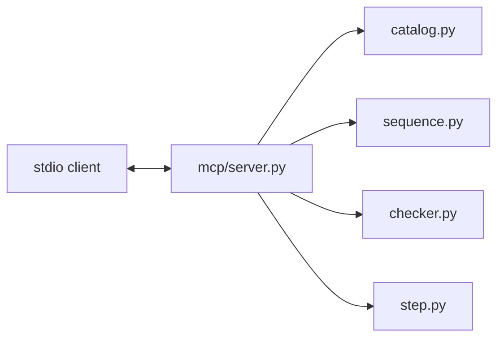
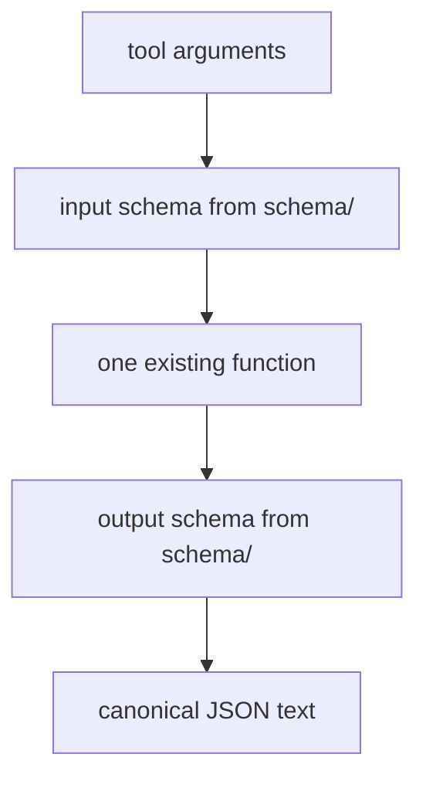

# U6 sketch B: thin MCP adapter

## Summary

`mcp/server.py` speaks MCP on stdio. It validates tool arguments and tool results against the schema documents, and the result JSON is the record those documents already describe.
`patterns_search` and `pattern_get` call `search`, `get`, and `pattern_record` in `catalog.py`. The result is one catalog record, or an array of them.
`language_sequence` calls `sequence` and returns the same JSON array of pattern numbers as `pl sequence`.
`model_check` calls `checker.run` and returns `report_json`.
`model_step` calls `build_step` and returns `step_json`.
The server calls those functions and does not sort, evaluate a condition, read IFC, or compute `preserved`.
A violated check-report, and a step whose `preserved` is false, are successful tool results. The flag is a field in the JSON.
`CatalogLoadError`, `SequenceError`, `CheckError`, `TopologyError`, and `OSError` return as tool errors whose text is that exception's message.
The client test spawns `python mcp/server.py` and calls all five tools. The two model tools use `fixtures/pass-house.ifc` and `fixtures/fail-house.ifc`.
U6 adds no schema file, no `pl` command, no Lean change, and no code under `adapters/blender/`.

## Usage

From the repository root, after U5:

```bash
uv sync
uv run pytest
uv run python scripts/validate_catalog.py
uv run python scripts/catalog_to_lean.py --check
uv run python scripts/make_fixtures.py --check
uv run pl check fixtures/pass-house.ifc --language projects/seed-house.json
uv run pl sequence projects/seed-house.json
uv run python mcp/server.py
cd lean && lake build
```

`pl check`, `pl sequence`, and `pl step` stay the U4 and U5 commands, with the same exits. `uv run python mcp/server.py` is the server. It reads MCP JSON-RPC from stdin and writes MCP JSON-RPC to stdout. It takes no arguments. The catalog root is the current directory. Relative paths inside tool arguments open from that directory. The process serves until the client closes stdin, then exits 0.

Stdout is the protocol stream. The server writes tool JSON only as MCP tool results. A missing schema file at startup prints one stderr line, `schema is missing`, and exits 2, before the protocol starts.

The dependency is the official MCP Python SDK, `mcp>=2.1,<3`, in `[project.dependencies]`. The lockfile changes. The console script stays `pl`.

The client test, and any host, launches the file as a subprocess. The SDK types are `mcp.server.Server`, `mcp.server.stdio.stdio_server`, `mcp.Client`, and `mcp.StdioServerParameters`. The test uses the subprocess client. An in-process client is a different transport, and this unit's check is stdio.

```python
import asyncio
import sys
from pathlib import Path

from mcp import Client, StdioServerParameters

root = Path(".").resolve()
params = StdioServerParameters(
    command=sys.executable,
    args=[str(root / "mcp" / "server.py")],
    cwd=str(root),
)

async def call_each() -> None:
    async with Client(params) as client:
        listed = await client.list_tools()
        assert [tool.name for tool in listed.tools] == [
            "patterns_search",
            "pattern_get",
            "language_sequence",
            "model_check",
            "model_step",
        ]
        found = await client.call_tool("patterns_search", {"name": "Entrance"})
        one = await client.call_tool("pattern_get", {"number": 105})
        order = await client.call_tool(
            "language_sequence", {"project": "projects/seed-house.json"}
        )
        report = await client.call_tool(
            "model_check",
            {
                "model": "fixtures/pass-house.ifc",
                "language": "projects/seed-house.json",
            },
        )
        step = await client.call_tool(
            "model_step",
            {
                "before": "fixtures/pass-house.ifc",
                "after": "fixtures/fail-house.ifc",
                "language": "projects/seed-house.json",
                "pattern": 112,
            },
        )
        assert found.is_error is False
        assert one.is_error is False
        assert order.is_error is False
        assert report.is_error is False
        assert step.is_error is False

asyncio.run(call_each())
```

`command` is the absolute interpreter running the tests, so the child imports the installed `pattern_language` and the installed SDK. `cwd` is the repository root. The v2 stdio client starts the child with a minimal environment; the absolute interpreter still finds its site-packages.

Library calls the server makes, which the tests also call directly and then compare:

```python
from pathlib import Path

from pattern_language.catalog import get, load_catalog, pattern_record, search
from pattern_language.checker import report_json, run
from pattern_language.parameters import load_project
from pattern_language.sequence import sequence
from pattern_language.step import build_step, step_json

root = Path(".").resolve()
catalog = load_catalog(root)
project = load_project(
    root / "projects/seed-house.json",
    schema_path=root / "schema/projects.schema.json",
)
records = [pattern_record(item) for item in search(catalog, name="Entrance")]
assert [item["number"] for item in records] == [110, 112, 130]
assert pattern_record(get(catalog, 105))["name"] == "South Facing Outdoors"
assert list(sequence(catalog, project)) == [
    105, 106, 107, 110, 112, 127, 128, 130, 159, 167, 180, 190,
]
report = run(
    catalog,
    project,
    root / "fixtures/pass-house.ifc",
    model_file="fixtures/pass-house.ifc",
    schema_path=root / "schema/check-report.schema.json",
)
step = build_step(
    catalog,
    project,
    root / "fixtures/pass-house.ifc",
    root / "fixtures/fail-house.ifc",
    pattern=112,
    before_file="fixtures/pass-house.ifc",
    after_file="fixtures/fail-house.ifc",
    schema_path=root / "schema/step.schema.json",
)
assert report_json(report)
assert step_json(step)
```

## Call sites

| Caller | Calls | Role in U6 |
|---|---|---|
| `mcp/server.py` | `search`, `get`, `pattern_record` | Tool results for the two catalog tools. |
| `mcp/server.py` | `load_project`, `sequence` | `language_sequence`. The text is the JSON array. |
| `mcp/server.py` | `load_project`, `run`, `report_json` | `model_check`. The text is `report_json`. |
| `mcp/server.py` | `load_project`, `build_step`, `step_json` | `model_step`. The text is `step_json`. |
| `pattern_language.cli:main` | unchanged | `pl check`, `pl sequence`, `pl step`. The server does not call `main`. |
| `tests/test_mcp.py` | `Client` on stdio | The five tool calls, then the error calls. |
| `tests/test_catalog.py` | `search`, `get`, `pattern_record` | Filters and the record object, without a server. |
| `tests/test_boundaries.py` | AST scan | `server.py` imports neither `ifcopenshell` nor `bpy`. `mcp/__init__.py` is absent. |

`gate.scan` still walks `catalog/` and `projects/` only. The server is a Python file under `mcp/`. It is not a catalog record. U6 adds no schema file and no catalog record.

Each tool call loads the catalog and, when it needs a project, the project file. The server keeps no catalog cache and no session model.





## Wire

The server is `mcp.server.Server("pattern-language", version="0.0.0")`, with `on_list_tools` and `on_call_tool`. `main` runs it inside `mcp.server.stdio.stdio_server`. There is no HTTP listener, no SSE endpoint, and no port flag. `tools/list` returns five tools, in this order, and no resources and no prompts.

| Tool | Input, copied from | Result text |
|---|---|---|
| `patterns_search` | `number`, `name`, and `scale` on `schema/catalog.schema.json` | JSON array of catalog records |
| `pattern_get` | `$defs.patternNumber` | one catalog record |
| `language_sequence` | a project path string | JSON array of pattern numbers |
| `model_check` | `model.file` on `schema/check-report.schema.json`, plus a language path | `report_json` |
| `model_step` | `modelRef.file` and `$defs.patternNumber` on `schema/step.schema.json`, plus a language path | `step_json` |

Descriptions, one line each:

| Tool | Description |
|---|---|
| `patterns_search` | Return catalog records whose number, name, or scale match. |
| `pattern_get` | Return the catalog record for one pattern number. |
| `language_sequence` | Return the project pattern numbers in sequence order. |
| `model_check` | Return the check-report for one IFC model. |
| `model_step` | Return the step record for two IFC models. |

Output schemas are the schema documents. `pattern_get` uses `schema/catalog.schema.json` as its `output_schema`. `model_check` uses `schema/check-report.schema.json`. `model_step` uses `schema/step.schema.json`. The `$schema` keyword stays, so the dialect stays draft 2020-12.

`patterns_search` returns an array. A catalog record's `$ref` values point at `#/$defs/...` on the document root, so the array schema lifts those `$defs` to its own root and puts the record's `type`, `additionalProperties`, `required`, and `properties` on `items`. Property names and constraints are the ones in the file. `language_sequence` is an array whose `items` are the catalog `$defs.patternNumber` object (`integer`, minimum 1, maximum 253). U6 adds no `schema/sequence.schema.json`.

Input objects set `additionalProperties` false. `patterns_search` has no required field. `pattern_get` requires `number`. `language_sequence` requires `project`. `model_check` requires `model` and `language`. `model_step` requires `before`, `after`, `language`, and `pattern`. `language` and `project` are file paths, the same strings the CLI takes. They are not the project id stored on a check-report.

The server validates arguments with the input schema before the call. The SDK rejects an argument that fails that schema, and the handler is not entered. After the call, the server validates the payload with `Draft202012Validator` against the same output schema object. A payload that fails that check is a tool error whose text is `schema rejected the result`. The seed path does not produce that error. `run` and `build_step` already validate against the same files.

A successful result is a `CallToolResult`. `content` is one text block whose text is the canonical JSON: `indent=2`, `sort_keys=True` for objects, one trailing newline. `structured_content` is `json.loads` of that same text. `is_error` is false. For `model_check` the text is the string `report_json` returned. For `model_step` the text is the string `step_json` returned. For `language_sequence` the text is `json.dumps(list(order), indent=2) + "\n"`, the same expression `pl sequence` writes. The server does not build a second report object.

`preserved` false and a report that fails the U4 gate are successes. The handler does not read `preserved` and does not call `fails_gate`. The CLI's exit 1 stays a CLI exit. On the wire the JSON is the result.

A tool error is a `CallToolResult` with `is_error` true, one text block whose text is `str(exc)`, and no structured content. The handler returns that result. It does not re-raise, so the SDK does not replace the message. The caught types are `CatalogLoadError`, `SequenceError`, `CheckError`, `TopologyError`, and `OSError`. An unknown tool name returns `unknown tool`.

Path rule, the same expression as the CLI, written in the server so the server does not import `cli`:

```python
def _path(raw: str) -> Path:
    path = Path(raw)
    if path.is_absolute():
        return path
    return Path.cwd() / path
```

`model`, `before`, and `after` are stored on the result with backslashes replaced by slashes, unresolved. `model_file`, `before_file`, and `after_file` receive that string. The opened path is `_path` of the argument.

The directory `mcp/` and the SDK distribution `mcp` share a name. U6 does not add `mcp/__init__.py`. The server runs as a file, `python mcp/server.py`, so `import mcp` inside that process is the installed SDK. The test imports the SDK client and spawns the file. It does not import `mcp.server` from the repository. Hatchling keeps installing `pattern_language` from `src/`. The `mcp/` directory is not a package.

## Data shapes

U6 adds no geometry and no Lean definition. The five results are records U1 through U5 already store.

### patterns_search

`search` walks `catalog.patterns`, which `load_catalog` already sorts by number. `number` and `scale` match exactly. `name` is a case-insensitive substring of `Pattern.name`. Filters combine by and. An empty argument object returns every pattern.

`name` `"Entrance"` on the seed catalog returns three records, in this order: 110 Main Entrance, 112 Entrance Transition, 130 Entrance Room. `name` `"entrance"` returns the same three. `number` 105 and `name` `"Entrance"` together return an empty array. `scale` `"town"` returns an empty array. `scale` `"building"` returns the twelve. An empty array is a successful result.

`scale` `"room"` and `number` 0 fail the input schema. The handler is not called.

Each element is `pattern_record` of that pattern. The object validates against `schema/catalog.schema.json`. `path` is not a field of that schema and is absent. A computed condition carries `id`, `kind`, `check`, and `params`. A judged condition carries `id`, `kind`, and `question`.

### pattern_get

`get(catalog, 105)` is 105 South Facing Outdoors. The tool text parses to `pattern_record` of that pattern. `confidence` is 2. The condition id is `south-facing-outdoors`.

`get(catalog, 200)` raises `CatalogLoadError` with `missing pattern: 200`. The tool result has `is_error` true and that text.

110 Main Entrance and 180 Window Place are catalog records with a judged condition. `pattern_get` returns the record. It does not answer the question.

### language_sequence

The argument `project` is `projects/seed-house.json`. The text is:

```json
[
  105,
  106,
  107,
  110,
  112,
  127,
  128,
  130,
  159,
  167,
  180,
  190
]
```

That is `numericOrder` in `lean/PatternLanguage/Instantiations/Buildings.lean`, the list `pl sequence` prints. The server does not call `order_ok` or `smaller_edges`. `sequence` does.

A project that lists 200 raises `SequenceError` with `missing pattern: 200`. A selection whose ascending order fails `order_ok` raises `SequenceError` with `sequence is not valid`. Both are tool errors.

### model_check

`model` `fixtures/pass-house.ifc` and `language` `projects/seed-house.json` return the U4 pass report. `project` is `seed-house`. `model.file` is `fixtures/pass-house.ifc`. `satisfied` is 105, 106, 107, 112, 127, 128, 130, 159, 167, 190. 110 Main Entrance and 180 Window Place are `needs_judgment` in `instances` and are absent from `satisfied`. `is_error` is false. The text equals `report_json` of the same `run` call.

The fail house returns a report whose `satisfied` is empty. `is_error` is false. The CLI exits 1 for that file. The tool returns the report.

A missing file raises `CheckError` or `OSError` and is a tool error. The text is that exception's message.

### model_step

Pass house then fail house, `pattern` 112, returns the U5 step. `pattern` is 112. `preserved` is false. `satisfied_before` is the ten computed numbers. `satisfied_after` is empty. 105 South Facing Outdoors is in `satisfied_before` and absent from `satisfied_after`. 110 and 180 are in neither list. The text equals `step_json` of the same `build_step` call. `is_error` is false. The CLI exits 1 for this pair.

The pass house twice, `pattern` 105, returns a step with `preserved` true and equal sha256 fields. `is_error` is false.

`pattern` 99 raises `SequenceError` with `pattern is not in language: 99`. That is a tool error. `pattern` 110 on the pass house twice returns `preserved` true, and 110 is in neither satisfied list.

## Module map

```text
mcp/server.py                         stdio, five tools, schema documents in and out
src/pattern_language/catalog.py       search, get, pattern_record
src/pattern_language/sequence.py      unchanged
src/pattern_language/checker.py       unchanged
src/pattern_language/step.py          unchanged
src/pattern_language/cli.py           unchanged
schema/                               the five documents, unchanged
pyproject.toml                        dependency mcp>=2.1,<3
uv.lock                               locked with that dependency
tests/test_catalog.py                 search, get, and the record object
tests/test_mcp.py                     stdio client, five tools, two houses
tests/test_boundaries.py              no mcp package init, no bpy, five schemas
```

U6 adds those three functions to `catalog.py` and adds `mcp/server.py`. It does not add a module under `src/pattern_language/`. It does not add a tool class, a session cache, or a second checker.

`server.py` imports `load_catalog`, `search`, `get`, `pattern_record`, and `CatalogLoadError` from `catalog`; `load_project` from `parameters`; `sequence` and `SequenceError` from `sequence`; `run` and `report_json` from `checker`; `build_step` and `step_json` from `step`; `CheckError` from `conditions.evidence`; `TopologyError` from `topology`. The only name it takes from `topology` is `TopologyError`. It imports the SDK. It does not import `cli`, `bpy`, `ifcopenshell`, or `conditions.registry`.

`ifcopenshell` stays inside `read_ifc` and `write_ifc`. `model_check` and `model_step` reach it only because `run` calls `read_topology`. `import pattern_language.sequence` still leaves `checker` unloaded.

No new Lean file. `lake-manifest.json` keeps `packages` empty. `adapters/blender/` stays empty.

When this unit is implemented, `docs/design/DESIGN.md` gains a U6 paragraph and `AGENTS.md` lists `mcp/server.py` and the client test. This sketch does not edit those files.

## Signatures

```python
def search(
    catalog: Catalog,
    *,
    number: int | None = None,
    name: str | None = None,
    scale: str | None = None,
) -> tuple[Pattern, ...]:
    """Patterns whose fields match every provided filter.

    number and scale are exact. name is a case-insensitive substring
    of Pattern.name. An empty filter returns catalog.patterns.
    """


def get(catalog: Catalog, number: int) -> Pattern:
    """Return the pattern with this number.

    Raise CatalogLoadError with ``missing pattern: N`` when the number
    is absent.
    """


def pattern_record(pattern: Pattern) -> dict[str, Any]:
    """The catalog schema object for this pattern.

    Omits path. A condition omits check, params, and question when
    the value is None.
    """
```

`pattern_record` copies `number`, `name`, `scale`, `confidence`, `larger`, `smaller`, `summary`, `forces`, `conditions`, and `source`. `larger` and `smaller` are lists in stored order. `summary` is `text` and `draft`. Each force is `name` and `draft`. `source` is `book` and `number`. Condition `params` is a plain dict.

```python
def main() -> None:
    """Serve the five tools on stdio until the client closes stdin."""
```

```python
def _array_of(record_schema: dict[str, Any]) -> dict[str, Any]:
    """An array schema whose items are one record schema.

    $defs move to the root so the record's #/$defs refs still resolve.
    properties, required, and additionalProperties are copied.
    """
```

```python
async def _call(name: str, arguments: dict[str, Any]) -> CallToolResult:
    """Dispatch one tool name to one function and wrap the JSON.

    A known name that raises CatalogLoadError, SequenceError,
    CheckError, TopologyError, or OSError returns is_error true.
    preserved false returns is_error false.
    """
```

The five handlers are the five rows in the call-site table. Each one loads, calls one function, and returns. `patterns_search` calls `search` and then `pattern_record` on each hit. `pattern_get` calls `get` and then `pattern_record`.

## Tests

`tests/test_catalog.py`

- `pattern_record(get(catalog, 105))` equals `json.loads` of `catalog/105-south-facing-outdoors.json`. The name is South Facing Outdoors. The condition has `check` and `params` and has no `question`.
- `pattern_record(get(catalog, 110))` equals `json.loads` of `catalog/110-main-entrance.json`. The condition has `question` and has no `check` or `params`.
- `Draft202012Validator` accepts both objects against `schema/catalog.schema.json`.
- `search(catalog, name="Entrance")` returns numbers 110, 112, 130. `search(catalog, name="entrance")` returns the same numbers.
- `search(catalog, number=105, name="Entrance")` is empty. `search(catalog, scale="town")` is empty. `search(catalog)` returns the twelve numbers in order.
- `get(catalog, 200)` raises `CatalogLoadError` and `str(exc)` is `missing pattern: 200`.

`tests/test_mcp.py`

One stdio session, cwd the repository root, command `sys.executable`, args the absolute path of `mcp/server.py`.

- `list_tools` returns the five names in the order above. `pattern_get`'s `output_schema` equals `schema/catalog.schema.json` parsed. `model_check`'s equals `schema/check-report.schema.json` parsed. `model_step`'s equals `schema/step.schema.json` parsed.
- `patterns_search` with `name` `"Entrance"` has `is_error` false. The text parses to three records, numbers 110, 112, 130, names Main Entrance, Entrance Transition, and Entrance Room. Each record validates against `schema/catalog.schema.json`.
- `pattern_get` with `number` 105 has `is_error` false. The text parses to `pattern_record` of 105 South Facing Outdoors and validates against the catalog schema.
- `language_sequence` with `project` `projects/seed-house.json` has `is_error` false. The text equals `json.dumps(list(sequence(catalog, project)), indent=2) + "\n"`.
- `model_check` with `fixtures/pass-house.ifc` and `projects/seed-house.json` has `is_error` false. The text equals `report_json` of the direct `run` call. `satisfied` is the ten computed numbers. 110 and 180 are absent from `satisfied`.
- `model_check` with `fixtures/fail-house.ifc` has `is_error` false and `satisfied` `[]`.
- `model_step` with the pass house, the fail house, and `pattern` 112 has `is_error` false. The text equals `step_json` of the direct `build_step` call. `preserved` is false. 105 is in `satisfied_before` and absent from `satisfied_after`.
- `model_step` with the pass house twice and `pattern` 105 has `is_error` false and `preserved` true.
- `pattern_get` with `number` 200 has `is_error` true and text `missing pattern: 200`.
- `model_step` with `pattern` 99 has `is_error` true and text `pattern is not in language: 99`.
- `pattern_get` with `number` 0 has `is_error` true, and the text is the SDK's input-schema failure. The catalog is not asked for pattern 0.

The test reads the text block. It compares parsed JSON to the library functions, so a server that recomputes a report in its own shape fails.

`tests/test_boundaries.py`

- The existing `ifcopenshell` and `bpy` scan still passes with `mcp/server.py` on disk.
- `mcp/__init__.py` is absent.
- An AST walk of `mcp/server.py` finds no call to `read_ifc`, `write_ifc`, `read_topology`, `CHECKS`, `order_ok`, `smaller_edges`, `preserving`, `fails_gate`, or `main`.
- The five schema files stay the five. The console script stays `pl = "pattern_language.cli:main"`.
- `sequence.py` still imports neither `checker` nor `ifcopenshell`.

## Rationale

The behavior U6 exposes is already shipped. `sequence` returns the list Lean decided. `run` returns the check-report. `build_step` returns the step. `report_json` and `step_json` are the canonical documents. A server that calls those functions and puts their JSON on the wire cannot drift from `pl check`, `pl sequence`, or `pl step`. The client test compares the tool text to those functions, so a second implementation of preservation or of the sequence fails the test.

Search and lookup have no function yet. They are catalog questions, so they live in `catalog.py`. `pattern_record` is the inverse of `_pattern_from_object`: the schema object, without the path the loader keeps for itself. The server then has nothing to assemble except a JSON array of objects the catalog already built.

The output schema is the document in `schema/`, not a type annotation. `pattern_get`, `model_check`, and `model_step` use the files as the tool schema. Search returns many records, and those records' `$ref`s are written for a document root, so the array schema lifts `$defs` and leaves the properties untouched. Sequence has no schema file. Its items are the `patternNumber` definition the catalog and the step schema already share. The low-level `Server` is what accepts those documents as `output_schema`. Decorator registration would build a different schema from annotations, and this unit does not use it.

Stdio is the transport a host uses for a local server. The unit check spawns the file. That also keeps the repository directory `mcp/` from shadowing the SDK: the test never imports the script as a package, and the script's own process imports the installed `mcp`.

Exit codes stay on the CLI. A failed preservation is a true step record; the agent has to read `preserved`. Mapping that to a tool error would hide the satisfied lists. The same holds for a violated check-report. Load failures stay tool errors, and the text is the line the CLI already prints.

U7 is the Blender adapter. U6 does not import `bpy` and does not edit a model.

## CI

`.github/workflows/ci.yml` gains no step. The server blocks on stdin, so a workflow step that launches it would hang. `uv run pytest` is the client test. `uv sync --frozen` installs `mcp` from the updated lock.

| Step | U6 result |
|---|---|
| `uv sync --frozen` | Lock includes `mcp` 2.x. |
| `uv run pytest` | The stdio client calls all five tools. Pass then fail returns `preserved` false with `is_error` false. |
| `validate_catalog.py` | `back-edges: 0` and `ok: 13 records`. |
| `catalog_to_lean.py --check` | Unchanged. |
| `pl check` on `fixtures/pass-house.ifc` | Unchanged. Exit 0. |
| `pl sequence` on `projects/seed-house.json` | Unchanged. Exit 0. |
| `lake build` | Unchanged. |

Done for U6: a stdio client calls `patterns_search`, `pattern_get`, `language_sequence`, `model_check`, and `model_step`. Search returns 110 Main Entrance, 112 Entrance Transition, and 130 Entrance Room. `pattern_get` of 105 returns South Facing Outdoors. The sequence is the twelve-number list. The pass house returns a check-report whose ten computed patterns are satisfied. The pass house then the fail house returns a step with `preserved` false.
