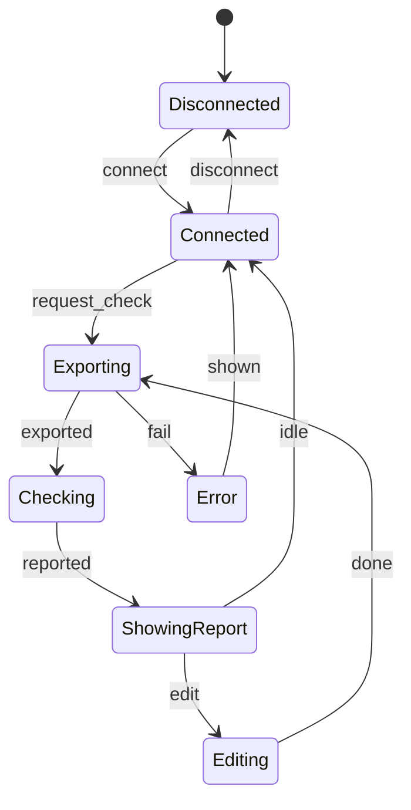

# U7 candidate A — add-on skeleton, fixture replay

U7 adds a Blender add-on skeleton, a session-state stub, and a fixture replay that writes `runs/seed-house/`.
The merge check is `scripts/record_run.py --check`: twelve steps, in seed sequence order, each from `pl step` on `fixtures/pass-house.ifc` twice, each log holding that step and the pass-house check-report, every `preserved` true.
The final report lists satisfied 105, 106, 107, 112, 127, 128, 130, 159, 167, and 190. 110 Main Entrance and 180 Window Place stay `needs_judgment` and stay out of `satisfied`.
The replay's model is the existing pass house on both sides of every step, the same pair `pl step` already exits 0 on.
Live Blender is gated. `blender` is absent on this machine, and CI's `ubuntu-latest` job installs only the uv lock, so the add-on is loaded by no test here.
`bpy` may be imported only under `adapters/blender/`. The record script, the core, and `mcp/server.py` stay clear of it.
The bridge stub is the §2.5 state names and their transitions as data. `connect` is the one transition a test drives. Export, Bonsai, and the panel's report stay unwired.
This unit adds no schema, no Lean edit, no `pl` command, and no MCP tool.
A person with Blender 4.x and Bonsai follows the live path in `adapters/blender/README.md`. That path is specified. It is outside the merge check.
Cite pattern numbers and names only.

## What the check is

§3.3 asks for a recorded run: an agent builds a small house in Blender, following the twelve-pattern sequence, every step logged with its report, and no step `preserved: false` at the end.

This environment cannot run that sentence. There is no `blender` binary here, Bonsai is not installed, and `.github/workflows/ci.yml` never installs either. A test that launches Blender would fail the merge for a missing program, which is the wrong failure.

The merge check is the fixture replay below. It logs twelve preserving steps and the pass-house report under `runs/`. The live session in §2.5 is drawn, stubbed, and documented. It is a gated check: a person runs it on a machine that has Blender 4.x and Bonsai. U7 does not claim that session happened.

The replay proves three things the unit can prove from files already in the repo:

- The seed order is the list `pl sequence projects/seed-house.json` prints.
- Each of those twelve numbers can be the `pattern` of a `pl step` whose before and after are `fixtures/pass-house.ifc`, and each of those steps has `preserved` true.
- `pl check` on that house reports the ten computed patterns satisfied, with 110 and 180 unanswered.

The replay leaves one thing unproved: a Blender edit that introduces one pattern per step. Both IFC arguments are the finished pass house, so `satisfied_before` and `satisfied_after` are the same ten numbers on every step, including the steps for 110 and 180. The log field `mode` is `fixture-replay` so that limit is visible in the artifact.

Pass house then fail house stays the U5 witness for `preserved` false. The replay never calls that pair, and it never writes it under `runs/`.

## Usage

From the repo root:

```bash
uv run python scripts/record_run.py
uv run python scripts/record_run.py --check
```

The default command writes `runs/seed-house/` and exits 0 when every step returns 0 from `pl step`. `--check` writes the same tree in a temporary directory, compares it to the committed `runs/seed-house/`, and exits 1 on any difference. `--check` leaves the worktree alone. An extra `--out` is ignored when `--check` is present.

The script resolves the repo root as the parent of `scripts/`, changes to that directory, and calls `pattern_language.cli.main`. Relative paths stay relative, so `model.file`, `before.file`, and `after.file` are `fixtures/pass-house.ifc`. Stdout and stderr of each `main` call are redirected to buffers. The process exit is the return value.

One sequence call:

```text
sequence projects/seed-house.json --root .
```

Stdout is the JSON array of twelve numbers. The script exits 2 when that call returns anything other than 0.

One check call:

```text
check fixtures/pass-house.ifc --language projects/seed-house.json --root .
```

Exit 0. The buffer is the check-report. The script exits 1 when the call returns anything other than 0.

Twelve step calls, one per number in that array, in that order:

```text
step fixtures/pass-house.ifc fixtures/pass-house.ifc --language projects/seed-house.json --pattern <n> --root .
```

Exit 0 on each. Exit 1 from `pl step` means `preserved` is false. The script then exits 1 and deletes the output directory it started. Exit 2 is a usage or load error, and the script exits 2 the same way.

Library the CLI is already calling, unchanged:

```python
from pattern_language.cli import main

main(["sequence", "projects/seed-house.json", "--root", "."])
main([
    "check",
    "fixtures/pass-house.ifc",
    "--language",
    "projects/seed-house.json",
    "--root",
    ".",
])
main([
    "step",
    "fixtures/pass-house.ifc",
    "fixtures/pass-house.ifc",
    "--language",
    "projects/seed-house.json",
    "--pattern",
    "105",
    "--root",
    ".",
])
```

## Run log

`runs/` is a log directory. The gate scans `catalog/` and `projects/` only, so these files are outside the schema map. There is no sixth schema. Each logged `step` object is validated against `schema/step.schema.json`. Each logged `report` object is validated against `schema/check-report.schema.json`.

`runs/seed-house/manifest.json`:

```json
{
  "final_report": "report.json",
  "final_satisfied": [105, 106, 107, 112, 127, 128, 130, 159, 167, 190],
  "mode": "fixture-replay",
  "model": "fixtures/pass-house.ifc",
  "project": "seed-house",
  "sequence": [105, 106, 107, 110, 112, 127, 128, 130, 159, 167, 180, 190]
}
```

`runs/seed-house/report.json` is the `pl check` document, keys sorted, indented two spaces, one trailing newline.

`runs/seed-house/steps/01-105.json` through `steps/12-190.json`, index padded to two digits:

```json
{
  "index": 1,
  "mode": "fixture-replay",
  "name": "South Facing Outdoors",
  "pattern": 105,
  "report": {},
  "step": {}
}
```

`report` is the same object as `report.json` on every step, because every after-model is the pass house. `step` is `json.loads` of that call's `pl step` stdout. `name` comes from the catalog record. The wrapper is `json.dumps(..., indent=2, sort_keys=True)` plus one trailing newline. No timestamp, so `--check` is stable for a given fixture hash.

The twelve names, in order: 105 South Facing Outdoors, 106 Positive Outdoor Space, 107 Wings of Light, 110 Main Entrance, 112 Entrance Transition, 127 Intimacy Gradient, 128 Indoor Sunlight, 130 Entrance Room, 159 Light on Two Sides of Every Room, 167 Six-Foot Balcony, 180 Window Place, 190 Ceiling Height Variety.

On every step file:

- `step.pattern` equals `pattern`.
- `step.preserved` is true.
- `step.before.file` and `step.after.file` are `fixtures/pass-house.ifc`.
- `step.before.sha256` equals `step.after.sha256`.
- `step.satisfied_before` and `step.satisfied_after` equal `final_satisfied`.
- `report.project` is `seed-house`.
- `report.satisfied` equals `final_satisfied`.
- The instance for 110 has status `needs_judgment` and unanswered evidence. The instance for 180 is the same.

`preserving` ignores a selected pattern that is absent from `satisfied_before`. 110 and 180 are absent on the pass house, so their steps stay `preserved` true. They stay out of `final_satisfied`.

## Add-on skeleton

`adapters/blender/.gitkeep` goes away. The directory is a Blender add-on folder: `bl_info` lives in its `__init__.py`. There is no `adapters/__init__.py`. Hatch stays on the `src/` layout. The core package does not gain a dependency on the add-on.

| File | Role |
|---|---|
| `adapters/blender/__init__.py` | `bl_info`, `register`, `unregister`. |
| `adapters/blender/panel.py` | One sidebar panel. Draws a fixed label. |
| `adapters/blender/export_ifc.py` | `export_ifc(path)`. Raises. |
| `adapters/blender/bridge.py` | §2.5 states and transitions. No `bpy`. |
| `adapters/blender/README.md` | The live path a person runs. |

`bl_info` names the add-on `Pattern Language`, sets `blender` to `(4, 0, 0)`, `location` to `View3D > Sidebar > Pattern Language`, and `category` to `Scene`. Version is `(0, 0, 1)`.

`register` and `unregister` import `bpy` inside the function, then import `.panel`, then call `bpy.utils.register_class` or `unregister_class` on `PL_PT_report`. The module body of `__init__.py` does not import `bpy`. Importing `bridge.py` by file path does not execute `register`.

`panel.py` imports `bpy` at module level, because a Panel subclass is a `bpy.types.Panel`. `bl_idname` is `PL_PT_report`, `bl_space_type` is `VIEW_3D`, `bl_region_type` is `UI`, `bl_category` is `Pattern Language`. `draw` writes the label `Pattern language` and the line `report unavailable`. It does not read `runs/`, call `pl`, or import `pattern_language`.

`export_ifc.py` defines `export_ifc(path: str) -> None`. The body imports `bpy` and raises `RuntimeError("Bonsai export is not wired")`. The operator Bonsai uses to write IFC is chosen when a person wires the live path. This unit does not call one, and it does not vendor Bonsai.

## Bridge stub

§3.1 says to look at an existing Blender MCP add-on, such as blender-mcp, before writing a bridge. U7 leaves that add-on outside the repo. A socket server would sit open the way U6 refused to launch `mcp/server.py` inside CI, and the merge check does not need it. The five U6 tools remain how an agent reads the catalog, the sequence, a check-report, and a step. The stub adds no sixth tool.

`bridge.py` imports neither `bpy` nor `pattern_language`. It holds the §2.5 names and the transitions between them:

| From | Event | To |
|---|---|---|
| `Disconnected` | `connect` | `Connected` |
| `Connected` | `request_check` | `Exporting` |
| `Exporting` | `exported` | `Checking` |
| `Exporting` | `fail` | `Error` |
| `Checking` | `reported` | `ShowingReport` |
| `ShowingReport` | `edit` | `Editing` |
| `Editing` | `done` | `Exporting` |
| `ShowingReport` | `idle` | `Connected` |
| `Error` | `shown` | `Connected` |
| `Connected` | `disconnect` | `Disconnected` |

```python
class Session:
    state: str = "Disconnected"

    def act(self, event: str) -> str:
        """Return the next state. Raise KeyError on a pair the table omits."""
```

`act` changes `state` and returns it. It writes no file and opens no socket. A test loads `bridge.py` with `importlib` under the module name `pattern_language_blender_bridge`, calls `connect`, and reads `Connected`. A second call with `request_check` reads `Exporting`. An unknown pair raises `KeyError`. The test never imports `panel.py` or `export_ifc.py`.

The string machine is the whole bridge in this unit. `Exporting` does not call `export_ifc`. `Checking` does not call `pl check`. `ShowingReport` does not fill the panel. Those three effects are the live path.



## Live path

`adapters/blender/README.md` is the gated check. It states the prerequisites a person installs: Blender 4.x, the Bonsai add-on, and this repo's `uv` environment so `pl` is on `PATH`. CI does not install them. The README tells the person to install the add-on from the `adapters/blender` folder and enable Pattern Language. Enabling it runs `register` and shows the panel. The panel reads `report unavailable` until a later unit hands it a report path.

The README then gives the commands that already exist, pointed at an IFC the person exported from Bonsai by hand:

```bash
uv run pl sequence projects/seed-house.json
uv run pl check path/to/export.ifc --language projects/seed-house.json
uv run pl step path/to/previous.ifc path/to/export.ifc --language projects/seed-house.json --pattern 105
```

That is the live shape of §2.5 once export exists: the scene becomes an IFC, `pl check` is Checking, the report is what the panel will show, and the next edit is a new export. U7 stops before the Bonsai call. `export_ifc` raises so a mistaken live call fails in one line.

An incremental Blender build, one pattern at a time from an empty scene, needs intermediate IFC that this repo does not have. The pass house already satisfies all ten computed patterns. The fail house satisfies none. Neither file is a prefix of the sequence. Building those prefixes is the live work, and it waits on Blender.

## Tests

`tests/test_record_run.py` runs `scripts/record_run.py --check` as a subprocess with the repo as the working directory. Exit 0. The committed `runs/seed-house/` is part of that assertion, because `--check` diffs against it.

The same file also loads the committed log and checks the invariants in the run-log section, so a diff failure names the broken field. It validates every `step` and every `report` with `Draft202012Validator` and the two existing schemas. It asserts the twelve file names are `01-105.json` through `12-190.json`.

`tests/test_boundaries.py` changes `test_import_boundary_forbids_ifcopenshell_and_bpy`. A `bpy` import is an offender when the file path does not start with `adapters/blender/`. An `ifcopenshell` import stays an offender outside `read_ifc` and `write_ifc` in `src/pattern_language/topology.py`. A new subprocess assertion imports `pattern_language.cli` and `scripts/record_run.py` and asserts `bpy` is absent from `sys.modules`. The import of `bridge.py` by file path gets the same assertion.

`test_ci_workflow_covers_gate_and_lean` gains one string: `uv run python scripts/record_run.py --check`.

`test_u4_pl_check_is_the_only_command` stays. `[project.scripts]` stays `pl` alone. `schema/` stays the five documents. `catalog_to_lean.py --check` stays green. The two houses stay. `mcp/server.py` stays the five tools.

## Module map

```text
adapters/blender/__init__.py          bl_info, register, unregister
adapters/blender/panel.py             PL_PT_report
adapters/blender/export_ifc.py        export_ifc raises
adapters/blender/bridge.py            Session.act over the §2.5 table
adapters/blender/README.md            gated live path
scripts/record_run.py                 pl sequence, pl check, pl step; writes runs/
runs/seed-house/manifest.json         sequence, mode, final satisfied
runs/seed-house/report.json           pl check of the pass house
runs/seed-house/steps/01-105.json     first step through
runs/seed-house/steps/12-190.json     last step
tests/test_record_run.py              --check and the log invariants
tests/test_boundaries.py              bpy only under adapters/blender/
.github/workflows/ci.yml              the --check line
README.md                             U7 paragraph
AGENTS.md                             blender row, U7 section
docs/design/DESIGN.md                 U7 section, adapters paragraph
```

Unchanged: `cli.py`, `catalog.py`, `checker.py`, `sequence.py`, `step.py`, `conditions/`, `topology.py`, `mcp/server.py`, the twelve catalog files, `projects/seed-house.json`, both IFC fixtures, `schema/`, `lean/`, `pyproject.toml` dependencies, `[project.scripts]`.

Docs the implementer updates, in place:

- `README.md` — a U7 section: the replay command, the committed `runs/seed-house/` log, and the sentence that live Blender is the README under `adapters/blender/`.
- `AGENTS.md` — `adapters/blender/` holds the add-on skeleton and the bridge stub. `scripts/record_run.py` writes the fixture replay. The done-when line is `--check` plus the gated live path. The command block gains `uv run python scripts/record_run.py --check`.
- `docs/design/DESIGN.md` — a U7 section after U6: skeleton, stub, fixture replay, `runs/seed-house/`, no `preserved` false in that log, live Blender gated. The adapters paragraph says `bpy` imports live only under `adapters/blender/`.

## Rationale

- §2.2 gives `adapters/blender` one job: an add-on that exports through Bonsai, runs the checker, shows a report, and bridges an agent. The skeleton is the add-on and the panel. The export function is the Bonsai slot, left raising. The checker stays `pl check`. The bridge is `Session` and the five U6 tools an agent already has.
- §2.5 is the session. Encoding it as a transition table lets a test walk `connect` without Blender. The effects on the arrows that touch the scene stay in the README.
- §3.3's done-when needs a log under `runs/` and a final report with no broken earlier pattern. `runs/seed-house/` is that log. Every committed step has `preserved` true, and the final satisfied list is the ten computed patterns. The pass house is the model that `pl check` already accepts with exit 0.
- Calling `cli.main` keeps the replay on `pl sequence`, `pl check`, and `pl step`. The script adds no second implementation of order or preservation.
- `bpy` at module level in `panel.py`, and inside `register`, `unregister`, and `export_ifc`, is the boundary §2.2 states. The AST scan learns that prefix and keeps rejecting `bpy` everywhere else. The record script never imports the add-on package, so pytest collects cleanly on a machine with no Blender.

## CI impact

`.github/workflows/ci.yml` gains one step after `pl sequence`:

```bash
uv run python scripts/record_run.py --check
```

`uv sync --frozen` is unchanged. The job does not install Blender or Bonsai.

| Check | U7 result |
|---|---|
| `uv run pytest` | `test_record_run.py` passes on the committed log. The boundary scan allows `bpy` only under `adapters/blender/`. |
| `record_run.py --check` | Exit 0. Twelve steps, each `preserved` true. Final satisfied list is the ten computed numbers. |
| `pl check` on the pass house | Unchanged, exit 0. |
| `pl sequence` on the seed | Unchanged, exit 0. |
| `pl step` pass then fail | Unchanged, exit 1, `preserved` false. Stays out of `runs/`. |
| `validate_catalog.py` | `back-edges: 0` and `ok: 13 records`. |
| `catalog_to_lean.py --check` | Unchanged. |
| `lake build` | Unchanged. |
| Import boundary | `ifcopenshell` still appears only inside `read_ifc` and `write_ifc`. `bpy` appears only under `adapters/blender/`. |

## What this unit leaves

A live session that exports IFC from Bonsai, fills the panel with a real report, and edits the scene once per pattern. The transition table already names those states. The functions that would perform them raise or draw a fixed label.

Intermediate houses, one prefix of the sequence each, are how a later run would show `satisfied` growing. This unit has the empty-of-growth pass house and the fail house.

Judgment evidence for 110 Main Entrance and 180 Window Place stays unanswered. The replay logs them as steps and leaves them out of `satisfied`.

blender-mcp, a socket inside Blender, and a sixth MCP tool stay out. An agent that can already call `language_sequence`, `model_check`, and `model_step` can read this run. It cannot yet drive the scene.
