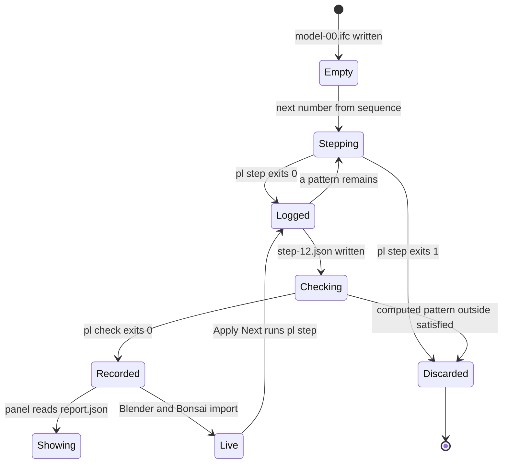
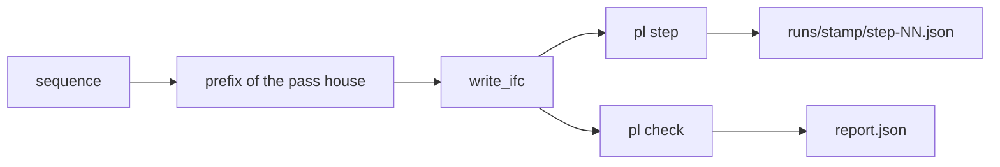

# U7 sketch B: run ledger

## Summary

A run is the directory `runs/<YYYYMMDDTHHMMSSZ>/`. It holds thirteen IFC snapshots and the JSON `pl step` and `pl check` already write.
`scripts/drive_run.py` walks the seed sequence, writes `model-00.ifc` through `model-12.ifc`, and logs each pair as `step-01.json` through `step-12.json`.
Each step file is that command's stdout. `--pattern` is the sequence number. The command exits 0.
`report.json` is `pl check` on `model-12.ifc` with the seed project. That command exits 0.
The ten computed patterns are `satisfied`. 110 Main Entrance and 180 Window Place are `needs_judgment` and are absent from `satisfied`.
Every logged step has `preserved` true. A step that exits 1 deletes the directory, and the driver exits 1.
Each snapshot is a prefix of the pass house, satisfied sets only grow, and `model-12.ifc` reads back as that house.
The Blender panel draws the newest `report.json`.
When Blender and Bonsai are present, the bridge loads the next snapshot and appends a step with the same `pl step` command. CI runs the driver and does not launch Blender.
U7 adds no schema, no Lean file, and no `pl` command. `bpy` stays under `adapters/blender/`.

## Usage

From the repository root, after U6:

```bash
uv sync
uv run pytest
uv run python scripts/validate_catalog.py
uv run python scripts/catalog_to_lean.py --check
uv run python scripts/make_fixtures.py --check
uv run pl check fixtures/pass-house.ifc --language projects/seed-house.json
uv run pl sequence projects/seed-house.json
uv run python scripts/drive_run.py --check
uv run python scripts/drive_run.py
cd lean && lake build
```

`pl check`, `pl sequence`, and `pl step` stay the U4, U5, and U6 commands, with the same exits. `drive_run.py` is a script. It is not a `pl` subcommand. `pl` with an unknown command still exits 2 with `unknown command`.

`uv run python scripts/drive_run.py` creates `runs/<YYYYMMDDTHHMMSSZ>/` under the current directory. The stamp is UTC. A directory of that name already present exits 2 with `run exists`. The process writes `model-00.ifc` first, then twelve steps. Each step is one subprocess:

```text
python -m pattern_language.cli step model-00.ifc model-01.ifc \
  --language <repo>/projects/seed-house.json --pattern 105 \
  --out step-01.json --root <repo>
```

The subprocess cwd is the run directory. `--pattern` is the next number from `sequence` on `projects/seed-house.json`. The stdout of that process is the bytes in `step-NN.json`. Exit 0 keeps the file. Exit 1 deletes the run directory and the driver exits 1. Exit 2 deletes the run directory and the driver exits 2.

After step 12 the driver runs:

```text
python -m pattern_language.cli check model-12.ifc \
  --language <repo>/projects/seed-house.json \
  --out report.json --root <repo>
```

Exit 0 leaves `report.json`. Exit 1 deletes the run directory and the driver exits 1.

`uv run python scripts/drive_run.py --check` does the same write under a temporary directory, asserts the contract below, and exits 0. It does not write into `runs/`.

The equivalent library call, which the script and the tests share:

```python
from pathlib import Path

from pattern_language.runs import record_run

run = record_run(Path("runs/20261119T090000Z"), root=Path(".").resolve())
assert (run / "step-12.json").is_file()
assert (run / "report.json").is_file()
```

A person who has Blender 4.x and Bonsai enabled installs `adapters/blender/` as an add-on. The 3D View sidebar category Pattern Language draws the newest `report.json`. The operator Apply Next writes the next snapshot, runs the same `pl step`, and asks Bonsai to open the new IFC. CI does not install the add-on and does not import `bpy`.

## Call sites

| Caller | Calls | Role in U7 |
|---|---|---|
| `scripts/drive_run.py` | `record_run` | One ledger under `runs/<stamp>/`, or `--check` in a temporary directory. |
| `runs.record_run` | `sequence`, `prefix`, `write_ifc`, `cli.main` | Thirteen IFC files, twelve `pl step` writes, one `pl check`. |
| `pattern_language.cli:main` | unchanged | `pl step` writes `step-NN.json`. `pl check` writes `report.json`. |
| `topology.prefix` | the pass-house space and opening tables | One coordinate table. `_pass_house` calls `prefix` with every name. |
| `adapters/blender/panel.py` | `latest_report`, `report_lines` | Draws the newest check-report. Imports `bpy`. |
| `adapters/blender/bridge.py` | `record_step`, Bonsai load | One live step when Blender and Bonsai are present. |
| `tests/test_run.py` | `record_run` | Twelve steps, monotonic `satisfied`, final report, pass-house graph. |
| `tests/test_boundaries.py` | AST scan | `bpy` only under `adapters/blender/`. `ifcopenshell` still only in `read_ifc` and `write_ifc`. |

`gate.scan` still walks `catalog/` and `projects/` only. A run directory is not a record root. U7 adds no schema file and no catalog record. `validate_catalog.py` still prints `back-edges: 0` and `ok: 13 records`.

`record_run` reaches `ifcopenshell` only because `write_ifc` imports it inside the function. `pl step` reaches it only because `build_step` calls `checker.run`, which calls `read_topology`. `runs.py` does not import `ifcopenshell`, `bpy`, `checker`, or `step`. Preservation stays inside `pl step`.





## Data shapes

U7 adds no schema and no Lean definition. `step-NN.json` is a step record. `report.json` is a check-report. The directory is the run.

### Directory

```text
runs/20261119T090000Z/
  model-00.ifc
  model-01.ifc
  ...
  model-12.ifc
  step-01.json
  ...
  step-12.json
  report.json
```

`NN` is two digits, 01 through 12, in `sequence` order. `model-00.ifc` is the before file of step 01. `model-NN.ifc` is the after file of step NN and the before file of step NN+1. `report.json` is the check of `model-12.ifc`.

The stamp matches `^[0-9]{8}T[0-9]{6}Z$`. Names sort in time order. `latest_report` chooses the greatest name that contains `report.json`.

Inside each step, `before.file` and `after.file` are the arguments the subprocess received: `model-00.ifc` and `model-01.ifc`, slash-separated, unresolved. `sha256` is the digest `pl step` already computes from the file bytes. Step N's `after.sha256` equals step N+1's `before.sha256`. The report's `model.file` is `model-12.ifc`. Its `model.sha256` equals step 12's `after.sha256`.

### Snapshots

`prefix(space_names, opening_names)` copies those spaces and openings out of the pass-house tables and assembles them with the same `_assemble` path `write_fixtures` uses. Unknown names raise `TopologyError`. `_pass_house()` is `prefix` of every name, so the coordinate table stays one table. `make_fixtures.py --check` still compares the two houses.

`model-00` is the street space and no openings. Each later row is that model plus the listed pieces. Rings, tags, and heights are the pass house's.

| Step | Pattern | Adds | `satisfied` after the step |
|---|---|---|---|
| 00 | — | street | empty |
| 01 | 105 South Facing Outdoors | court, hall | 105, 106, 107 |
| 02 | 106 Positive Outdoor Space | approach-door | 105, 106, 107 |
| 03 | 107 Wings of Light | hall-south | 105, 106, 107 |
| 04 | 110 Main Entrance | — | 105, 106, 107 |
| 05 | 112 Entrance Transition | main-door | 105, 106, 107, 112, 130 |
| 06 | 127 Intimacy Gradient | living, bedroom, hall-living, living-bedroom | 105, 106, 107, 112, 127, 128, 130, 190 |
| 07 | 128 Indoor Sunlight | living-south | 105, 106, 107, 112, 127, 128, 130, 190 |
| 08 | 130 Entrance Room | living-east | 105, 106, 107, 112, 127, 128, 130, 190 |
| 09 | 159 Light on Two Sides of Every Room | hall-west, bedroom-north, bedroom-west | 105, 106, 107, 112, 127, 128, 130, 159, 190 |
| 10 | 167 Six-Foot Balcony | balcony, bedroom-balcony | 105, 106, 107, 112, 127, 128, 130, 159, 167, 190 |
| 11 | 180 Window Place | — | 105, 106, 107, 112, 127, 128, 130, 159, 167, 190 |
| 12 | 190 Ceiling Height Variety | — | 105, 106, 107, 112, 127, 128, 130, 159, 167, 190 |

`to_json(read_ifc(model-12.ifc))` equals `to_json` of the pass house. Steps 01, 02, 03, 05, 06, 07, 08, 09, and 10 change that graph. Steps 04, 11, and 12 write the previous graph again. Equal graphs yield equal sha256 values because `write_ifc` stamps GUIDs from the fixed namespace already in `topology.py`.

The early satisfactions are what those prefixes do on the seed project at latitude 40:

- The court is the one outdoor space and it is convex, and the hall is occupied and shallow, so 106 Positive Outdoor Space and 107 Wings of Light hold from step 01.
- The door path arrives in the hall, which is tagged room, so 130 Entrance Room holds from step 05.
- The living room is 3.0 m against the hall at 2.4 m, and it sits equator-ward of the bedroom, so 128 Indoor Sunlight and 190 Ceiling Height Variety hold from step 06.

110 Main Entrance and 180 Window Place are `needs_judgment` on every model, with unanswered evidence, and they appear in neither satisfied list. Step 05 leaves 127 Intimacy Gradient `violated`. Step 09 is the first model on which 159 Light on Two Sides of Every Room is `satisfied`. Step 10 is the first on which 167 Six-Foot Balcony is `satisfied`. `not_applicable` and `violated` stay out of `satisfied`, so they do not make `preserved` false. The final `pl check` is the command that requires every computed instance to be `satisfied`.

`record_run` asks `sequence` for the order. The twelve keys of the snapshot table are that order. Any other list raises `RunError` with `sequence is not the seed run` before an IFC file is written.

### Step file

Step 01, canonical JSON from `pl step`, `indent=2`, `sort_keys=True`, one trailing newline:

```json
{
  "after": {
    "file": "model-01.ifc",
    "sha256": "<sha256 of model-01.ifc>"
  },
  "before": {
    "file": "model-00.ifc",
    "sha256": "<sha256 of model-00.ifc>"
  },
  "pattern": 105,
  "preserved": true,
  "satisfied_after": [105, 106, 107],
  "satisfied_before": []
}
```

Step 06 names 127 Intimacy Gradient. `satisfied_before` is `105, 106, 107, 112, 130`. `satisfied_after` adds 127, 128, and 190. `preserved` is true.

Step 12 names 190 Ceiling Height Variety. Both satisfied lists are the ten computed numbers. `preserved` is true. The two sha256 fields are equal.

`Draft202012Validator` accepts every step file against `schema/step.schema.json`. The driver does not build a second step object. The bytes are the CLI's bytes.

### Report

`report.json` validates against `schema/check-report.schema.json`. `project` is `seed-house`. `satisfied` is:

```json
[105, 106, 107, 112, 127, 128, 130, 159, 167, 190]
```

That is the satisfied list `pl check` writes for `fixtures/pass-house.ifc`. Instance statuses match that report: the ten computed instances are `satisfied`, and 110 Main Entrance and 180 Window Place are `needs_judgment`. `fails_gate` is false, so the command exits 0.

The panel lines, one per instance, in the report's order:

```text
105 South Facing Outdoors: satisfied
106 Positive Outdoor Space: satisfied
107 Wings of Light: satisfied
110 Main Entrance: needs_judgment
112 Entrance Transition: satisfied
127 Intimacy Gradient: satisfied
128 Indoor Sunlight: satisfied
130 Entrance Room: satisfied
159 Light on Two Sides of Every Room: satisfied
167 Six-Foot Balcony: satisfied
180 Window Place: needs_judgment
190 Ceiling Height Variety: satisfied
```

Names come from the catalog. The panel copies no book text. An empty `runs/` draws `no report`.

## Module map

```text
src/pattern_language/runs.py              record_run, record_step, latest_report, report_lines
src/pattern_language/topology.py          prefix; _pass_house calls it with every name
src/pattern_language/cli.py               unchanged writer of step JSON and check-report JSON
src/pattern_language/step.py              unchanged
src/pattern_language/checker.py           unchanged
scripts/drive_run.py                      CLI over record_run, including --check
adapters/blender/__init__.py              bl_info, register, unregister
adapters/blender/panel.py                 sidebar panel, last check-report
adapters/blender/bridge.py                Apply Next, Bonsai load, one pl step
tests/test_run.py                         the twelve-step ledger and the final report
tests/test_boundaries.py                  bpy only in the add-on; ifcopenshell unchanged
```

`adapters/blender/.gitkeep` goes away once those three files are the add-on. `mcp/server.py` stays the U6 server. It does not write `runs/`. Lean files stay as U6 left them. `lake-manifest.json` keeps `packages` empty. No new dependency. The lockfile stays.

`runs.py` imports `load_catalog`, `load_project`, `sequence`, `prefix`, `write_ifc`, and `TopologyError`. The subprocess it spawns is `sys.executable -m pattern_language.cli`. `checker.py` does not import `runs`. `sequence.py` does not import `runs`.

`bpy` imports sit in `adapters/blender/__init__.py`, `panel.py`, and `bridge.py`. `bridge.py` is the only file that imports `bonsai`. `report_lines` and `latest_report` have no Blender import, so the panel test calls them without Blender.

When this unit is implemented, `docs/design/DESIGN.md` gains a U7 paragraph and `AGENTS.md` lists `runs.py`, `drive_run.py`, and the add-on. This sketch does not edit those files.

## Signatures

```python
def prefix(space_names: frozenset[str], opening_names: frozenset[str]) -> Topology:
    """Pass-house spaces and openings restricted to these names.

    Raise TopologyError when a name is not in the pass-house tables.
    _pass_house() is this function on the full name sets.
    """
```

```python
class RunError(Exception):
    """The seed sequence was not the one this run writes, a step exited 1,
    or the final check exited 1. The caller deletes the run directory.
    """


def record_run(directory: Path, *, root: Path) -> Path:
    """Write model-00.ifc through model-12.ifc, twelve step files, and report.json.

    directory is the run directory, created by the caller.
    root is the repository root, passed as pl --root.
    The subprocess cwd is directory.
    Raise RunError("sequence is not the seed run") before any IFC write
    when sequence(catalog, seed project) is not the twelve snapshot keys
    in that order.
    Raise RunError("preserved is false: N") when pl step exits 1.
    Raise RunError("check failed") when pl check exits 1.
    Raise CheckError and TopologyError unchanged when a model cannot be written.
    """


def record_step(directory: Path, *, root: Path, pattern: int) -> Path:
    """Write the next model and one step file for a run that already has model-00.ifc.

    pattern is the next unused number in the seed sequence.
    Raise RunError when that number is not the next snapshot.
    The step file is the pl step stdout. Exit 1 raises RunError and
    leaves the previous step files in place for the caller to delete.
    """
```

`record_run` calls `record_step` twelve times after `model-00.ifc`. Apply Next calls `record_step` once, then asks Bonsai to open the new IFC.

```python
def latest_report(runs: Path) -> Path:
    """Path of report.json in the lexicographically latest stamp directory.

    Raise CheckError("no report") when no child matches the stamp and
    contains report.json.
    """


def report_lines(report: Mapping[str, Any], names: Mapping[int, str]) -> tuple[str, ...]:
    """One line per instance: ``NNN Name: status``.

    Order is the order of report["instances"].
    """
```

```python
def main(argv: list[str] | None = None) -> int:
    """Write one run, or check the contract in a temporary directory.

    No arguments: create runs/<stamp>/ under the current directory and
    call record_run. Exit 0 when report.json is written.
    --check: call record_run in a temporary directory, assert the contract,
    and exit 0. The temporary directory is removed.
    Exit 1 when record_run raises RunError. The stamp directory is removed.
    Exit 2 on usage, CatalogLoadError, CheckError, TopologyError, or OSError.
    """
```

```python
def load_snapshot(path: Path) -> None:
    """Open this IFC in the current Blender file through Bonsai.

    Raise BridgeError("Bonsai is not enabled") when the Bonsai import
    is absent. Write no step in that case.
    """
```

Apply Next is a Blender operator, `bl_idname` `pattern_language.apply_next`, on the same sidebar panel. It resolves the repository root from the add-on preference `repo`, finds the latest stamp that does not yet contain `report.json`, calls `record_step`, then `load_snapshot`. When `step-12.json` is the file just written, it runs `pl check` into `report.json`. The panel then draws that report.

## Tests

`tests/test_run.py`

- `record_run` in a temporary directory writes `model-00.ifc` through `model-12.ifc`, `step-01.json` through `step-12.json`, and `report.json`.
- The step patterns are `105, 106, 107, 110, 112, 127, 128, 130, 159, 167, 180, 190`.
- Each step file equals `step_json` of `build_step` on that pair, and `Draft202012Validator` accepts it against `schema/step.schema.json`.
- Every step has `preserved` true. Each `satisfied_before` is a subset of `satisfied_after`. The satisfied tuples are the table above.
- Step N's `after.sha256` equals step N+1's `before.sha256`. The report's `model.sha256` equals step 12's `after.sha256`.
- `to_json(read_ifc(model-12))` equals `to_json` of the pass house. Steps 04, 11, and 12 match the previous graph. The other nine steps differ.
- The report's `satisfied` is the ten computed numbers. 110 and 180 are `needs_judgment` and are absent from `satisfied`. Statuses match `pl check` of `fixtures/pass-house.ifc` apart from `model.file` and `model.sha256`.
- `main(["--check"])` returns 0. A snapshot table whose step 10 drops the balcony is not shipped; the test above is the witness that step 10 keeps 105 South Facing Outdoors.
- `latest_report` on a directory of two stamps returns the later `report.json`. An empty directory raises `CheckError` with `no report`.
- `report_lines` on the final report are the twelve lines above.

`tests/test_boundaries.py`

- `bpy` imports occur only in `adapters/blender/__init__.py`, `panel.py`, and `bridge.py`.
- `bonsai` imports occur only in `bridge.py`.
- `ifcopenshell` imports sit only inside `read_ifc` and `write_ifc`.
- Importing `pattern_language.runs` leaves `bpy`, `bonsai`, and `ifcopenshell` out of `sys.modules`.
- An AST walk of `runs.py` finds no call to `preserving`, `build_step`, `CHECKS`, or `evaluate`. The subprocess argument list contains `step` and `check`.
- The five schema files stay the five. The console script stays `pl = "pattern_language.cli:main"`.

`tests/test_topology.py` still runs `make_fixtures.py --check`. `_pass_house()` going through `prefix` leaves that comparison green.

`tests/test_mcp.py` stays. U7 does not add a tool.

## Rationale

The record of a run is the directory of step files. `pl step` already writes the step schema and already decides `preserved`. A driver that stores that stdout cannot grow a second preservation rule. The test compares each file to `step_json(build_step(...))`, so a writer that assembles its own step object fails.

The geometry is the pass house, revealed in prefixes. `prefix` reads the tables `_pass_house` already uses, and the last snapshot compares equal under `to_json`. A second house drawn beside the fixture would make the final check pass while drifting from the house U3 and U4 already witness. Patterns that share one court or one hall become satisfied together. The table records that. The step name is still the sequence number `pl step` stores in `pattern`. `Preserving` does not read that field.

The chain is `Run` in `Preservation.lean`: each edge is `Preserving`, and `Preserving.trans` carries the empty satisfied set of `model-00` forward. That fact does not by itself put the ten computed patterns in the final satisfied list, because the start list is empty. `report.json` is the witness that they are satisfied. The run is not `Applies`. `Applies` requires each named pattern, including 110 Main Entrance and 180 Window Place, to be unsatisfied before its step and satisfied after. Those two stay unanswered, and 106, 107, 128, 130, and 190 are already satisfied when their steps are logged. The done check is the ledger: twelve steps, `preserved` true on each, and the final report's ten computed patterns satisfied.

The panel reads `report.json` and does not call the checker. A live Apply Next uses `record_step` and then opens the IFC Bonsai already knows how to load. There is no mesh operator beside `prefix`. CI runs `drive_run.py --check` and never imports the add-on.

U8 can add a town model. U7 records one building run for the twelve seed patterns.

## CI

`.github/workflows/ci.yml` gains one step after `pl sequence` and before `leanprover/lean-action`:

```yaml
- run: uv run python scripts/drive_run.py --check
```

`--check` writes a temporary run and removes it. The workflow does not start Blender. `use-mathlib-cache` stays `"false"`. `lake-package-directory` stays `lean`.

| Step | U7 result |
|---|---|
| `uv sync --frozen` | Same lock. No Blender package. |
| `uv run pytest` | The temporary run has twelve steps, each `preserved` true, and the final report's ten computed patterns are satisfied. |
| `validate_catalog.py` | `back-edges: 0` and `ok: 13 records`. |
| `catalog_to_lean.py --check` | Unchanged. |
| `pl check` on `fixtures/pass-house.ifc` | Unchanged. Exit 0. |
| `pl sequence` on `projects/seed-house.json` | Unchanged. Exit 0. |
| `drive_run.py --check` | Exit 0. Twelve step files. No `preserved` false. Final `satisfied` is the ten computed numbers. |
| `lake build` | Unchanged. |

Done for U7: one recorded run logs a step for each of the twelve seed patterns, every step has `preserved` true, and the final check-report has 105 South Facing Outdoors, 106 Positive Outdoor Space, 107 Wings of Light, 112 Entrance Transition, 127 Intimacy Gradient, 128 Indoor Sunlight, 130 Entrance Room, 159 Light on Two Sides of Every Room, 167 Six-Foot Balcony, and 190 Ceiling Height Variety satisfied.
